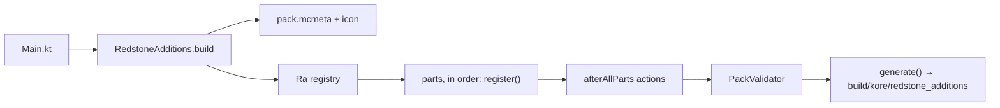

# Architecture

Kore is a **generator**. The Kotlin runs once, on your machine or in CI, and writes ordinary
`.mcfunction` and JSON files; nothing of it exists in game afterwards. A Kotlin `val` is never a
scoreboard, and a Kotlin `if` decides what is **written** into a function, not what the game
evaluates when it runs. The runtime model (markers, placement, tick loop) is unchanged from the
beet pack and is described in [How It Works](how-it-works.md). This page is about the code
that writes it.



## Entry point

`ra/Main.kt` builds the pack and writes it:

```kotlin
fun main() {
	val output = System.getProperty("kore.output") ?: "out"
	RedstoneAdditions.build(output).generate()
}
```

`ra/RedstoneAdditions.kt` is the whole pack in one place:

| Member | What it is |
| --- | --- |
| `VERSION` | The pack version, read from `gradle.properties` (see [Release and Versioning](release.md)) |
| `PACK_NAME` | `"redstone_additions"`: the output folder name. Must equal `packName` in `build.gradle.kts`. |
| `modules` | The gameplay modules, in load and tick order |
| `parts` | Every part, in registration order |
| `build(output)` | Creates the `DataPack`: output path, icon, JSON style, `pack.mcmeta`, then runs the parts, the deferred actions and the validator |

`build` sets `prettyPrint = true` with two-space indents, so generated JSON is readable and
diffs cleanly. `pack.mcmeta` leaves `min_format` / `max_format` at Kore's default, the format of
the Minecraft version Kore targets (121 for 26.3); the description is the beet one, with the
version filled in from `VERSION`.

## Parts

Everything the pack contains is written by a **part**: an `object` implementing `PackPart`
(`ra/core/Ra.kt`).

```kotlin
interface PackPart {
	/** Declares this part's functions and resources, and registers what it shares. */
	fun Ra.register()
}

interface GameplayModule : PackPart {
	val ns: Ns
	val title: String
	val load: FunctionArgument get() = ref(ns, "load")
	val tick: FunctionArgument? get() = ref(ns, "tick")
}
```

A gameplay module must define its `<ns>:load` and, unless it overrides `tick` to `null`, its
`<ns>:tick`. The hub calls them; nothing else has to know they exist.

`RedstoneAdditions.parts` fixes the registration order:

| # | Part | Namespace | Package |
| --- | --- | --- | --- |
| 1 | `RaLibPart` | `ra_lib` | `ra.lib` |
| 2 | `MultiblockLibPart` | `ra_lib_multiblock` | `ra.multiblocklib` |
| 3 | `SettingsPart` | `ra_settings` | `ra.settings` |
| 4 | `MigrationsPart` | `ra_migrations` | `ra.migrations` |
| 5 | `InteractiveModule` … `EnderModule` (the 12 entries of `modules`) | `ra_interactive` … `ra_ender` | `ra.modules.*` |
| 6 | `ExamplePart` | `ra_example` | `ra.example` |
| 7 | `AdvancementsPart` | `ra_advancements` | `ra.advancements` |
| 8 | `ToolsPart` | `ra` (`tools/*`, tool recipes, predicates, advancements) | `ra.tools` |
| 9 | `HubPart` | `ra` (load, tick, placement, items, uninstall, `settings`), `minecraft` | `ra.hub` |

`modules` is:

```
InteractiveModule, StorageModule, SensorsModule, GatesModule, WirelessModule, WiresModule,
ChunkLoaderModule, MultiblockModule, EnchantingModule, InfiniteModule, JetpacksModule, EnderModule
```

That is the order the beet `ra:load` and `ra:tick` hard-coded, and `ra:load` / `ra:tick` still
follow it. Change it only knowing that module ticks run in this sequence every game tick.

**Why tools and hub come last.** `ToolsPart` builds `draw_block`, the wrench and read-only
registries and the toggle dispatch from what modules registered; `HubPart` builds
`#ra:placement_handlers`, the give bundles and the load / tick dispatch. Both read the registry,
so everything must have registered before they run.

## The registry

`Ra` (`ra/core/Ra.kt`) is passed to every part's `register()`. It holds the `DataPack`
(`ra.pack`) and the lists parts use to tell the rest of the pack about themselves. **Parts never
edit each other's files.** A part registers; the part that owns the shared output builds it.

| Field / call | Holds | Registered by | Built into, by |
| --- | --- | --- | --- |
| `allBlocks` | every `CustomBlock` | `ra.block(b)` | reference only; bundles use their own lists. Not named `blocks`: see [Kore Gotchas](gotchas.md) |
| `placementHandlers` | `handle_placement` functions | `ra.block(b)` (`placement = true`), or `placementHandlers += fn` for a shared handler | `#ra:placement_handlers`, by Hub |
| `goggles` | `TagRoute(markerTag, readout)` | `ra.block(b)` (`goggles = true`), or `goggles += …` | `ra:tools/goggles/draw_block`, by Tools |
| `multiblockGoggles` | `TagRoute(multiblockTag, readout)` | `multiblockGoggles += …` | `ra:tools/goggles/draw_multiblock`, by Tools |
| `wrenchCycles` | `type → [WrenchCycle(label, prop, fn)]` | `ra.wrenchCycle(type, rows…)` | `storage ra:wrench cyclables` in `ra:tools/wrench/init_registry`, by Tools |
| `wrenchToggles` | `TagRoute(markerTag, toggle)` | `wrenchToggles += …` | the plain-RMB dispatch in `ra:tools/wrench/found_block`, by Tools |
| `blockProperties` | `type → [PropSpec]` (name, type, bounds, flags), in menu order | `ra.properties(block) { … }` / `ra.properties("type") { … }` | `storage ra:dh types` / `order` / `known` in `ra:tools/data_handler/init_registry`, by Tools |
| `bundles` | `GiveBundle(id, title, lore, ns, items)` | `bundles += GiveBundle(…)` | `ra:items/bundles/give_<id>_bundle` and `give_all`, by Hub |

Order is preserved everywhere, because several of these become functions whose order is
observable: `#ra:placement_handlers` runs handlers in list order, and the Data Handler's buttons
carry `100 + index`. The two maps the tools write as storage (`wrenchCycles`, `readonly`) are
sorted by key, as the hand-written beet maps were.

[Tools and Registries](tools-and-registries.md) covers each tool's side in detail.

### Function tags: `pack.hook`

Function tags need no registry. `pack.hook(ns, tag, fn)` (`ra/core/Fn.kt`) appends `fn` to
`data/<ns>/tags/function/<tag>.json`; every part appending to the same tag writes into the same
file, in registration order. The part that **owns the hooked function** registers it:

```kotlin
// ra/modules/multiblock/blastforge/BlastForge.kt
pack.hook(Ns.LIB_MULTIBLOCK, MultiblockLib.Hooks.TICK, tickDispatch)
```

| Tag | Owner (declares it) | Who appends |
| --- | --- | --- |
| `#minecraft:load` | — | Hub (`ra:load`) |
| `#ra:placement_handlers` | Hub | built from `placementHandlers` |
| `#ra_lib_multiblock:load` / `tick` / `validate` / `setup_type` / `check_structure` / `on_break` | Multiblock library (empty tags declared up front) | `ra_multiblock` structures; then the library's compiled-spec dispatchers (`spec/*`), and its own `generic/*` last |
| `#ra_enchanting:recipes` | Enchanting | `ra_infinite`, `ra_jetpacks`, `ra_interactive` (each its own `enchant_recipes`) |

### After all parts: `afterAllParts`

Some entries must come **after** everything other parts append. `ra.afterAllParts { … }` queues
an action that `RedstoneAdditions.build` runs once the last part has registered, in the order
queued. The multiblock library uses it to put its `generic/check_structure`, `generic/setup_type`
and `generic/validate` at the end of their tags, after every structure's own hook, as the beet tags
listed them: the generic versions only cover types nobody else handled.

## Function references

A function is named **once**, as a `FunctionArgument`, and that value is used for both its
definition and every call (`ra/core/Fn.kt`):

| Helper | Does |
| --- | --- |
| `ref(Ns.X, "a/b")` | A reference to `ra_x:a/b`. Creates nothing. |
| `pack.define(ref) { … }` | Writes the body of `ref`. Returns `ref`. |
| `pack.fn(Ns.X, "a/b") { … }` | `ref` + `define` in one, for functions only this file calls. |
| `Function.fn(Ns.X, "a/b") { … }` | The same, while building another function. |
| `block.fn("process")` | `ns:blocks/<dir>/process` of a `CustomBlock`. |
| `pack.hook(ns, tag, fn)` | Appends `fn` to `#ns:tag`. |

```kotlin
// ra/api/LibApi.kt: the contract
object RaLib { object Redstone { val detect = ref(Ns.LIB, "redstone/detect") } }

// ra/lib/...: the definition
pack.define(RaLib.Redstone.detect) { /* ... */ }

// any caller
function(RaLib.Redstone.detect)
function(RaLib.Util.property, nbt { this["name"] = "delay"; this["default"] = 20; this["min"] = 1 })
```

**Where a reference lives:**

| Called from | Declared in |
| --- | --- |
| Other namespaces, part of a library's public surface | `ra/api/LibApi.kt` (`RaLib`, `MultiblockLib`) or `ra/api/ToolsApi.kt` (`Goggles`, `Tools`, `Hub`, `Settings`, `ModulesApi`) |
| Only the owning part | Next to its definition (`val process = block.fn("process")`, `WrenchRegistry`) |
| Another part, but not worth a public API | That part keeps a private `ref` to the same path. The owner must define it at exactly that path; `PackValidator` catches it if not. |

## Lifecycle

### `ra:load`

Hooked into `#minecraft:load` by Hub (`ra/hub/Load.kt`). In order:

1. Scoreboards for the tools (`ra.edit_type`, `ra.dh.action`, `ra.dh.pending`, `ra.dh.mid`,
   `ra.dh.sel`, `ra.dh.req`, `ra.hold.wrench`, `ra.hold.dh`, `ra.goggles`, `ra.clip.id`).
2. `data merge storage ra:temp {…}`: the shared scratch roots.
3. `ra:tools/goggles/billboard/init_offsets`.
4. `ra_lib:init`.
5. Every module's `load`, in `modules` order.
6. `ra_lib_multiblock:init`.
7. Wrench menu objectives (`ra.wrench`, `ra.wr.x/y/z`).
8. `ra_settings:init`: after the modules, which register their settings pages.
9. `ra:tools/wrench/init_registry`, `ra:tools/readonly/init_registry`,
   `ra:tools/data_handler/init_registry`: configuration, rewritten on every load.
10. `ra_migrations:run`: the world steps this world has not had yet (see [Migrations](#migrations)).
11. `schedule function ra:tick 1t replace`.
12. The disabled-blocks notice (always), then the welcome messages, each line gated on the `welcome`
    setting. Every module's "loaded!" line (step 5) carries the same gate; see
    [Load messages are gated](gotchas.md#load-messages-are-gated).

### `ra:tick`

Rescheduled every tick by itself, not run from `#minecraft:tick` (`ra/hub/Tick.kt`). In order:

1. `schedule function ra:tick 1t replace`. **First**, so a tick cut short by
   `maxCommandChainLength` has already scheduled the next one; at the end, the cut took the
   reschedule with it and the pack stopped until `/reload`.
2. Tool "active" tag cleanup (`cdh`, `dh`, `wrench`, `clip`, `meter`, `remote`, `pager`, `lens`).
3. `ra_migrations:entities`: custom blocks saved by an older version, migrated before anything
   below reads them (see [Migrations](#migrations)).
4. `ra_settings:tick`: per-player defaults, menu clicks. Early, because module ticks filter
   sounds and particles on those scores.
5. `ra_lib:transport/tick`: debounced network rebuild.
6. `ra_lib:input/tick`: input sessions.
7. `ra:tools/data_handler/tick`.
8. `ra_settings:input_tick`: **after** `input/tick`, so a form finished this tick is seen this tick.
9. `ra:placement/detect_bats`: the placement router.
10. Every module's `tick`, in `modules` order.
11. `ra:tools/goggles/tick`, which also runs the Goggles Lens menu (`/trigger ra.goggles`).
12. Tool menu triggers: hold timers, `enable` / `reset` of `ra.wrench`, `ra.dh.action`,
    `ra.edit_type`, then `ra:tools/wrench/menu_action` for players who clicked.

The order is load-bearing; [How It Works](how-it-works.md#2-tick-orchestration) explains the
constraints. When you add a step, put it where the beet `ra:tick` would have, and write down why
in a comment.

## Migrations

Every one-time fix for data an older version left behind lives in `ra/migrations`
(`ra_migrations`), and only there: block ticks, placement and menus never check whether a marker
is from an old version. Two versions are recorded, both as `major*10000 + minor*100 + patch`
(6.0.1 is `60001`, `DataVersion` in `ra/migrations/Migration.kt`):

| Recorded | Where | Written by | Read by |
| --- | --- | --- | --- |
| The world's version | `storage ra:migrations version` | `ra_migrations:run`, after its steps | `ra_migrations:run` |
| Each custom block marker's | score `ra.ver`, plus tag `ra.ver.<version>` | placement (`DataVersion.stampNew`), and `ra_migrations:entity` after its steps | `ra_migrations:entities` / `ra_migrations:entity` |

A step is declared once, for the two versions it bridges, and has a world part, entity parts, or
both:

```kotlin
internal val m6_0_0 = migration("6.0.0", "6.0.1") {
    world { raw("data remove storage ra:multiblock bf_dir") }   // once per world
    entity("liquid_drain") { /* as each drain marker */ }        // once per drain
    entity("teleport_anchor", TeleportAnchor.repairTargets)       // a function, as each anchor
    marker(Tag.CUSTOM_BLOCK) { /* as every custom block */ }
}
```

`MigrationsPart` lists the steps oldest first and generates:

- `ra_migrations:run` (from `ra:load`): each world part whose target is above the stored version,
  in order, then the current version. A world with no stored version (older than 6.0.1, when it
  started being recorded) runs every world part once.
- `ra_migrations:entities` (from `ra:tick`, before the module ticks):
  `execute as @e[type=marker,tag=ra.custom_block,tag=!ra.ver.<current>] run function ra_migrations:entity`.
  The version tag is what makes this one selector: `tag=!` matches a marker never stamped and one
  stamped by an older version alike, which a `scores=` filter cannot (it never matches an entity
  with no score). When nothing is outdated, the whole pass is that one selector finding nothing.
- `ra_migrations:entity`, as one outdated marker: `ra_migrations:<step>/entity` for every step
  whose target is above the marker's `ra.ver` (missing counts as 0), which dispatches on the
  block-type tag to `ra_migrations:<step>/<type>`; then the old version tag is removed and the
  marker stamped. A marker in a chunk that was unloaded at load is migrated the first tick it is
  loaded, before its block's tick sees it.

Every part must be idempotent: an unversioned world or marker runs all of them, including fixes
its old block ticks may already have applied. The step names (`5.1.7-to-5.1.8`) are identifiers,
not the build version ([Release and Versioning](release.md)). `ra.ver` and `ra:migrations` are
removed by the uninstall like every other objective and storage.

## Shared identifiers

`ra/core/Ns.kt` lists every namespace. `ra/core/Ids.kt` holds identifiers more than one part
uses:

| Object | Holds | Examples |
| --- | --- | --- |
| `Obj` | scoreboard objectives | `TEMP` = `ra.temp`, `FACING`, `POWER*`, `TR_*`, `USER_SOUND` = `ra.u.snd` |
| `Tag` | entity tags | `RA`, `CUSTOM_BLOCK`, `NEW`, `BROKEN`, `SPAWNED`, `customBlock(id)`, `place(id)` |
| `Storage` | `storage ra:<name>` arguments | `TEMP`, `SETTINGS`, `TRANSPORT`, `MULTIBLOCK`, `WRENCH`, `DH` |

An identifier used by one module only stays in that module (`ra.jp.*` in `ra.modules.jetpacks`,
`ra.clock_on` in `Clock.kt`). Every one of these strings is written into saved worlds; renaming
one orphans existing blocks.
