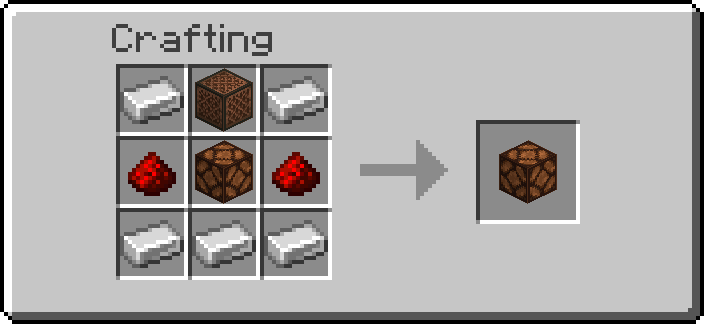
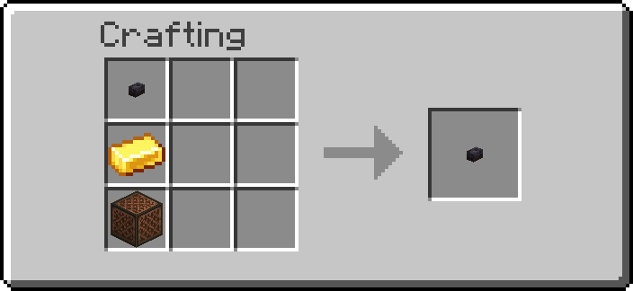
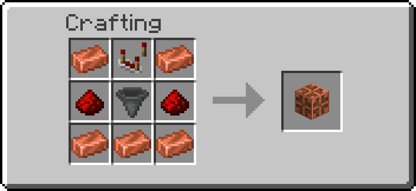

# Audio

Blocks that make sound on a redstone signal. The **Alarm** sounds while it is powered, the
**Doorbell** chimes once per press, and the **Jukebox Controller** plays, stops and skips the
music discs of a vanilla jukebox from redstone pulses.

## Getting them

| Item | Looks like | Recipe |
| --- | --- | --- |
| Alarm | redstone lamp | { width="220" } |
| Doorbell | polished blackstone button | { width="220" } |
| Jukebox Controller | waxed copper bulb | { width="220" } |

Operators: `/function ra_audio:items/give_all` (one of each).

The sounds come from a fixed list in the pack: a block stores which sound it plays as a number,
never a sound id, so nothing typed in chat ever reaches a sound command.

**Who hears it.** Every player within the block's `range`, whatever their *Machine sounds*
preference: an alarm or a doorbell nobody hears is not one. `volume` (10 to 100 %) is how loud it
is; a sound carries 16 blocks on its own, and players further away but still in range hear it at
a quarter of the volume, so the range decides who hears it.

---

## Alarm

A redstone lamp that, **while powered**, plays its sound every `interval` ticks. The lamp lights
while it is powered, so you can see when it is sounding. An alarm that has been quiet for longer
than its interval rings at once when it is switched on.

| Index | Sound | What it is |
| --- | --- | --- |
| 0 | Bell | one stroke of a village bell |
| 1 | Siren | two alternating beeps, four times a second |
| 2 | Klaxon | three low trumpet honks |
| 3 | Beeper | two short high beeps |
| 4 | Alarm clock | four quick bell notes |
| 5 | Toll | one deep bell stroke |
| 6 | Buzzer | a low buzz, five pulses |

Every sound is shorter than the default interval of 20 ticks, so at 20 they follow each other
without a gap. A shorter interval cuts the sound off and starts it again.

| Tool | Does |
| --- | --- |
| Wrench, Shift+RMB | The next sound, played once so you can hear it |
| Goggles | Sound, state (sounding or silent), interval, range, volume |
| Data Handler | `sound` (0–6), `interval` (10–1200 ticks), `range` (1–64 blocks; admins up to 256), `volume` (10–100 %) |

A redstone lamp stays lit for 4 ticks after its power goes, as in vanilla, so an alarm may ring
once more in that time.

---

## Doorbell

A polished blackstone button that plays its chime **once per press**. It is a real button: it
also gives the usual redstone pulse, so it can ring a bell and open a door at the same time.

Place it like a button, on the face of the block you click (top, bottom or side). A Doorbell whose
block is removed pops off as a button would, and drops as a Doorbell.

| Index | Chime | What it is |
| --- | --- | --- |
| 0 | Ding-dong | two bell notes, high then low |
| 1 | Westminster | the four notes of the Westminster chime |
| 2 | Chime | two chime notes |
| 3 | Bell | one bell stroke |
| 4 | Buzzer | three short buzzes |
| 5 | Knock | two knocks on a wooden door |

| Tool | Does |
| --- | --- |
| Wrench, Shift+RMB | The next chime, played once |
| Goggles | Chime, range, volume |
| Data Handler | `chime` (0–5), `range` (1–64 blocks; admins up to 256), `volume` (10–100 %) |

---

## Jukebox Controller

A waxed copper bulb that runs the **jukebox next to it**. Each redstone pulse into it does one
thing, chosen by the strength of the signal:

| Signal | Does |
| --- | --- |
| 15 (a button, lever or repeater right against it) | Play / stop |
| 8 to 14 | The next disc |
| 1 to 7 | Stop |

A button on the controller is play/stop; a button with 2 to 8 dust between it and the controller
(signal 14 to 8) skips to the next disc. The bulb is lit while the controller is playing.

### A chest of discs

Put a **chest** (or a trapped chest, a barrel or a shulker box) next to the controller, filled
with music discs: that is the playlist. The controller plays them in slot order, and round again
from the first after the last.

- **Play** takes the next disc from the chest into the jukebox.
- **Next** puts the playing disc back into the slot it came from, then plays the next one.
- **Stop** puts the disc back into its slot (into any free slot if that one has been filled).

With **continuous** on (the default), the next disc plays by itself when one ends, so a chest of
discs is background music that never stops. Shift+RMB with the Wrench switches it.

### Without a chest

With only a jukebox, **stop** keeps the disc in the controller (the Goggles show it) and **play**
puts it back and starts it again. A disc you put in the jukebox yourself works too. With
continuous on, a disc that ends starts again from the beginning. Breaking the controller drops a
disc it keeps.

A disc with nowhere to go (the chest full, the controller already keeping one) is popped out on
top of the jukebox, as a jukebox does.

| Tool | Does |
| --- | --- |
| Wrench, Shift+RMB | Continuous on or off |
| Goggles | State (playing, stopped, no jukebox), the disc, continuous |
| Data Handler | `continuous` (on or off) |

Server admins set the Alarm's interval and range and the Doorbell's range for new blocks on the
**Audio** settings page, and can switch each block off for the world there.

## Troubleshooting

| What happens | Check |
| --- | --- |
| The Alarm is lit but silent | Are you within its `range`? It rings once per `interval` |
| The Alarm never stops | It sounds while powered: take the power away |
| The Doorbell does not chime | It chimes once per press; a press while it is still down does nothing |
| The controller only buzzes | No jukebox next to it (it must touch the controller), or no disc to play |
| "Next" plays the same disc | The chest holds only one disc, or the chest is full so the disc could not go back |
| A pulse does the wrong thing | The signal strength picks the action: 15 play/stop, 8–14 next, 1–7 stop |

---

## Advanced

### What runs

Every tick, each Alarm, Doorbell and Jukebox Controller gets one block test (broken? powered?
pressed?), nothing else while it is idle. The Alarm reads `redstone_lamp[lit=true]`, the
Doorbell `polished_blackstone_button[powered=true]`, the controller
`waxed_copper_bulb[powered=true]`: the vanilla block carries the answer, so no redstone is read
until the controller reads the signal strength once on a rising edge.

A sound is a short pattern of notes at tick offsets. While one plays, its block's marker is
tagged `ra.au.playing` and its `ra.au.step` score is `pattern * 64 + tick`; the per-tick look runs
the notes due that tick, and the tag comes off after the last one. An Alarm's `ra.cooldown` score
is the game time of its next ring.

A Jukebox Controller that started a disc is tagged `ra.au.on`. While any is, a clock runs once a
second (`ra_audio:poll/run`) and checks each one: a jukebox that still holds the disc but no
longer has `ticks_since_song_started` has finished it, and continuous plays the next. With none
playing, nothing is scheduled.

### Data

| Block | Where | What |
| --- | --- | --- |
| Alarm | `data.properties.sound`, `interval`, `range`, `volume` | the settings |
| Doorbell | `data.properties.chime`, `range`, `volume` | the settings |
| both | `data.data.snd` | `{range, vol, min}` of the last sound, the arguments of its notes |
| Jukebox Controller | `data.properties.continuous` | play the next disc when one ends |
| Jukebox Controller | `data.data.slot` | the chest slot the playing disc came from (-1 none) |
| Jukebox Controller | `data.data.held` | the disc it keeps without a chest |
| all | `data.status.*` | what the Goggles show |

Discs are moved with `item replace`, which sets the jukebox's item the way a hopper does and so
starts (or, with air, stops) the song; a disc kept in the controller goes back through a
temporary item display. Only items with the `jukebox_playable` component count as discs, so
discs from other packs work too.
