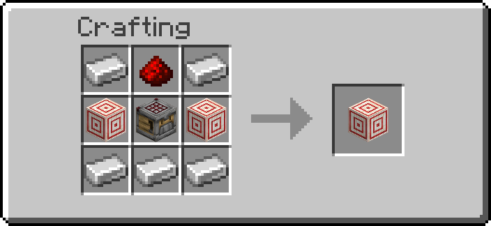
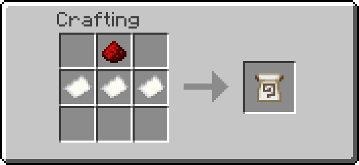
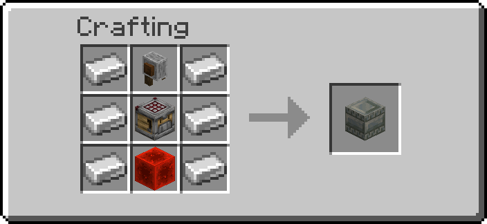
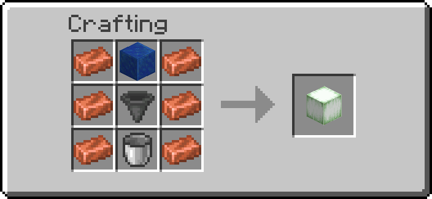
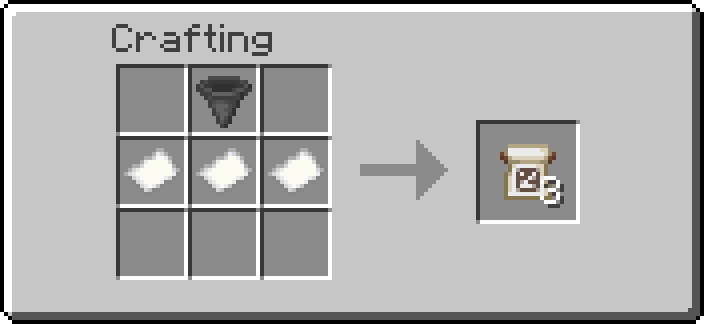
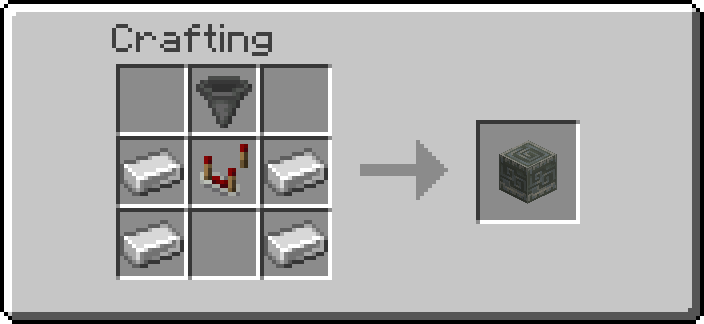
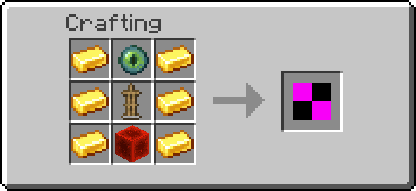
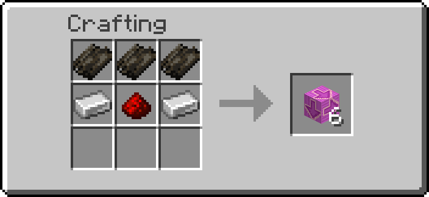

# Automation

Blocks and items that run vanilla machines for you. The **Crafter Controller** fires a vanilla
crafter on its own once the crafter holds the ingredients its **Pattern** asks for; given a
**Recipe Pattern** it also fills the crafter itself from a chest. The **Uncrafter** takes items
back apart into their ingredients for EU, the **Experience Absorber** collects experience orbs
into a fluid network as liquid experience, and the **Item Pipe Splitter** shares a stream of items
out between several containers. The **Fake Player** keeps a mob farm or a spawner running while
nobody is near, and the **Conveyor** carries items, mobs and players along.

## Getting them

| Item | Looks like | Recipe |
| --- | --- | --- |
| Crafter Controller | target block | { width="220" } |
| Pattern | flow banner pattern | { width="220" } |
| Uncrafter | chiseled tuff bricks | { width="220" } |
| Experience Absorber | verdant froglight | { width="220" } |
| Recipe Pattern | globe banner pattern | { width="220" } |
| Item Pipe Splitter | chiseled tuff | { width="220" } |
| Fake Player | player head | { width="220" } |
| Conveyor | smooth stone slab with a magenta arrow | { width="220" } |

Operators: `/function ra_automation:items/give_all` (a Crafter Controller, a blank Pattern, a
blank Recipe Pattern, an Uncrafter, an Experience Absorber, an Item Pipe Splitter, a Fake Player and
a Conveyor),
`/function ra_automation:pattern/give` (one blank Pattern),
`/function ra_automation:pattern/give_recipe` (one blank Recipe Pattern).

## Pattern

A Pattern remembers a 3×3 crafting grid: which item goes in each of the nine slots, or that a
slot stays empty. It ignores stack sizes and item details (names, enchantments), only the item
type counts.

| Do this, holding a Pattern | What happens |
| --- | --- |
| **Sneak + right-click a crafter** | Records the crafter's grid as it is now. Fill the grid by hand first, one of each ingredient is enough. |
| **Sneak + right-click air** (or any other block) | Clears the Pattern back to blank. |
| **Right-click a Crafter Controller** | Loads the Pattern into it (see below). |

Hover over a recorded Pattern to see its grid, row by row, as item names; `-` is an empty
slot. A crafter's disabled slots are recorded as empty.

Patterns stack to 64: identical Patterns (the same grid) stack together, blank ones with blank
ones. The recipe makes three. Holding a stack, recording or clearing acts on one Pattern only:
one is taken from the stack and the new one goes into your inventory (or lands at your feet when
it is full), so the rest of the stack keeps its grid. A Crafter Controller takes one Pattern from
a held stack.

## Recipe Pattern

A Recipe Pattern is a Pattern that also tells the Crafter Controller to **fill the crafter
itself**. It is recorded, cleared, read and stacked exactly like a Pattern (the table above), and
its lore shows the grid the same way. Recipe Patterns stack with each other, not with Patterns.
The recipe makes three, from three paper and a hopper.

It stores the grid, which is the recipe: the crafter works the result out from it, as it always
does.

1. Record the recipe: fill a crafter's grid by hand (one of each ingredient), sneak + right-click
   it with the Recipe Pattern, then take the ingredients back out.
2. Place the **Crafter Controller** against the crafter, and a **container on the Controller's
   other side**: crafter, Controller and chest in a line (crafter on top, chest underneath; or
   crafter to the north, chest to the south).
3. Right-click the Controller with the Recipe Pattern.
4. Fill the chest (by hand, with hoppers, pipes or an Item Pipe Splitter). Leave the crafter
   empty; nothing needs to feed it.

Every half second the Controller puts one ingredient from the chest into each crafter slot the
Pattern names that is empty, then fires the crafter as soon as every slot is right. The crafter
crafts one at a time, at most twice a second.

- Only plain items are used: a renamed, enchanted or damaged item in the chest is never taken as
  an ingredient.
- Nothing is put in a slot the Pattern leaves empty, and a slot holding something else is left
  alone (the Controller then waits, "waiting for the ingredients").
- An ingredient missing from the chest is simply waited for; what is already in the crafter
  stays there.
- The container can be a chest, barrel, hopper, dropper, dispenser or shulker box.
- A slot disabled in the crafter (clicked shut in its grid) is never filled. If the Pattern needs
  one, the Goggles say "a Pattern slot is disabled in the crafter" and nothing is fired until the
  slot is enabled again or the Pattern is recorded anew (a recording leaves disabled slots empty).

## Crafter Controller

1. Place a vanilla **crafter** and fill its grid once by hand with the recipe you want.
2. Record it with a Pattern (sneak + right-click the crafter).
3. Place the **Crafter Controller** right against the crafter: under it, beside it or on top.
4. Right-click the Controller with the Pattern. The Controller keeps it (one from a stack); if it
   already held one, that one comes back to you.
5. Feed the crafter with hoppers, droppers or pipes as usual.

Whenever every slot of the crafter holds the Pattern's item (and every slot the Pattern leaves
empty is empty, or disabled), the Controller powers itself for an instant and the crafter
crafts once, exactly as if you had pulsed it with redstone: the result comes out of its front,
into a container if there is one. The Controller then waits until the crafter's contents
change before it looks again, so a crafter that cannot craft (a wrong recipe, an output that is
full) is not fired over and over.

- It looks every half second, so a crafter crafts at most twice a second.
- A crafter that is already powered by something else is left alone.
- With several crafters around it, it runs the first one it finds: above, then north, south,
  east, west, then below.
- The Controller is a target block and gives off a short redstone pulse when it fires: dust or
  other machines touching it see that pulse too.
- With a [Recipe Pattern](#recipe-pattern) it also fills the crafter from the container on its
  other side.

### Wrench and tools

| Tool | Does |
| --- | --- |
| Wrench, Shift+RMB | Switches the Controller off and on (`enabled`) |
| Wrench, RMB | Takes the Pattern back out, dropped on top of the Controller |
| Goggles | State (waiting for the ingredients, crafting, crafter empty, no crafter next to it, …) and the number of crafts |
| Data Handler | `enabled`, and the loaded Pattern's nine ids (read-only) |

Breaking the Controller drops it and the Pattern it held.

## Uncrafter

Takes items back apart into the ingredients of their vanilla crafting recipe: an iron block
into nine iron ingots, a hopper into five iron ingots and a chest, three iron doors into six
iron ingots. Each item taken apart costs a lot of EU.

1. Put a container **on top** of the Uncrafter (a hopper, chest or barrel): that is its input.
2. Put a container **under** it: that is where the ingredients go.
3. Touch one of its four sides with an EU wire or a Battery on a grid holding enough EU.

Once a second it looks at the input, slot by slot, and acts on the first stack it can:

| The stack is | What happens |
| --- | --- |
| an item it knows, with at least as many as the recipe makes | that many are taken apart; the ingredients go into the container below, for *eu_per_uncraft* EU (default 2000) |
| an item it knows, with fewer than the recipe makes (two of the three iron doors) | it waits for more |
| damaged, enchanted, renamed, dyed or changed in any other way | passed to the container below unchanged, for free |
| a shulker box, with a shulker box below | left in the input (a shulker box cannot hold one) |
| an item it does not know | passed to the container below unchanged, for free |

- It never gives back more than went in: only the exact vanilla recipe, and only recipes where
  taking apart cannot beat crafting (no stairs, which a stonecutter makes more cheaply; no
  recipes taking "any planks"; nothing that hands back buckets or bottles).
- It checks everything before it moves anything: the container below needs one empty slot per
  ingredient, and the grid must hold the whole price. If either is missing, nothing is taken and
  nothing is paid.
- The EU comes from the first wire or battery beside it whose grid holds the whole price. A grid
  with no Battery holds almost nothing, so put a Battery on it.
- A redstone signal stops it.

What it takes apart:

| Group | Items |
| --- | --- |
| Storage blocks | iron, gold, diamond, emerald, lapis, redstone, coal, copper, netherite, raw iron, raw gold, raw copper, quartz, bone, slime, hay, dried kelp, snow, glowstone, clay, bricks; and the netherite ingot (four scrap, four gold) |
| Tools and armour | iron, golden and diamond swords, pickaxes, axes, shovels, hoes, helmets, chestplates, leggings and boots; leather armour; turtle shell; bow; crossbow; shears; compass; clock; spyglass |
| Redstone and machines | hopper, observer, dispenser, dropper, repeater, comparator, crafter, target, weighted pressure plates, iron door (3), iron trapdoor, iron bars (16), minecart, bucket, cauldron, anvil, lantern |
| Late game | enchanting table, ender chest, eye of ender, beacon, conduit, lodestone, respawn anchor |

The number in brackets is how many of the item one recipe makes, and so how many it waits for.

### Wrench and tools

| Tool | Does |
| --- | --- |
| Goggles | State (waiting for items, uncrafting, passing items on, waiting for a full recipe, not enough EU, output full, no container above / below, stopped by redstone), the number of items taken apart and the EU per item |
| Data Handler | `eu_per_uncraft` (admins only) |

The default *eu_per_uncraft* for new Uncrafters is on the Automation page of the server
settings.

## Experience Absorber

Collects the experience orbs around it and sends them, as liquid experience, into a fluid network
touching it. One point is 100 mL, the same rate the Fluid Drain uses and the Disenchanter, Book
Upgrader and Book Printer charge in, so the experience it collects pays for those directly.

1. Place it where the orbs fall: beside a mob farm's kill spot, a furnace array, a breeding pen.
2. Touch one of its faces with a pipe, tank or drain.

- Once a second it takes the orbs within *radius* blocks (default 4, up to 8; admins up to 16),
  nearest first.
- It only takes what the network has room for. An orb bigger than the room left is taken in part
  and the rest stays on the ground.
- A network that holds something else and no experience is left alone, as with the Fluid Drain.
  It uses the first network beside it with room.
- Players near the orbs still pick them up first.

### Wrench and tools

| Tool | Does |
| --- | --- |
| Wrench, Shift+RMB | Cycles the radius: 2, 4, 6, 8 |
| Goggles | State (absorbing, no experience around, no room in a network beside it), the radius and the points absorbed so far |
| Data Handler | `radius` (1 to 8; admins up to 16) |

## Item Pipe Splitter

Takes the items out of the container **above** it and shares them out between the containers on
its **four sides and under it**, one item at a time, each side in turn. It is not a container
itself: put a chest, a hopper pointing down into it, or the end of an Item Pipe on top, and
chests, hoppers, barrels or Item Pipes around it.

1. Place the Splitter with its input container on top.
2. Put a container against each side (and under it) that should get a share.
3. Optional: give each side its share with the Data Handler.

Each side has a **share**, `north`, `east`, `south`, `west` and `down` (0 to 16, default 1). The
Splitter sends that many items in a row to one side before it moves on to the next: 1 everywhere
splits evenly, `north` 2 and `south` 1 sends two thirds north and one third south, 0 switches a
side off.

- It moves *per_second* items a second (default 8, 1 to 16; admins up to 64).
- A side with no container, or a full one, is skipped and its turn passes on: the others keep
  getting items. Items are only taken out of the input once there is room for them, so nothing is
  ever dropped or lost; when every side is full, the items wait in the input.
- It takes the input's first stack first. If no side has room for that item, it waits.
- It never sends items back up: the input is above, the outputs are the other five faces.
- A shulker box item is never sent into a shulker box (the game does not allow it either); it goes
  to the next side that can take it.
- A redstone signal stops it.

### Wrench and tools

| Tool | Does |
| --- | --- |
| Wrench, Shift+RMB | Cycles the speed: 2, 4, 8, 16 items a second |
| Goggles | State (splitting, waiting for items, outputs full, no container above, stopped by redstone), the speed and the items moved so far |
| Data Handler | the five shares, and `per_second` (1 to 16; admins up to 64) |

## Fake Player

Mob farms and spawners stop working when nobody is around. Vanilla only spawns mobs naturally
within 128 blocks of a player (and never within 24), a mob spawner only runs with a player within
16 blocks of it, and a mob that can despawn vanishes at once when the nearest player is more than
128 blocks away. A data pack cannot add a player, so the Fake Player does the spawning itself, by
the vanilla rules, and only where vanilla is not already doing it. It looks like a player head.

1. Place it beside a spawner (touching it), or in the middle of a dark mob farm.
2. Touch it with an EU wire or a Battery on a grid holding EU. Each mob costs *eu_per_mob* EU
   (default 250), taken before the mob appears: no EU, no mob.
3. Keep its chunk loaded (a [Chunk Loader](chunk-loader.md)) if you leave the area.

It runs once a second.

### What it does

**Next to a spawner.** When a vanilla mob spawner touches one of its six faces, the Fake Player
runs that spawner the way the spawner runs itself when a player is near:

- It counts down from the spawner's own `Delay`. When the countdown ends it makes `SpawnCount`
  tries (4 by default), each at a random block within `SpawnRange` (4) across and one block up or
  down. The next countdown is a random value between `MinSpawnDelay` and `MaxSpawnDelay` (10 to
  40 seconds by default).
- A try spawns a mob only where the mob fits in free space and the light is 11 or less, as for a
  vanilla spawner. It stops once `MaxNearbyEntities` (6) mobs of that type are around the
  spawner.
- The mob is the one the spawner shows. A spawner set with a plain spawn egg gives mobs with the
  usual random equipment, babies and jockeys. A spawner whose mob carries more data (set by
  command) gives exactly that mob, except that a spawner whose mob has riders (`Passengers`) is
  not run: only the spawner's own mob type ever comes out.
- If the game refuses to summon the mob, the EU is paid back.
- It runs these spawner mobs: zombie, husk, zombie villager, drowned, skeleton, stray, bogged,
  wither skeleton, spider, cave spider, blaze, silverfish, creeper, witch, enderman and zombified
  piglin.

**On its own (natural spawning).** With no spawner beside it, it spawns the Overworld's hostile
mobs in the cube of *radius* blocks around it (default 8, up to 16; admins up to 32):

- It makes 4 tries a second, each at a random block in the cube. A spot works only when it is
  **completely dark (light 0)**, the mob's feet and head are in free space (air, grass, ferns,
  flowers, saplings) and the block underneath has a full top: not glass, leaves, ice, bedrock,
  barriers, magma, a bottom slab or stair, fences, walls, carpets or the like.
- The mob is drawn from the biome's vanilla monster list with the vanilla weights: spiders,
  zombies, zombie villagers, skeletons, creepers, endermen and witches. Deserts use the desert
  list, Snowy Plains and Ice Spikes the snowy list. **Every other biome uses the plains list**,
  so what a biome adds of its own is not spawned: no swamp slimes, no drowned in caves or rivers,
  no bogged. The Mushroom Fields and the Deep Dark spawn nothing.
- Spiders need the eight blocks around their feet free too, endermen three blocks of headroom.
- It stops while *max_mobs* hostile mobs (default 20, up to 70, vanilla's monster cap) are in the
  same cube it spawns in, counting every hostile mob there, not only its own.

**Keeping its mobs.** A mob it spawns does not despawn while a Fake Player is within 48 blocks of
it, as a mob near a player does not. A mob that has had no Fake Player near it for 30 to 60
seconds (it wandered off, the block was broken) goes back to the normal rules and despawns like any
other. A mob you name keeps its name tag's protection.

### What it never does

- **Never more than vanilla.** It does nothing while a player (not a spectator) is within the
  spawner's range, for a spawner, or within 128 blocks, for natural spawning: vanilla is spawning
  there already. Its natural spawning is slower than vanilla's around a player (one mob per good
  spot where vanilla spawns packs of up to four), and asks for light 0 where vanilla sometimes
  takes a little moonlight.
- **Nothing in peaceful**, and nothing with `spawn_mobs` off. No natural spawning with
  `spawn_monsters` off, no spawners with `spawner_blocks_work` off.
- **No animals, no water mobs, no Nether or End spawning.** Natural spawning is the Overworld's
  hostile mobs only. Mobs that cannot spawn in a dark room in vanilla either (slimes outside slime
  chunks and swamps; husks, strays and parched, which need open sky; zombie horses) are left out:
  their share of the draw spawns nothing, so the others come no more often. The extra mobs a few
  biomes add (drowned in caves and rivers, bogged in swamps) are not spawned.
- **No slimes or magma cubes from spawners**, no animal spawners, no trial spawners. It does not
  step through a spawner's list of possible mobs (`SpawnPotentials`): the spawner keeps the mob it
  shows.
- **It does not keep the chunk loaded**, and it does not make the world tick crops, furnaces or
  anything else around it. Only spawning.

### Wrench and tools

| Tool | Does |
| --- | --- |
| Wrench, Shift+RMB | Cycles the radius: 4, 8, 12, 16 |
| Goggles | State (spawning, running a spawner, waiting for its delay, a player is near, mob cap reached, not enough EU, peaceful, ...), the radius, the mob cap, the EU per mob and the mobs spawned so far |
| Data Handler | `radius` (1 to 16; admins up to 32), `max_mobs` (1 to 70), `eu_per_mob` (admins only) |

The default *eu_per_mob* for new Fake Players is on the Automation page of the server settings.

## Conveyor

A smooth stone slab with an arrow on it that carries whatever stands on it (dropped items, mobs,
players) the way the arrow points. The recipe makes six.

- Place it looking the way things should go: the arrow points away from you. Only the four
  compass directions; placing while looking up or down still uses the direction you face.
- Line Conveyors up to carry things further. Each one hands things on to the next straight away.
  Things fall off the end.
- *speed* sets how fast: 1 is one block a second, the default 2 is two, up to 5 (admins up to
  10).
- Players are carried in small steps every tick, so the ride looks smooth, and can still walk,
  jump and turn while on it. A Conveyor never pushes anyone into a wall. Players in the air,
  riding something, gliding with an elytra, flying in creative or spectating are not moved, and a
  player a Fan is already pushing is not pushed by the Conveyor in the same tick.
- Items and mobs get the Conveyor's speed along the arrow. Anything already moving faster that way
  keeps its speed, and mobs still walk sideways and fall.
- Armor stands, markers, displays, interactions, item frames, paintings and everything the pack
  itself places (anything tagged `ra`) are left alone.
- Breaking it, or putting a second slab on it, drops the Conveyor.

### Wrench and tools

| Tool | Does |
| --- | --- |
| Wrench, Shift+RMB | Cycles the speed: 1 to 5 |
| Goggles | The speed |
| Data Handler | `speed` (1 to 5; admins up to 10) |

## Troubleshooting

| Goggles say | Check |
| --- | --- |
| no pattern | Right-click it with a recorded Pattern |
| no crafter next to it | The crafter must touch the Controller face to face |
| waiting for the ingredients | Some slot holds a different item, or holds something where the Pattern has an empty slot |
| crafter powered | Something else keeps the crafter powered; it needs to be unpowered to be fired |
| crafting, but nothing comes out | The ingredients are not a real recipe, or the crafter's output is blocked |
| pattern unreadable | The Pattern was edited by hand; record a new one |
| Uncrafter: not enough EU | No wire or battery beside it, or its grid holds less than the price: add a Battery |
| Uncrafter: output full | The container below needs one empty slot per ingredient |
| Uncrafter: waiting for a full recipe | The stack is smaller than what the recipe makes (3 iron doors, 16 iron bars) |
| Absorber: no room in a network beside it | No pipe, tank or drain touching it, the network is full, or it holds another fluid |
| a Pattern slot is disabled in the crafter | The Pattern names a slot that is now disabled in the crafter: enable it, or record the Pattern again |
| Uncrafter: no shulker box into a shulker box | The container below is a shulker box and the input holds shulker boxes; use a chest or barrel below |
| Recipe Pattern: the crafter never fills | The container must be on the Controller's other side, opposite the crafter, and hold plain (unrenamed, undamaged) ingredients |
| Splitter: outputs full | Every side with a share above 0 is full, has no container, or cannot take the input's first item |
| Splitter: every side's share is 0 | Give at least one side a share with the Data Handler |
| Fake Player: a player is near | A player within 128 blocks (or within the spawner's range): vanilla is spawning, so it waits |
| Fake Player: looking for dark, free spots | No spot in the radius is at light 0 with room and a solid floor: darken the farm, check the radius |
| Fake Player: no dark, free spot around it | The spawner's surroundings are lit above 11 or have no room for the mob |
| Fake Player: spawner mob not supported | The spawner holds a mob it does not run (slime, magma cube, an animal) |
| Fake Player: not enough EU | No wire or battery beside it, or its grid holds less than one mob's price |
| Conveyor does not move a player | The block ahead is solid at the feet or head, or the player is in the air |

---

## Advanced

### Pattern data

A Pattern is `minecraft:paper` (drawn as a flow banner pattern) whose `custom_data` holds the
grid:

```snbt
{ra:{pattern:{slots:["minecraft:oak_planks","","","minecraft:oak_planks","","","","",""]}}}
```

- `slots` always has nine strings, in crafter slot order (`container.0` top left to
  `container.8` bottom right, row by row).
- Each is a namespaced item id, or `""` for an empty slot. No counts, no components.
- A blank Pattern has nine `""`.
- An item is a Pattern when its `custom_data` contains `ra.pattern`:
  `*[minecraft:custom_data~{ra:{pattern:{}}}]`.
- A **Recipe Pattern** is the same item with one more key, `recipe:1b`, beside `slots`
  (`{ra:{pattern:{slots:[...],recipe:1b}}}`, test `*[minecraft:custom_data~{ra:{pattern:{recipe:1b}}}]`).
  It is a Pattern to every reader; recording rewrites only `slots`, so the flag stays.
- Patterns stack (`max_stack_size` 64). The item carries nothing per-item: two Patterns are the
  same stack exactly when their `slots` are equal (the lore is built from `slots`). The use is
  detected through an endless `consumable` (a `using_item` advancement), which works on a stack
  as on a single item.

The format is generic on purpose, so other blocks and add-ons can read Patterns too. Treat the ids as player data: an
edited item can hold anything, so check a value with `ra_lib:safe/check` (format ID) before
pasting it into a command, as the Crafter Controller does.

A custom block that takes Patterns adds itself to `Pattern.targets` (Kotlin,
`ra/modules/automation/pattern/Pattern.kt`): right-clicking it with a Pattern then runs its
function as the block's marker, the player tagged `ra.auto.pattern_user`. The main hand may hold
a stack: a block that keeps the Pattern takes one (`Pattern.TAKE_ONE`, a `set_count` -1
modifier), a block that only compares it leaves the stack alone.

### Crafter Controller data

| Where | What |
| --- | --- |
| `data.properties.enabled` | `1b` on, `0b` off |
| `data.properties.pattern` | the loaded Pattern's nine ids (read-only) |
| `data.data.item` | the Pattern itself, given back on eject or break |
| `data.data.match` | the ids after the format check, `minecraft:air` for an empty slot |
| `data.data.checked` | the list `match` was built from; when `pattern` no longer equals it, the Controller re-checks |
| `data.data.last` | the crafter's `Items` at the last look |
| `data.status.state`, `data.status.crafts` | what the Goggles show |

A Controller holding a Recipe Pattern is tagged `ra.auto.cc_fill` (set when the Pattern is
loaded). Its look first fills the empty slots: for each slot the Pattern names, one test that the
source holds that id at all, then the first plain stack of it gives one item. The crafter slot is
written (`item replace`) and read back before one item is taken off the source stack, in the same
function, so an item is never made or lost.

Only Controllers with a valid Pattern (tag `ra.auto.cc_armed`) are looked at, on a 10-tick
schedule that stops when none is loaded. A look stops at the first of: switched off, no
crafter, an empty crafter, a powered crafter, contents unchanged since the last look. The fire
is `setblock ~ ~ ~ minecraft:target[power=15]`, back to `power=0` two ticks later.

### Uncrafter data

| Where | What |
| --- | --- |
| `data.properties.eu_per_uncraft` | EU per item taken apart (admin only) |
| `data.status.state`, `data.status.uncrafted` | what the Goggles show |
| `storage ra_automation:uncraft map` | the reverse recipes, written at load: `{"minecraft:iron_door":{n:3,out:[{id:"minecraft:iron_ingot",count:6}]}}` |

The table is built in Kotlin (`ra/modules/automation/uncrafter/UncraftTable.kt`) from a curated
list checked against the vanilla recipe files; the comment there says what is left out and why.
An add-on can add a row to the storage after load, in the same shape; `n` is how many one recipe
makes, and each ingredient's count must fit in one stack.

### Experience Absorber data

| Where | What |
| --- | --- |
| `data.properties.radius` | reach in blocks, 1 to 8 (16 for an admin) |
| `data.status.state`, `data.status.absorbed` | what the Goggles show; `absorbed` is in points |

### Item Pipe Splitter data

| Where | What |
| --- | --- |
| `data.properties.north`, `east`, `south`, `west`, `down` | each side's share, 0 to 16 |
| `data.properties.per_second` | items moved a second, 1 to 16 (64 for an admin) |
| `data.data.face`, `data.data.sent` | whose turn it is (0 north, 1 east, 2 south, 3 west, 4 down) and how many it has had this turn |
| `data.status.state`, `data.status.split` | what the Goggles show; `split` is the items moved so far |

Each item is checked with `ra_lib:inventory/can_accept_one` before it moves and goes in with
`ra_lib:inventory/insert_or_drop`; only then is it taken off the input.

### Fake Player data

| Where | What |
| --- | --- |
| `data.properties.radius` | natural spawning reach in blocks, 1 to 16 (32 for an admin) |
| `data.properties.max_mobs` | no natural spawn while this many hostile mobs are within the radius, 1 to 70 |
| `data.properties.eu_per_mob` | EU per mob spawned (admin only) |
| `data.data.delay` | the spawner countdown, in ticks |
| `data.status.state`, `data.status.spawned` | what the Goggles show |
| tags `ra.auto.fp_mob`, `ra.auto.fp_held` | on a mob it spawned (persistent while tagged), and on one a Fake Player held since the last sweep. No scores: a mob that dies leaves nothing behind |
| `storage ra_automation:fake_player allow` | the spawner mobs it runs, written at load: `{"minecraft:zombie":{h:2,w:0},...}` (`h` blocks of headroom, `w` 1 for a mob wider than a block) |

Light is read with a `location_check` predicate (`light` 0 for natural spawning, up to 11 for a
spawner), which tests the light the game shows there. The spawner's mob id is checked with
`ra_lib:safe/check` (format ID) and must be a key of `allow` before it is used; a spawner mob
with `Passengers` is refused. A held mob gets `PersistenceRequired:1b`. Each run a Fake Player
tags the `ra.auto.fp_mob` mobs within 48 blocks `ra.auto.fp_held`; every 30 clock runs, while
some mob carries the tag, a sweep releases the ones not held since the last sweep
(`PersistenceRequired` back to `0b` unless it has a name) and clears `ra.auto.fp_held`.
Uninstalling releases every held mob.

### Conveyor data

| Where | What |
| --- | --- |
| `data.properties.speed` | 1 to 5 (10 for an admin), 0.05 blocks a tick per step |
| marker `ra.facing` | the facing the arrow is drawn with (2 north .. 5 east); things move the opposite way |
| `block_display` tagged `ra.auto.cv_arrow` | the arrow: magenta glazed terracotta scaled to 0.001 blocks high on top of the slab |

Every 5 ticks each Conveyor tests the half block above it for something to move and tags itself
`ra.auto.cv_active`; only active Conveyors run each tick. An idle one costs that one test every 5
ticks and its break check.

The Uncrafter, the Absorber, the Splitter and the Fake Player run on one 20-tick schedule, started at load (markers
tagged `ra.auto.clocked`); nothing of theirs runs per tick but the break checks, and with none
loaded a run is four selectors a second. A Splitter with an empty input costs two tests a
second. The Uncrafter and the Absorber are not network nodes: like the Boiler, they reach into the network of a
node touching them, so placing or breaking one never splits or joins a network. An Absorber with
no orb within 16 blocks costs one selector a second.
