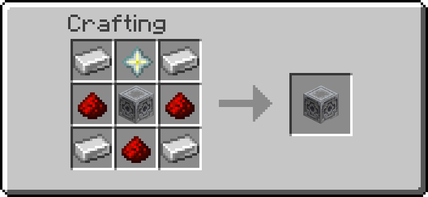

# Chunk Loader

One block that keeps its chunk loaded while it is powered — farms keep running when you walk away.

## Getting it

| Block | Looks like | Recipe |
| --- | --- | --- |
| Chunk Loader | lodestone | { width="220" } |

Operators: `/function ra_chunk_loader:items/give_all`.

## Using it

1. Place one Chunk Loader in each chunk you want loaded (press F3 + G to see chunk borders).
2. Power it with redstone (a lever is enough). The chunk is now force-loaded.
3. Remove the power to let the chunk unload again.

Breaking the Chunk Loader also releases its chunk.

---

## Advanced

- Turning on runs `forceload add ~ ~`, turning off runs `forceload remove ~ ~`, on the power edge
  (`ra.powered` / `ra.was_powered`).
- Marker tag: `ra.custom_block.chunk_loader`.
