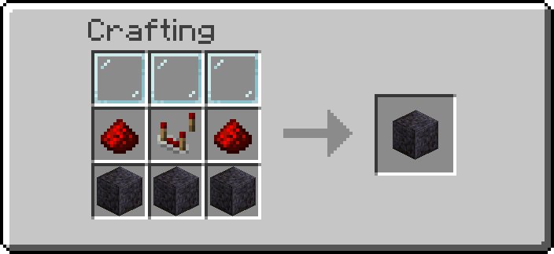

# Displays

Blocks that show something in the world with display entities: a signal level as a bar, an item
floating above its block.

## Getting them

| Block | Looks like | Recipe |
| --- | --- | --- |
| Gauge Bar | polished blackstone | { width="220" } |

Operators: `/function ra_displays:items/give_all`.

## Gauge Bar

A bar on the front of the block, filled to the redstone level feeding it: empty at 0, full at 15.

1. Place it: the bar is drawn on the face looking at you (it can face up or down too).
2. Feed it redstone from any side. The strongest level wins; a repeater or comparator pointing
   into it fills it completely. Dust carries its real level: to show how full a chest is, put one
   dust between the comparator reading it and the Gauge Bar.
3. Shift+right-click with the Wrench to change the colour or turn the bar vertical.

| Property | Values | Default |
| --- | --- | --- |
| `color` | red, orange, yellow, lime, green, cyan, light_blue, blue, purple, magenta, pink, white (anything else draws red) | red |
| `vertical` | on: the bar fills bottom to top; off: left to right | off |

The Goggles show the level, the colour, the orientation and the facing. A colour typed with the
Data Handler shows within a second.

Crafted from three glass panes, two redstone, a comparator and three polished blackstone.

---

## Advanced

- Every display is a `block_display`, `item_display` or `text_display` standing on the block's
  marker, tagged `ra` and `ra.display`, and moved where it is drawn by its transformation. Breaking
  the block removes them; so do the uninstall and the admin purge.
- Displays are fully lit (`brightness` 15): they stand inside the block, where the light is 0.
- One slow clock, `ra_displays:poll/run`, runs once a second while a display block that needs it is
  loaded, and stops when none is. It puts back a display killed by hand.
- Gauge Bar: marker tag `ra.custom_block.gauge_bar`, displays `ra.displays.gauge_track` and
  `ra.displays.gauge_fill`. The input is read every tick (each side asked `any_side` first, as the
  gates do); the fill is redrawn only when the level changes, and the client eases it over 3 ticks.
  The last level drawn is the marker's `ra.power` score; `data.status.level` holds it for the Goggles.
