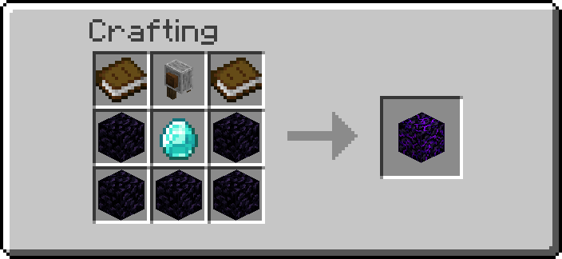
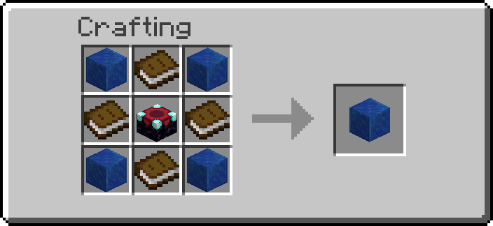
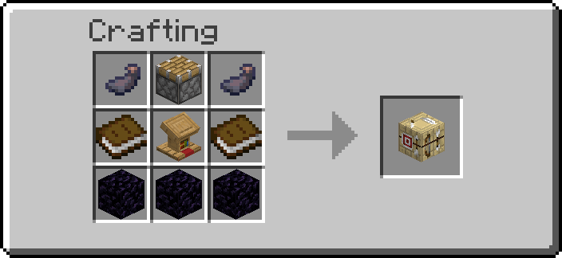

# Enchant Crafting

Gamble items on a plain enchanting table. Throw items on top of it: once a second the table eats
one and rolls — a hit gives you an upgrade, a miss destroys the item. This is how you get the
Cores for [Infinite Generators](infinite-generators.md) and the Infinite Jetpack Kit.

There is nothing to craft for that: any vanilla enchanting table works. Three crafted blocks
work with enchanted books, paid in liquid experience from a
[fluid network](transport-networks.md): the [Disenchanter](#disenchanter) moves an item's
enchantments onto a book, the [Book Upgrader](#book-upgrader) raises a book past its usual
level, and the [Book Printer](#book-printer) copies a book once you have drawn its Schematic.

## Using it

1. Place an enchanting table.
2. Drop (`Q`) the items you want to sacrifice on top of it.
3. Wait. Once a second the table takes **one** item and rolls.

| Outcome | You see | You get |
| --- | --- | --- |
| Success | Enchant and end-rod particles, an enchanting sound and a level-up chime | The upgrade, on the table |
| Failure | Lava and smoke particles, a hiss and a breaking sound | Nothing — the item is gone |

A stack of 64 takes 64 seconds and rolls 64 separate times. Pick the stack back up at any point
to stop. Items with no recipe are left alone on the table.

## Recipes

| Sacrifice | Result | Chance |
| --- | --- | --- |
| Stone | Mineral Core | 1% |
| Netherrack | Nether Core | 1% |
| Poppy | Poppy Core | 1% |
| Coal | Enchanted Coal | 1% |
| Iron Jetpack Kit | Infinite Iron Jetpack Kit | 1% |

Cores are half of an [Infinite Generator](infinite-generators.md); the other half is the crafted
Generator Casing.

## Disenchanter

{ width="220" }

Moves an item's enchantments onto a book.

1. Place the Disenchanter (it looks like crying obsidian).
2. Put a pipe, tank or [Liquid Drain](transport-networks.md#getting-fluid-in-and-out) holding
   **experience** against one of its sides or under it. A drain facing up takes a sneaking
   player's experience into the network.
3. Drop a **book** and an **enchanted item** on top.

Twice a second it checks what lies on it. With both there and the price in the network, it makes
an enchanted book holding every enchantment of the item, and the item stays on the block without
them. The book stack loses one book.

| | |
| --- | --- |
| Price | 1000 mL of experience (10 points) per enchantment moved, all at once. Server setting `disenchanter_xp` (0 to 100000; 0 makes it free and needs no network) |
| Curses | Curse of Binding and Curse of Vanishing stay on the item, as at a grindstone. An item with only curses is left alone |
| Repair cost | Reset, as at a grindstone, so the item is cheap to repair again |
| One at a time | One enchanted item per book: a stack of several enchanted items is left alone |

Items it cannot use (anything but a book or one enchanted item) are left where they are and no
longer looked at until someone picks them up. The Goggles show what it is doing (`needs a book`,
`needs liquid experience`, `disenchanted`, …) and the last price. Where the experience comes from:
the first network beside it that holds the whole price; nothing is taken from a network that
holds less.

## Book Upgrader

{ width="220" }

Raises one enchantment of an enchanted book by one level, for a price that doubles every level.

1. Place the Book Upgrader (it looks like a lapis block) and put a network holding
   **experience** against a side or under it, as for the Disenchanter.
2. Drop an **enchanted book** on top.

Which enchantment it raises:

- the one named by its **enchantment** property, set with the [Data Handler](tools.md):
  `sharpness` or `minecraft:sharpness`. A book without it is left alone;
- with the property empty (the default), the first enchantment of the book in alphabetical
  order of its id that is below the highest level.

| Level | Price (default base 500 mL) |
| --- | --- |
| I → II | 1000 mL (10 points) |
| III → IV | 4000 mL (40 points) |
| V → VI | 16000 mL (160 points) |
| IX → X | 256000 mL (2560 points) |

The price is `base × 2^level` mL, taken all at once; with less than that in the network nothing is
taken and the book waits on the block. The highest level it makes is **10**. Server settings:
`book_upgrader_base` (1 to 1000 mL) and `book_upgrader_max` (1 to 20).

One level at a time: the raised book stays on the block and is not raised again until someone
picks it up and throws it back, so a network is never drained by accident. A book with nothing
left to raise (all at the highest level, or without the chosen enchantment) is left alone. The
Goggles show the chosen enchantment, what it is doing and the last price.

## Book Printer

{ width="220" }

Copies enchanted books. First you gamble a book for its **Schematic**; then the Schematic prints
copies of that book on plain books, for liquid experience.

### Drawing a Schematic

1. Place the Book Printer (it looks like a fletching table).
2. Drop an **enchanted book** on top.

The book is **used up**, whatever happens, and rolls once:

| Outcome | Chance | You get |
| --- | --- | --- |
| Hit | 2% (server setting `book_printer_chance`, 0 to 100) | A Schematic of the book, on the block, with enchant particles and a level-up chime |
| Miss | the rest | Nothing — the book is gone, with a puff of smoke |

It is a gamble, like the enchanting table: at 2% you spend fifty books on average for one
Schematic, so draw from a book worth copying. Drawing costs no experience.

The Schematic is a map-like sheet whose tooltip lists the book's enchantments and levels. It
cannot be crafted, and it is not an enchanted book: an anvil, a grindstone or the Disenchanter
ignores it.

### Printing

1. Put a pipe, tank or [Liquid Drain](transport-networks.md#getting-fluid-in-and-out) holding
   **experience** against a side of the printer or under it, as for the Disenchanter.
2. Drop the **Schematic** and a stack of plain **books** on top.

Twice a second, while there are books and experience, one book becomes an enchanted book with the
Schematic's enchantments. The Schematic stays on the block: pick it up when you have enough copies.

| | |
| --- | --- |
| Price | 1000 mL of experience (10 points) per enchantment level of the copy, all at once: Sharpness V costs 5000 mL, Efficiency V + Unbreaking III 8000 mL. Server setting `book_printer_xp` (0 to 100000; 0 makes it free and needs no network) |
| Not enough | With less than the price in the network nothing is taken, and the book waits |
| One thing at a time | An enchanted book lying on the printer is drawn before anything is printed, so do not drop books you want to keep while it prints |

Copies and Schematics come out tagged as done: they are not drawn again or printed from until
someone picks them up and throws them back. The Goggles show what it is doing (`needs a book`,
`needs liquid experience`, `printed`, `the book crumbled`, `Schematic drawn!`, …) and the last
price.

---

## Advanced

### Adding your own recipes

Recipes come from the function tag `#ra_enchanting:recipes`, so an addon adds its own without
touching this module. A recipe list looks like this:

```mcfunction
# /my_addon:enchant_recipes
# An earlier recipe already matched: it wins, leave its result and chance alone.
execute if data storage ra:enchant result run return 0
execute if data storage ra:enchant input{id:"minecraft:stone"} run data modify storage ra:enchant result set value {id:"minecraft:diamond",count:1}
execute if data storage ra:enchant result run data modify storage ra:enchant chance set value 5
execute if data storage ra:enchant result run return 1
```

| Storage | Meaning |
| --- | --- |
| `ra:enchant input` | the sacrificed item, components and all |
| `ra:enchant result` | the item to produce; leave it unset for "not mine" |
| `ra:enchant chance` | percent, `1..100`, default `5` |

The first recipe that matches wins: every list in the tag runs, so each must start with the
`if data … result run return 0` line. In the pack's own Kotlin, `sacrificeRecipe(...)`
(`ra/modules/enchanting/SacrificeRecipe.kt`) writes exactly these lines.

### The Disenchanter

Settings (Server Settings, Enchant Crafting page): `disenchanter_xp` and whether the block may be
placed. It is not a network node: like the Boiler, it reads the networks of the fluid nodes on
its four sides and below (`ra_enchanting:xp/pay`), so it never splits or joins one. It takes from
the first whose network holds the whole price of `experience`, with `ra_lib:transport/net/take`.
Only the vanilla curses (`minecraft:binding_curse`, `minecraft:vanishing_curse`) stay on the item;
a data pack's own curse moves to the book. Status for the Goggles is in `data.status.state` and
`data.status.price`. It has no properties.

### The Book Upgrader

Property `enchantment` (text, may be empty). It is never pasted into a command: it is compared
with the ids of the game's enchantments, a list written into `ra_enchanting:blocks/book_upgrader/pick`
and `only` when the pack is built. So an enchantment added by a data pack is never raised. The
level is written by one macro (`book_upgrader/apply`) whose id comes from that same list. Settings
`book_upgrader_base` and `book_upgrader_max`; the cap stops at 20 so the price
(`base × 2^19` at most) stays inside 32 bits. The price is one `/compute`
(`mul(base, pow(2, level))`), and a price that ever failed to compute would read 0 and be refused.

### The Book Printer

No properties. Settings `book_printer_chance` (percent, rolled with `random value 1..100`) and
`book_printer_xp`. A Schematic is `minecraft:paper` with `custom_data`
`{ra:{schematic:1b,enchantments:{...}}}`: the book's `stored_enchantments`, copied compound to
compound with `data modify`. They are kept in custom data rather than in an enchantment component
so that no vanilla block (anvil, grindstone) treats the Schematic as a book. Its lore is written
when it is drawn, one translated line per enchantment, by `book_printer/lore`, a list of the
game's enchantment ids written from Kore at build time; the two macros (`lore_one`, `lore_add`)
receive only those ids and the level as an int. A data pack's own enchantment is printed but shows
as `+ other enchantments`. The price is one `/compute`, `mul(cost, levels)`, where `levels` adds
up the levels from the same list (`book_printer/levels`); a data pack's own enchantment counts as
one level. Experience is paid as for the other blocks (`ra_enchanting:xp/pay`). Status in
`data.status.state` and `data.status.price`.

### Cost

The enchanting blocks run every ten ticks from the same scan, and only a block with an untagged
item lying on it does any work: an empty one costs one entity test. Items they cannot use are
tagged `ra.ench.done`, like sacrifice products.

The table scan looks for item entities every five ticks. Items produced by a sacrifice are tagged
`ra.ench.done` and skipped from then on, so an upgrade landing back on the table is not
sacrificed again.
