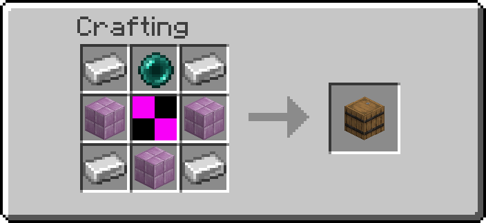
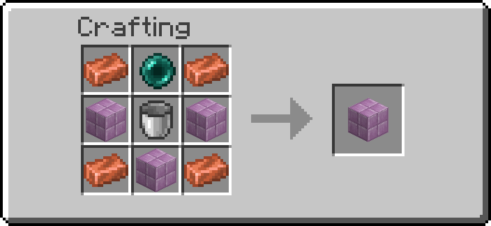
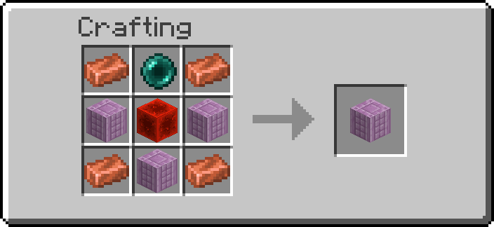
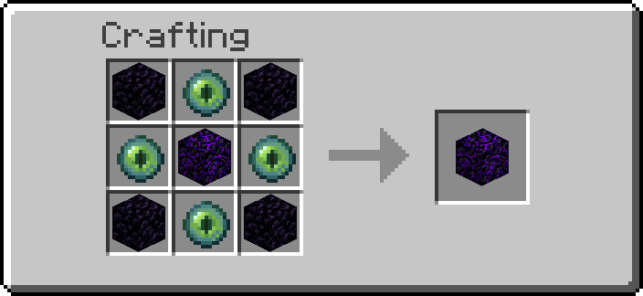
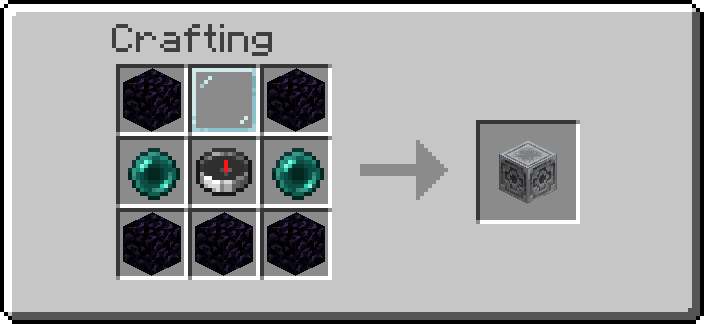
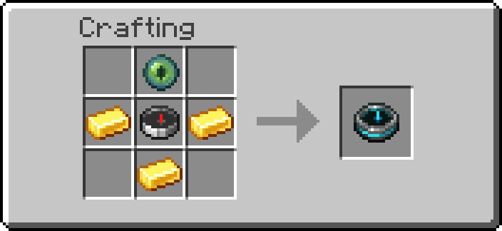

# Ender Links

Move things between two places that are nowhere near each other. Three **vaults** link two
endpoints by channel — items, fluids or power — and the **Teleport Anchor** moves players. The
**Anchor Terminal** and the **Anchor Tablet** send you to any anchor by its name.

## Getting them

| Block | Looks like | Carries | Recipe |
| --- | --- | --- | --- |
| Ender Item Vault | barrel | item stacks | { width="220" } |
| Ender Fluid Vault | purpur block | liquids and gases | { width="220" } |
| Ender Power Vault | purpur pillar | EU (electricity) | { width="220" } |
| Teleport Anchor | crying obsidian | players | { width="220" } |
| Anchor Terminal | lodestone | players, to the anchor you choose | { width="220" } |
| Anchor Tablet (item) | recovery compass | you, from anywhere | { width="220" } |

Operators: `/function ra_ender:items/give_all` (the tablet alone: `/function ra_ender:tablet/give`).

## Vaults

### Linking two vaults

1. Place two vaults of the same kind, anywhere.
2. Give both the same **channel** with the [Data Handler](tools.md). New vaults start on
   `default`, so two fresh vaults are already linked.
3. Use them like the block they look like: hoppers, Item Pipes and your hands work on the Item
   Vault; [pipes, pumps, tanks and wires](transport-networks.md) connect to the Fluid and Power
   Vaults.

A vault always pairs with the **nearest** vault on its channel, so use one channel per pair.

### Modes

Shift + right-click a vault with the [Wrench](tools.md) to cycle its mode.

| Mode | Behaviour |
| --- | --- |
| `link` (default) | Two-way: put something in either end and it can be taken out of the other |
| `send` | One-way: this vault empties itself into the channel |
| `receive` | One-way: this vault only accepts from the channel |

There is never a copy: everything exists in exactly one vault at a time and moves between them.

### What each vault does

| Vault | How often | Moves |
| --- | --- | --- |
| Item Vault | every 4 ticks (hopper speed) | **one whole stack** into the first free slot of the partner. In `link` mode: put a stack in one end and it goes to the other; take a stack out and one is pulled back |
| Fluid Vault | every 10 ticks | up to `transfer_rate` (default 200) one-way; in `link` mode, half the difference between the two ends, so they even out. Holds 1000 |
| Power Vault | every 5 ticks | up to `transfer_rate` (default 80) EU one-way; in `link` mode, half the difference. Stores nothing itself: it is a link, not a battery |

!!! note "Item Vault counts stacks"
    Taking *part* of a stack out (32 of 64) does not count as taking it, so it does not pull a
    refill. Take whole stacks.

A full partner simply receives nothing; nothing is ever destroyed.

## Teleport Anchor

A pad that sends you to another anchor. Each anchor has a **name** (`anchor_id`) and a
**destination** for each redstone signal strength, 1 to 15 (`targets`).

### Setting one up

1. Place two anchors. A new anchor is named `anchor` (or `anchor_2`, `anchor_3`… when that name
   is taken). Shift + right-click each with the [Data Handler](tools.md) and use **[Modify]** on
   `anchor_id` to rename them, e.g. `Home` and `Mine`. Names may contain letters, digits and
   `_ . + - : / #`, no spaces, and **each name belongs to one anchor**: a name another anchor
   already has is refused.
2. On `Home`, click **[List]** on `targets` in the Data Handler to show the fifteen strengths:

    ```
    targets: list (15/15) [Edit all] [List]
      Strength 1: (empty)  [Edit]
      Strength 2: (empty)  [Edit]
      …
    ```

    Click **[Edit]** on *Strength 1* and type `Mine` (the anchor may be placed later).
    **[Clear]** empties a strength.
3. Stand on or next to `Home` (within 2 blocks) and power it with strength 1 (a lever on dust one
   block away, for example). You arrive on top of `Mine`.

Different signal strengths can send you to different anchors: strength 3 picks target 3, and so
on up to 15 (a redstone block counts as 15). The destination can be anywhere: in a chunk that is
not loaded, or in another dimension (the Overworld, the Nether and the End). A strength that
names the anchor you are standing on does nothing. The Goggles show the target in red with
*(no such anchor)* when no anchor has that name.

### Commands

These act on the nearest anchor within 6 blocks:

| Command | Does |
| --- | --- |
| `/function ra_ender:tools/anchor/set_id {id:"A"}` | Set this anchor's id (refused when another anchor has it) |
| `/function ra_ender:tools/anchor/set_table {table:["A","B","C"]}` | Set targets for strengths 1, 2, 3…; the rest are cleared |
| `/function ra_ender:tools/anchor/set_target {level:3,id:"B"}` | Set the target for one strength |
| `/function ra_ender:tools/anchor/show` | Show the name and each strength that leads somewhere |
| `/function ra_ender:tools/anchor/forget {id:"B"}` | Drop a destination whose anchor is gone without being broken (`/kill`, a deleted chunk); refused while the anchor is still there |
| `/function ra_ender:tools/anchor/help` | Show this help in game |

The [Data Handler](tools.md) edits the same two values, without operator rights: `anchor_id`
as text, and `targets` one strength at a time (or the whole list at once with **[Edit whole
list]**, written like `["A","B","C"]`).

Wear the [Goggles](tools.md) to see an anchor's id, the current signal and where it points.

### Good to know

- After arriving you have 1.5 seconds (30 ticks) before you can be teleported again, so landing
  on a powered anchor does not bounce you straight back. A two-way door works: wire both ends,
  walk in, walk out.
- Each anchor waits 1 second (20 ticks) between teleports.
- A target id with no anchor does nothing.
- An anchor whose name was changed for it (a name copied with the Clipboard onto a second
  anchor, for example) becomes `name_2`; its owner, server admins and players within 8 blocks are
  told in chat.

## Anchor Terminal

A station that sends you to the anchor you pick. Stand on it and **sneak**: a menu opens in chat.

```
── Anchor Terminal ──
  ★ Home  [Go]
  ★ Mine  [Go]
  [Type a destination]
```

- **[Go]** sends you to that favourite.
- **[Type a destination]** gives you the Input Form book: write the anchor's name (`Mine`,
  `anchor_2`…) on page 1 and close it. You must still be standing on the terminal when you do.

The favourites are the terminal's own: up to 8 anchor names in its `favourites`, set with the
[Data Handler](tools.md) (**[List]**, then **[Add]** or **[Edit]**). Nothing lists the anchors of
the world, so a destination is a name you saved or a name you know. You arrive on top of that
Teleport Anchor, wherever it is (any chunk, the Overworld, the Nether or the End), with the same
1.5 seconds of arrival grace as an anchor. Using a terminal is free.

The menu's buttons work for one minute, and only while you stand on the terminal. Holding sneak
opens it once; let go and sneak again to open it again. The Goggles show how many favourites the
terminal has.

## Anchor Tablet

The same menu, from anywhere: **right-click** the tablet.

```
── Anchor Tablet ──
  ★ Home  [Go] [Forget]
  Last: Mine  [Go] [Save]
  [Type a destination]
  A trip: 1 ender pearl(s), then 10 s to recharge.
```

- **[Type a destination]** asks for an anchor name in the Input Form book, as on the terminal.
  Keep the tablet in the same hotbar slot until you close the book.
- **Last** is your last trip; **[Save]** keeps it as a favourite (up to 8 per tablet),
  **[Forget]** removes one. Favourites and the last trip are stored on the tablet itself, so they
  go wherever it goes.

Each trip costs **1 ender pearl** (none in creative) and the tablet then **recharges for 10
seconds**. Server operators set both on the Ender Links settings page:

| Setting | Default | Range |
| --- | --- | --- |
| `ender_tablet_pearls` — ender pearls per trip | 1 | 0 to 16 |
| `ender_tablet_cooldown` — recharge, in seconds | 10 | 0 to 600 |

---

## Advanced

### Properties

| Block | Property | Meaning |
| --- | --- | --- |
| Vaults | `channel` | string; vaults with the same channel are linked. Default `"default"` |
| Vaults | `mode` | `link`, `send` or `receive` |
| Fluid, Power Vault | `transfer_rate` | units per move in one-way mode (200 fluid, 80 EU) |
| Teleport Anchor | `anchor_id` | string in format `ID`, unique in the world, what other anchors aim at. Default `anchor`, `anchor_2`, … |
| Teleport Anchor | `targets` | fifteen ids: `targets[0]` is signal 1, `targets[14]` is signal 15; `""` is unused |
| Anchor Terminal | `favourites` | up to 8 anchor ids (format `ID`), shown as **[Go]** buttons |

The Anchor Tablet keeps `favs` (up to 8 ids) and `last` in its `custom_data`, under `ra`. They are
written only through the item modifier `ra_ender:tablet_data`, from `storage ra_ender:tablet`, and
read back through the cleaner (format `ID`) before every use, so an edited tablet can only name a
key of the destinations table.

### The destination menu

The terminal and the tablet share one chat menu (`ra_ender:chooser/*`). Every button runs
`/trigger ra.ender.go set <n>`: 1 shows the menu again, 2 types a destination, 3 and 4 are the
tablet's last trip ([Go], [Save]), 11–18 favourite 1–8, 21–28 forget favourite 1–8. The trigger is
enabled when a menu is drawn and taken back a minute later or after a trip. A click is checked
again where it lands: still on a terminal (the box above it), or still holding the tablet; the
favourites are read again from the block or the item at that moment. A typed name comes back
through `ra_lib:input` (request id kept in `ra.ender.req`) and is cleaned to format `ID`, as an
anchor cleans its own name, before `ra_ender:anchors/lookup` and `ra_ender:anchors/send`.

A terminal costs one player box test per tick (the block above it), and nothing when no terminal
is loaded. The sneak is a pressed edge: a player seen on a terminal the tick before
(`ra.ender.t_seen`) who was not sneaking then (`ra.ender.t_sneak`). The tablet's right-click is
the `using_item` advancement `ra_ender:tablet/use` (an endless `consumable`, as on the Redstone
Remote), and only the first tick of a press counts (`ra.ender.used`). Its recharge is a game time
(`ra.ender.ready`), compared when it is used, so nothing counts down while it waits; vanilla's
`use_cooldown` would need the use to finish, and the tablet's never does.

### The destinations table

Every anchor is filed by name in `storage ra:ender anchors`:

```
anchors: {
  "Home": {id:"Home", x:12, y:64, z:-30, dim:"minecraft:overworld", owner:[I; …]},
  "Mine": {id:"Mine", x:400, y:12, z:88, dim:"minecraft:the_nether"}
}
```

`x y z` is the anchor's block, `dim` its dimension (`""` in a dimension other than the three
vanilla ones: a data pack cannot read an entity's dimension, only test for one it names, and such
an anchor cannot be reached), `owner` the UUID of the player who placed it (absent for anchors
placed before 6.0.3).

Only the anchor writes its entry, as its marker: `ra_ender:anchors/register` when it is placed and
whenever its `anchor_id` differs from the name it filed (`data.data.registered_id`, one comparison
per tick), and `ra_ender:anchors/drop` when it is broken. Registering cleans the name to format
`ID` (as `ra_lib:safe/clean`) and, when another anchor's entry already has it, takes the first free
`name_2`, `name_3`…, telling the owner, admins and players within 8 blocks. The Data Handler refuses
a taken name before that (the property's `unique`, see
[Tools and registries](tools-and-registries.md)).

A teleport is one key lookup, no search through the loaded anchors:

| Function | Context | Does |
| --- | --- | --- |
| `ra_ender:anchors/lookup` | any | `storage ra:ender lookup.id` (a string) → `lookup.dest`, a copy of the entry; returns 1 when found, 0 otherwise (also for an id not in format `ID`, which is checked with `ra_lib:safe/check` before it becomes a path key) |
| `ra_ender:anchors/send` | as a player | teleports `@s` onto the anchor `lookup.id` names, in its dimension, with the arrival grace, sound and particles; returns 1 when sent |

The names are not listed anywhere to pick from (6.0.1 and 6.0.2 had `storage ra:ender anchor_ids`
and a Data Handler **[Choose]**); a compound cannot be walked by key, and the table is not a menu
of everyone's anchors. Before 6.0.1 the name was pasted into an `nbt=` selector, and a target
containing `"}` could add commands to it.

**Upgrading to 6.0.3.** The old list is removed at load. Each anchor placed before 6.0.3 has its
targets cleaned to format `ID` (`Main base` becomes `Mainbase`; the anchor cleans its own name the
same way) and files itself in the table on its first tick, or the first tick its chunk is loaded.
The first anchor to file a name keeps it; another with the same name (every anchor was `A` before
6.0.3) becomes `A_2`, `A_3`…, and a target that named the shared name now leads to the anchor that
kept it.

An anchor whose `targets` is not a list of fifteen (an old Data Handler edit could store
anything) is repaired once, the first time it is loaded, by the 6.0.1 migration
(`ra_migrations:6.0.0-to-6.0.1/teleport_anchor`): `ra_ender:blocks/teleport_anchor/repair_targets`,
as the anchor marker, pads a short list with `""`, trims a long one and replaces anything else
with fifteen empty entries.

### How `link` decides

- **Items:** each vault remembers how many stacks it held last cycle (`data.data.last_used`).
  More stacks than before → push one stack to the partner; fewer → pull one back; unchanged →
  nothing. A delivery updates the receiver's count straight away, so an arriving stack is not
  bounced back. Stacks move with `ra_lib:inventory/move_slot` into a slot checked empty first.
- **Fluid and EU:** only the fuller side pushes, half the gap, with a dead zone (20 fluid, 4 EU)
  so the last few units do not oscillate. Fluid is taken, offered, and any remainder handed back,
  so it is always in exactly one network.

### Scoreboards and tags

| Name | Meaning |
| ---- | ------- |
| `ra.ender.cd` | Per-vault work timer |
| `ra.ender.tp_cd` | Ticks before an anchor may fire again |
| `ra.ender.grace` | Ticks before a player may be teleported again |
| `ra.ender.recv_item` / `recv_fluid` / `recv_power` | Recomputed each tick: this vault can accept |
| `ra.ender.send_item` | Recomputed each tick: this vault can be pulled from |
| `ra.ender.self` | Held for one cycle so a vault or anchor never links to itself |
| `ra.ender.pull_target` | The vault a refill is being fetched for, for one command |
| `ra.ender.tell` | Players told that an anchor's name was changed, for one command |
| `ra.ender.go` | Trigger: the destination menu's buttons |
| `ra.ender.menu` | Game time a player's destination menu expires |
| `ra.ender.src` | What opened the menu: 1 an Anchor Terminal, 2 an Anchor Tablet |
| `ra.ender.pend` / `ra.ender.req` | Waiting for a typed destination, and its `ra_lib:input` request |
| `ra.ender.t_seen` / `ra.ender.t_sneak` | Last game time on a terminal, and whether sneaking then |
| `ra.ender.slot` | Hotbar slot of the tablet whose menu is open |
| `ra.ender.ready` / `ra.ender.used` | Game time the tablet is ready again; last tick it was used |
| `ra.ender.pick` | The vault picked as partner, for one command |

Vault channels are compared without a macro:
`ra_ender:link/pick` visits the receiving vaults nearest first, copies each one's `channel` to
storage and overwrites it with the sender's, and the first copy that does not change is the
partner (it wears `ra.ender.pick` for one command). Vaults after the first match cost one command
each. Before 6.0.2 the nearest receiving vault was taken first and its channel checked
afterwards, so a closer vault on another channel hid the real partner. A channel may only hold
letters, digits, spaces and `_ . + - : / #` (format `NAME`), still checked by `ra_lib:safe/guard`
before each use; a vault whose channel fails the check links nothing.
