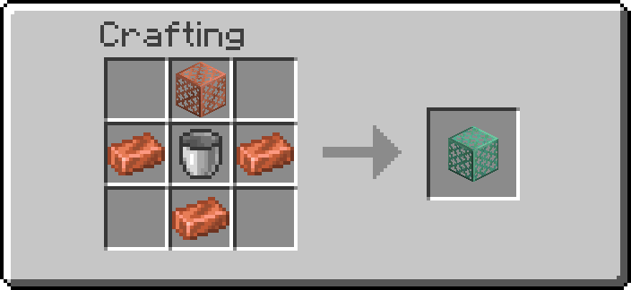
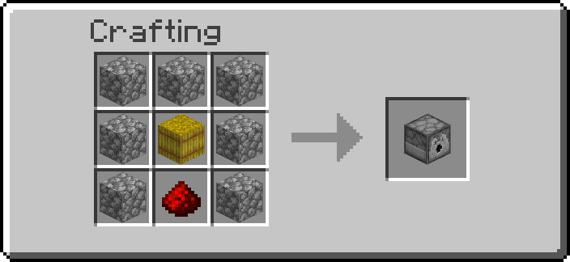
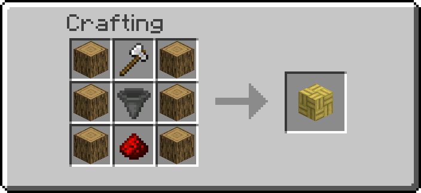
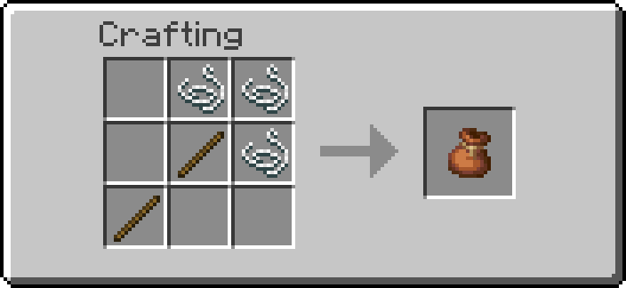
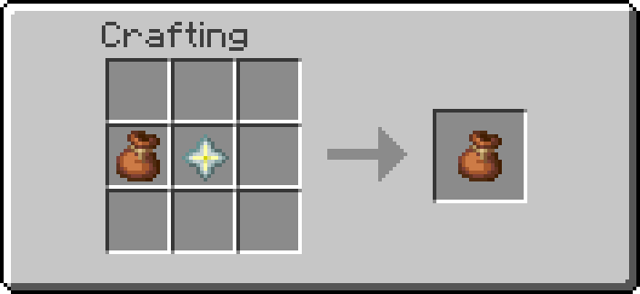

# Farming

Blocks that tend crops, trees and animals. The **Sprinkler** waters the farmland around it from a
fluid network, and with liquid experience makes the crops there grow about four times as fast. The
**Breeder** feeds the animals in front of it. The **Tree Farm** plants saplings, grows them and fells
the trees into a chest. The **Capture Net** catches a mob so you can carry it somewhere else.

## Getting them

| Block | Looks like | Recipe |
| --- | --- | --- |
| Sprinkler | oxidized copper grate | { width="220" } |
| Breeder | dispenser | { width="220" } |
| Tree Farm | bamboo mosaic | { width="220" } |

| Item | Looks like | Recipe |
| --- | --- | --- |
| Capture Net | cobweb | { width="220" } |
| Master Capture Net | cobweb, purple name | { width="220" } |

The Master Capture Net is a Capture Net (the cobweb in the picture) and a nether star, anywhere in
the crafting grid. The upgrade keeps whatever the net holds. A plain rabbit hide works in place of
the Capture Net too, by design: the recipe cannot tell them apart, and the result is an empty
Master Capture Net either way.

Operators: `/function ra_farming:items/give_all` (every block and both nets),
`/function ra_farming:capture_net/give`, `/function ra_farming:capture_net/give_master`.

!!! note "The Breeder moved here"
    The Breeder was part of [Interactive Machines](interactive-machines.md) until v6.0.3. Only
    the module it is listed under moved: Breeders already placed keep working, its recipe is the
    same, and its ids (`ra_interactive:breeder`) did not change.

## At a glance

| Block | Needs redstone? | Does |
| --- | --- | --- |
| Sprinkler | no (redstone locks it) | Waters the farmland around it; with liquid experience, crops grow about 4x as fast |
| Breeder | while powered | Feeds the animals in front of it from its inventory |
| Tree Farm | no (redstone locks it) | Plants saplings beside it, grows them with bone meal, fells the tree into the container below |

## Sprinkler

1. Place it in the middle of your field. It works at farmland level, where the water hole of a
   vanilla farm would be, or one block higher, standing among the crops.
2. Put a pipe, tank or drain of a [fluid network](transport-networks.md) against any of its six
   faces, and fill the network with **water**, **liquid experience** or both.
3. Leave it unpowered: a redstone signal locks it, as it does a hopper.

It is not part of the network itself, so placing or breaking it never splits or joins one. The
first neighbour whose network holds the whole price pays.

**The area** is a square of `radius` blocks each way around it (4 by default, a 9x9 field), from
one block below the Sprinkler to one block above it: crops planted level with it, one block above
or one below are all reached.

| Fluid | What it does | Price |
| --- | --- | --- |
| Water | Every 5 seconds, all the farmland in the area becomes fully moist, so the crops grow at their best vanilla rate and the farmland never dries out | 4 mL per block of the area each time (324 mL at radius 4, about a bucket every 75 seconds) |
| Liquid experience | Once a second, extra growth: crops in a moist field grow about **4x** as fast as on their own | 10 mL (a tenth of an experience point) per crop stage it grows |

With both in the network it does both. The extra growth picks random spots in the area, as the
game's own random ticks do. A second's experience is taken from the network before anything
grows, and what a spot with nothing to grow (dirt, a ripe crop) did not use is put back, so in
the end only crops that grew are paid for.

**Crops it grows:** wheat, carrots, potatoes, beetroots, nether wart, melon and pumpkin stems,
torchflower crops and sweet berry bushes. A ripe stem still needs the game's own growth to set a
melon or pumpkin, and a torchflower crop stops one stage short of the flower.

| Setting | Default | Range | Meaning |
| --- | --- | --- | --- |
| `radius` | 4 | 1 to 8 (admins up to 16) | How many blocks each way the square reaches |

Change it with the [Data Handler](tools.md) (Shift + right-click the Sprinkler). Server admins
set the radius new Sprinklers start with on the **Farming** settings page, 1 to 16, the same
ceiling as their own. A default above 8 gives every new Sprinkler that radius whoever places it;
a player can then only set it within 1 to 8. The page can also switch the Sprinkler or the
Breeder off for the world.

The [Goggles](tools.md) show its state (running or locked), whether it is watering, whether the
experience boost is on, and its radius.

## Breeder

1. Put the right food in the Breeder itself (it has a chest-like inventory and never throws its
   items). It feeds only from its own inventory, not from a container next to it.
2. Keep two adult animals of the same kind in front of it (within two blocks of the block it
   faces).
3. Power it. It uses one food per pair it feeds.

| Animal | Food |
|---|---|
| Cow, Mooshroom, Sheep, Goat | wheat |
| Pig | carrot, potato, beetroot |
| Chicken | wheat seeds, melon seeds, pumpkin seeds, beetroot seeds, torchflower seeds, pitcher pod |
| Rabbit | carrot, golden carrot, dandelion |
| Horse | golden apple, golden carrot, enchanted golden apple |
| Llama | hay block |
| Turtle | seagrass |
| Panda | bamboo |
| Fox | sweet berries, glow berries |
| Bee | any flower |
| Wolf | any raw or cooked meat, rotten flesh |
| Cat | cod, salmon |
| Axolotl | bucket of tropical fish |
| Strider | warped fungus |
| Hoglin | crimson fungus |
| Camel | cactus |
| Sniffer | torchflower seeds |
| Frog | slime ball |
| Armadillo | spider eye |

## Tree Farm

1. Place it next to a block of dirt or grass (podzol, moss, mud and the other dirt blocks work too),
   with air above that block: that is where the tree grows. Any of its four sides will do; it uses
   the first free one and keeps it until the tree is down.
2. Put a chest, barrel or hopper **on top** of it and fill it with saplings, and bone meal if you
   want the trees to grow fast.
3. Put a chest or barrel **under** it for the wood.

Once a second it looks at its spot:

| The spot holds | It does |
| --- | --- |
| Nothing | Plants the first sapling it finds in the container above |
| Its sapling | Waits for it to grow. With bone meal above and `bone_meal` on, uses one a second, as a player would: 45% of the time the sapling moves on a stage, and the second stage grows the tree |
| The tree's log | Fells the tree into the container below |
| Anything else | Forgets the spot and plants again where it can |

**Felling** takes only the tree that grew there: starting from the log on the spot, the logs of
that one wood connected to it, beside or above (never below the trunk's base), then that tree's
leaves that were not placed by hand. A leaf is taken only when one of the felled logs is within its
own distance to a log (the `distance` every leaf carries), so a tree of the same kind whose leaves
touch keeps them. Everything must be within 12 blocks of a point 8 blocks above
the spot, and at most 96 logs and 384 leaves are taken. Each block's drops, as if cut with an axe
(logs, saplings, sticks, apples), go into the container below while it has three free slots; when
it is fuller, they fall on the spot instead, so nothing is lost. With no container below it does
not fell at all.

**Trees it grows:** oak (one in ten a fancy oak), spruce, birch, jungle, acacia, cherry and poplar,
each from a single sapling. Dark oak and pale oak need four saplings, mangroves grow on roots, and
the giant spruce and jungle trees need four saplings, so it does not grow those.

| Setting | Default | Meaning |
| --- | --- | --- |
| `bone_meal` | on | Use bone meal from the container above on the sapling |

Change it with the [Data Handler](tools.md). The [Goggles](tools.md) show what it is doing and how
many trees it has felled. Redstone locks it, as it does a hopper.

!!! warning "Keep your own builds of the same wood out of reach"
    A log is felled when it is of the tree's wood and touches the tree, within 12 blocks of it.
    A fence of oak logs built against an oak tree would go with it; planks, stripped logs, wood
    blocks and leaves you placed yourself never do. A bee nest an oak or birch grew on its own stays
    where it was.

## Capture Net

Right-click a mob with a net in your main hand to catch it. The net now shows what it holds and
glints. Right-click a block to let the mob out on that side of the block. The mob comes back as it
was: its name, health, equipment, owner, baby or grown, and a villager's trades and level.

| Net | Catches |
| --- | --- |
| Capture Net | Farm animals and small peaceful mobs: armadillo, axolotl, bat, bee, cat, chicken, cod, cow, fox, frog, glow squid, goat, mooshroom, ocelot, parrot, pig, pufferfish, rabbit, salmon, sheep, squid, tadpole, tropical fish, turtle, wolf |
| Master Capture Net | Any mob but the wither, the ender dragon and players: villagers, horses, golems, hostile mobs, the warden |

It refuses a mob that has something riding it, is invulnerable, or is a pet tamed by another
player. A mob on a lead is let off it first, as when a leash breaks: the lead drops where the mob
was, and if the mob was holding other mobs on leads, each of those drops its lead too. One lead per
leash, and no leash is ever kept in the net. A net only lets out the types on its own list above. One net holds one mob, so nets do not stack. A mob that Peaceful
removes (a zombie, a creeper) is not let out on Peaceful: it stays in the net.

!!! tip "Chests, villagers and allays"
    Right-clicking a chest opens it: sneak to let a mob out on one. Right-clicking a villager opens
    its trades and catches it at the same time. An allay takes any item it is offered, a net
    included, so the plain Capture Net does not catch allays.

---

## Advanced

- **Cost.** Per tick a Sprinkler costs only the break check every block has. Its work runs once a
  second on the network machines' clock (the one the Spout and the Tesla Coil use), which only runs
  while one of them is loaded. Watering is a single `fill` of the farmland in the area, which
  changes nothing on farmland that is already wet.
- **Growth rate.** The game gives each block 3 random ticks per 4096 per game tick, and a random
  tick grows a crop in a full, moist field 1 time in 6 (1 in 13 on dry farmland). The Sprinkler
  adds three times the moist-field figure: `area x 15 / 2048` growths a second (0.6 at radius 4,
  4 at radius 12), the remainder rolled, each growing the crop at a random spot by one stage. With
  the game's own growth that is about 4x on moist farmland, which its water keeps; on dry
  farmland the game is slower, so the Sprinkler's share is larger.
- **Paid first.** The second's experience is taken before any crop grows, and only as many growths
  as were really taken are made; what a spot with nothing to grow did not use is put back into
  the same network. A short take of water (the network changed since it was read) is put back and
  waters nothing.
- **Tree Farm cost.** It runs on the same once-a-second clock as the Sprinkler. With nothing to
  plant a second is a redstone read and one item test; a growing sapling a few block tests. Felling
  happens once per tree, in one go, and checks each log's 17 neighbours (beside it and one up) and
  each leaf's 6.
- **Capture Net data.** A caught mob is stored in the net's `custom_data`:
  `{ra:{capture_net:{mob:{id:"minecraft:cow",type:{translate:"entity.minecraft.cow"},data:{...}}}}}`.
  `data` is the mob's own entity data without its UUID, position, motion, brain and the like. The
  mob is removed only after the net has been read back holding it, by moving it far below the world
  and removing it there so nothing it drops is left. Letting it out summons the type, merges the
  data in, and only then empties the net. The type id is checked (`ra_lib:safe/check`) before it
  is used. A net is any rabbit hide wearing the cobweb model; the Master Capture Net is the one with
  the epic rarity.
- **Physical blocks.** The Sprinkler is a waxed oxidized copper grate. The Tree Farm is bamboo
  mosaic. The Breeder is a barrel
  wearing a dispenser skin, so redstone never makes it throw its food.
- **Ids.** The Breeder keeps the `ra_interactive` namespace it was created in: its functions
  (`ra_interactive:blocks/breeder/...`), its recipe and the entity tag `#ra_interactive:breedable`.
  The crop list is the block tag `#ra_farming:sprinkler_crops`. The Tree Farm's saplings are the
  item tag `#ra_farming:tree_farm/saplings`; the nets' mob lists are the entity type tags
  `#ra_farming:capture_net/small`, `#ra_farming:capture_net/any` and
  `#ra_farming:capture_net/hostile`.
