# Redstone Additions


**Version:** v6.0.3  
**Minecraft:** 26.3  
**Author:** [AnCarsenat](https://github.com/AnCarsenat)

---

Redstone Additions is a vanilla data pack — no mods — that adds automation machines, logic
gates, wireless redstone, sensors, item and fluid storage, pipes and electricity, chunk loading,
multiblock machines, jetpacks and more.

## Version Compatibility

**Supported: Minecraft 26.3.** The pack will not load on other versions.

On Minecraft 1.21.9 – 26.2, use **v5.1.17** from [Modrinth](https://modrinth.com/datapack/redstone-additions).

## Quick Start

1. Download the data pack zip from [Modrinth](https://modrinth.com/datapack/redstone-additions)
   (or the `+mod` jar for a `mods` folder, which applies it to every world).
2. Put the zip in your world's `datapacks` folder — no need to unzip it.
3. Run `/reload`.
4. Run `/function ra:give_all_items` to get one prefilled bundle per namespace.

Path example:

```text
.minecraft/saves/<world>/datapacks/redstone_additions_v<version>(RELEASE)-0000.zip
```

Never keep two copies of the pack in the same world. Building it yourself from the source is
described in [Contributing Guidelines](contributing-guidelines.md#installing-into-a-world).

## Modules

**Looking for a recipe? [The Recipe Atlas](recipe-atlas.md) has all 73 of them on one
page**, listed A to Z and grouped by module — plus the four items that have no recipe
and are instead gambled for on an [enchanting table](enchant-crafting.md). This table
is the shortcut: one sample per module, and where to read about it.

| Module | What you get | Sample recipe |
|---|---|---|
| [Logic Gates](logic-gates.md) | 8 timing/logic blocks | 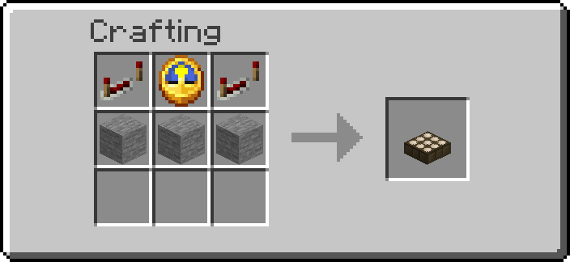{ width="220" } |
| [Interactive Machines](interactive-machines.md) | 12 automation and utility blocks | 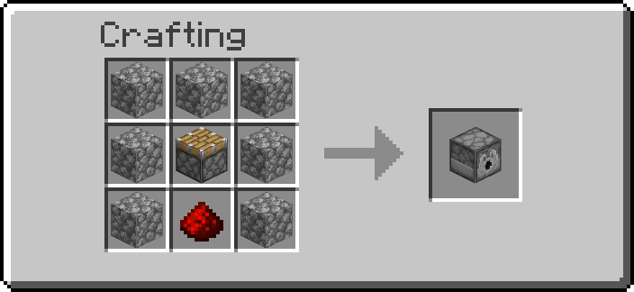{ width="220" } |
| [Storage](storage.md) | Boxer + Unboxer workflow | 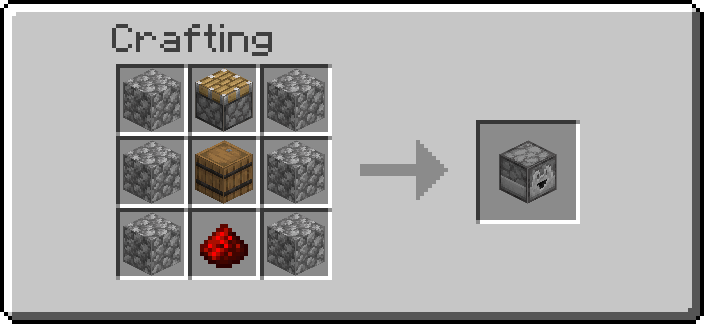{ width="220" } |
| [Sensors](sensors.md) | Entity detector, tag operators, light and weather sensors | 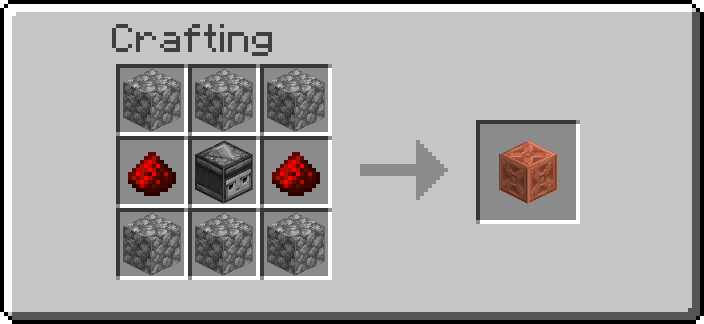{ width="220" } |
| [Wireless Redstone](wireless-redstone.md) | Emitter, Receiver, and Remote | 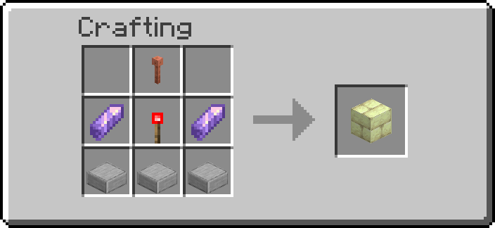{ width="220" } |
| [Transport Networks](transport-networks.md) | Liquid, gas, EU, Boiler, Solar Panel | 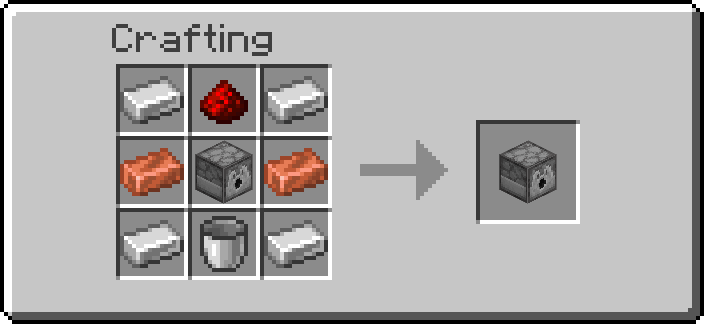{ width="220" } |
| [Chunk Loader](chunk-loader.md) | 1 force-load block | 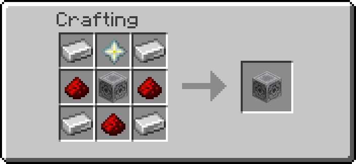{ width="220" } |
| [Multiblocks](multiblocks.md) | 5 base tiers + structures | 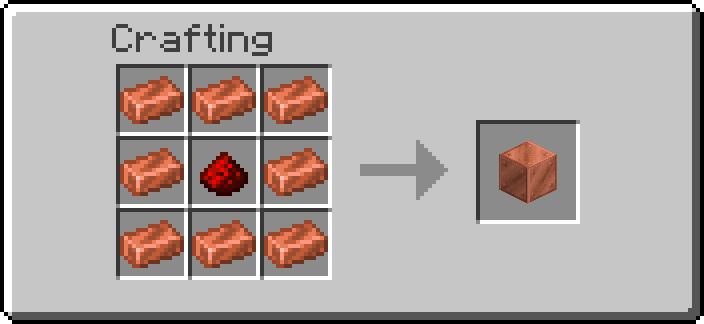{ width="220" } |
| [Enchant Crafting](enchant-crafting.md) | Sacrifice items on an enchanting table | No recipe — uses the vanilla table |
| [Jetpacks](jetpacks.md) | 2 jetpacks + 3 upgrade kits | 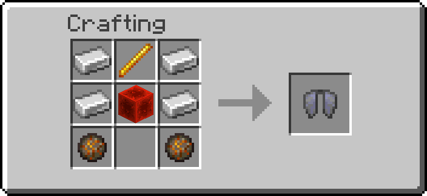{ width="220" } |
| [Infinite Generators](infinite-generators.md) | 3 self-growing blocks + casing | 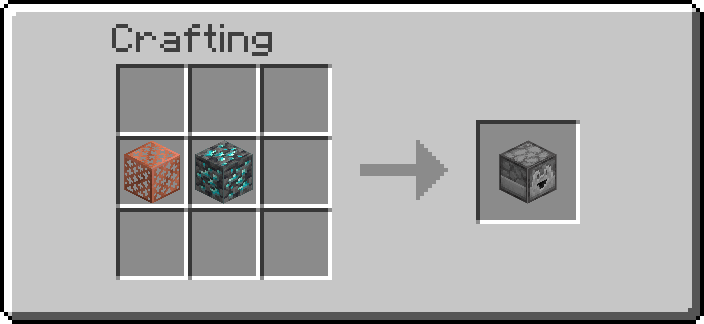{ width="220" } |
| [Ender Links](ender-links.md) | 3 remote vaults + teleport anchor | 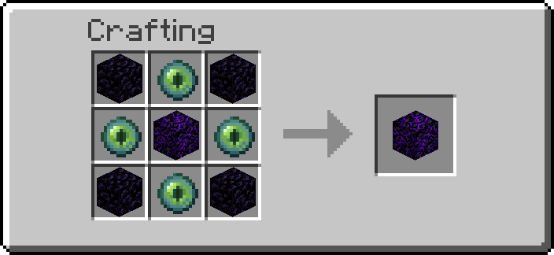{ width="220" } |

Current pack totals:

- 63 placeable custom blocks
- 73 recipes, all of them in the [Recipe Atlas](recipe-atlas.md)
- 7 tools (Wrench, Goggles, Data Handler, Creative Data Handler, Clipboard,
  Multimeter, Redstone Remote)

## Commands Most Players Need

| Command | Purpose |
|---|---|
| `/function ra:give_all_items` | Full starter kit (all namespaces) |
| `/function ra_gates:items/give_all` | Logic gates bundle |
| `/function ra_interactive:items/give_all` | Interactive machines bundle |
| `/function ra_storage:items/give_all` | Boxer and Unboxer bundle |
| `/function ra_sensors:items/give_all` | Sensor bundle |
| `/function ra_wireless:items/give_all` | Wireless bundle |
| `/function ra_wires:items/give_all` | Transport/EU bundle |
| `/function ra_chunk_loader:items/give_all` | Chunk loader bundle |
| `/function ra_multiblock:blocks/give_all` | Multiblock bases |
| `/function ra_infinite:items/give_all` | Generator casing and generators |
| `/function ra_jetpacks:items/give_all` | Jetpack kits |
| `/function ra_ender:items/give_all` | Ender vaults and Teleport Anchors |
| `/function ra:uninstall` | Opens uninstall confirmation dialog |

## Tools At A Glance

| Tool | Give command | Recipe preview | Main use |
|---|---|---|---|
| Wrench | `/function ra:tools/wrench/give` | 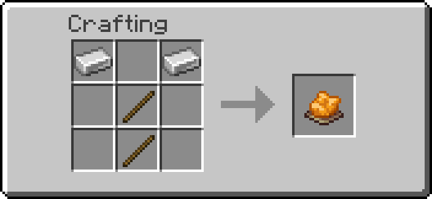{ width="200" } | Change block modes, assemble multiblocks |
| Data Handler | `/function ra:tools/data_handler/give` | 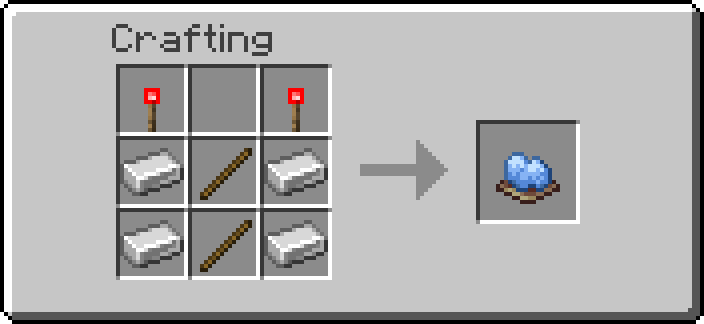{ width="200" } | Edit a block's settings |
| Goggles | `/function ra:tools/goggles/give` | 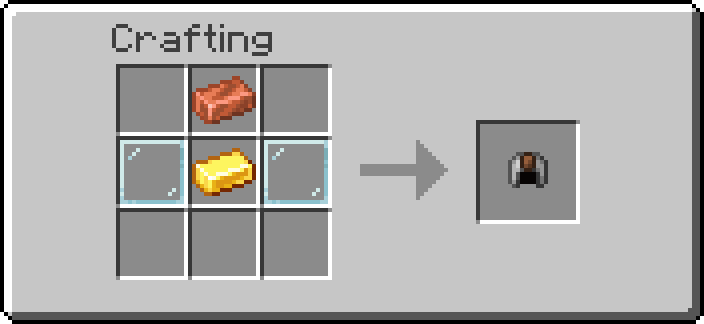{ width="200" } | See every block's status |

## What's New

See the [Changelog](changelog.md) for every release.

## More

- [Tools](tools.md) — Wrench, Goggles, Data Handler, Clipboard, Multimeter
- [Settings](settings.md) — your own and the server's
- [Recipe Atlas](recipe-atlas.md) and [Item Reference](item-reference.md)
- For builders of addons and contributors: [How It Works](how-it-works.md),
  [Getting Started](getting-started.md)

## Support

- [GitHub Repository](https://github.com/AnCarsenat/Redstone-Additions)
- [Issues](https://github.com/AnCarsenat/Redstone-Additions/issues)
- [Modrinth](https://modrinth.com/datapack/redstone-additions)

