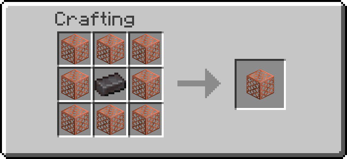
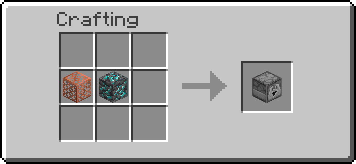
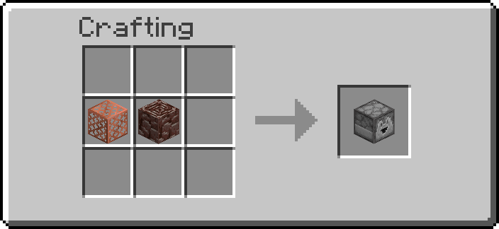
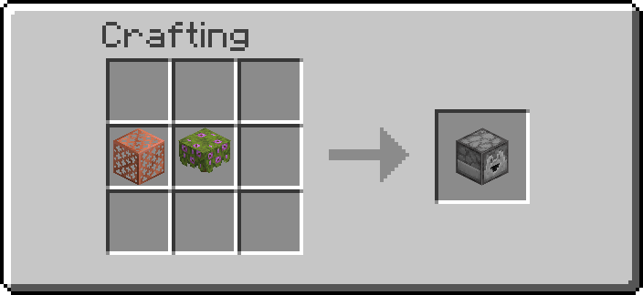

# Infinite Generators

Blocks that grow their own material in front of themselves, forever: ores, nether blocks or
flowers. Point a [Block Breaker](interactive-machines.md) at one and you have a self-feeding farm.

## Getting one

A generator is made of two halves: a crafted **Generator Casing** and a **Core** won on an
enchanting table.

1. Craft a Generator Casing: eight copper grates around one netherite scrap.
2. Throw stone, netherrack or poppies on an enchanting table. Each one has a **1%** chance of
   coming back as a Core; the rest are used up. See [Enchant Crafting](enchant-crafting.md).
3. Put the Casing and the Core together in a crafting grid (any two slots).

| Core | Sacrifice | Builds |
| --- | --- | --- |
| Mineral Core | stone | Mineral Generator |
| Nether Core | netherrack | Nether Generator |
| Poppy Core | poppy | Poppy Generator |

| Result | Recipe |
| --- | --- |
| Generator Casing | { width="220" } |
| Mineral Generator | { width="220" } |
| Nether Generator | { width="220" } |
| Poppy Generator | { width="220" } |

The Casing and Cores cannot be placed as blocks.

Operators: `/function ra_infinite:items/give_all`.

## What they grow

| Generator | Every | Grows |
| --- | --- | --- |
| Mineral Generator | 5 s (100 ticks) | stone 57%, coal ore 20%, iron ore 14%, redstone ore 7.5%, diamond ore 1.2%, emerald ore 0.3% |
| Nether Generator | 5 s (100 ticks) | netherrack 69%, magma block 30%, ancient debris 1% |
| Poppy Generator | 4 s (80 ticks) | poppy, dandelion, cornflower, azure bluet, oxeye daisy, allium, blue orchid, lily of the valley — equal odds |

On average a Mineral Generator makes a diamond every seven minutes or so and an emerald every half
hour; a Nether Generator makes ancient debris about every ten minutes.

## Using them

- A generator looks like a dropper; it grows into the block its **face** points at.
- It only grows when that block is empty (or grass, fern, dead bush or snow). Mine what it grew
  and it grows again.
- No redstone needed: it runs whenever its chunk is loaded.
- Change how fast it grows (`cooldown`, in ticks) with the [Data Handler](tools.md). Operators can
  change the default for new generators in [Settings](settings.md).

### Poppy Generator

It plants one flower per cycle, on soil you provide: grass block, dirt, coarse dirt, rooted dirt,
podzol, mycelium, moss, pale moss, mud, muddy mangrove roots or farmland.

It looks at the 3×3 area around the block in front of it and plants in the first spot that works:

| Spot | Flower goes |
| --- | --- |
| Empty, with soil under it | In that spot |
| The spot *is* soil (a grass block it faces) | On top of it |
| Empty, with another empty block under it and soil below that | One block down — handy for a generator on a pedestal |

**Place it looking straight ahead.** Placed while looking down, it faces up and will never find
anywhere to plant.

Wear the [Goggles](tools.md) to check: a **Ground** line says `ok` when it has somewhere to plant,
`none` when it does not.

---

## Advanced

- Properties: `data.properties.cooldown` (ticks).
- "Empty" means the block tag `#ra_infinite:growable` (air, cave air, short grass, fern, dead bush,
  snow). Poppy soil is `#ra_infinite:flower_ground`, which lists block ids directly rather than
  using `#minecraft:dirt`.
- The Casing and Cores are game-master items no survival player can place:
  Generator Casing = `minecraft:repeating_command_block` (drawn as a copper grate), Mineral Core =
  `minecraft:jigsaw`, Nether Core = `minecraft:structure_block`, Poppy Core =
  `minecraft:chain_command_block`. Different base items are what let the three generator recipes
  tell their cores apart.
- Generators are real droppers with no skin. A dropper's redstone behaviour does nothing here:
  a generator stores nothing and reads no redstone.
- `/function ra_infinite:debug/poppy` prints, for every loaded Poppy Generator, its position,
  facing, cooldown, the block in front and the ground verdict.
