# Interactive Machines

Machines for everyday automation: break and place blocks, move and sort items, breed animals,
endless water, lava and powder snow, item magnets, mob-proof torches and message blocks.

## Getting them

| Block | Looks like | Recipe |
| --- | --- | --- |
| Block Breaker | dispenser | 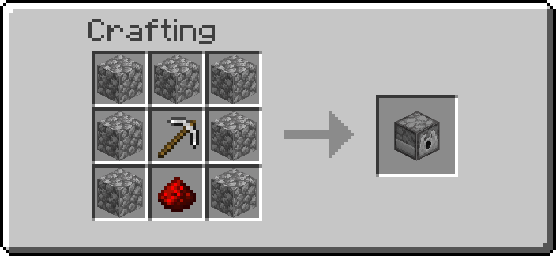{ width="220" } |
| Block Placer | dispenser | 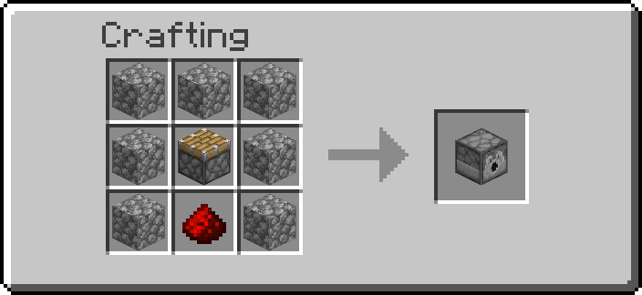{ width="220" } |
| Item Pipe | dispenser | 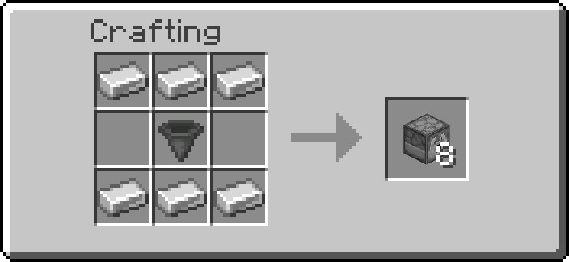{ width="220" } |
| Item Mover | observer | 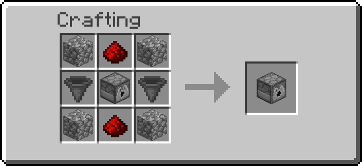{ width="220" } |
| Spitter | dropper | 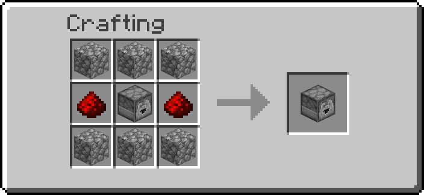{ width="220" } |
| Breeder | dispenser | 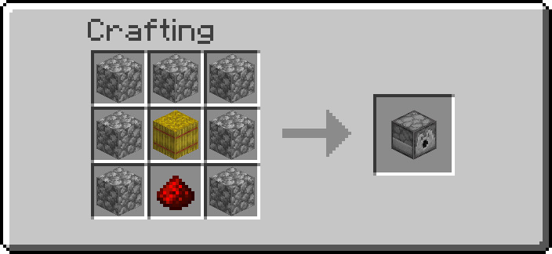{ width="220" } |
| Infinite Water Cauldron | cauldron | 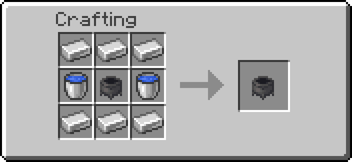{ width="220" } |
| Infinite Lava Cauldron | cauldron | 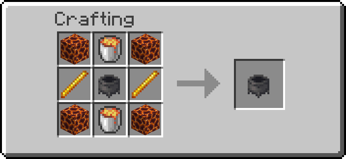{ width="220" } |
| Infinite Snow Cauldron | cauldron | 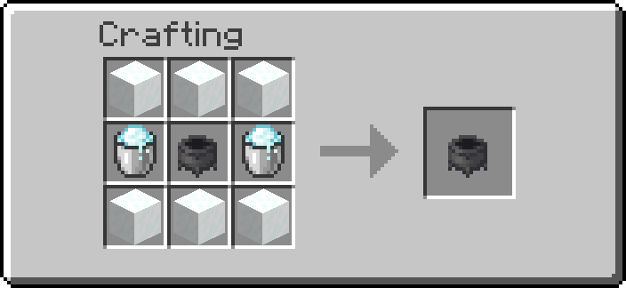{ width="220" } |
| Magic Crate | barrel | 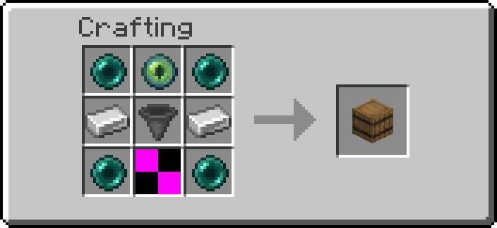{ width="220" } |
| Big Torch | a tall torch | 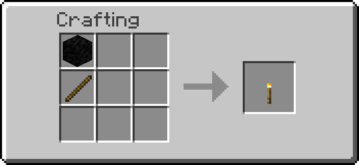{ width="220" } |
| Message Block | note block | 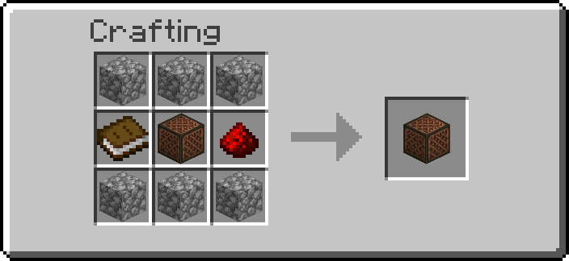{ width="220" } |

Operators: `/function ra_interactive:items/give_all`.

## At a glance

| Block | Needs redstone? | Does |
| --- | --- | --- |
| Block Breaker | while powered | Breaks the block in front of it, once a second; the block drops as an item |
| Block Placer | while powered | Places a block from its inventory into the empty space in front, once a second |
| Item Pipe | no | Carries items forward from container to container, and can sort them |
| Item Mover | no | Moves items from the container behind it to the container in front |
| Spitter | no | Throws its items out of its face as dropped items |
| Breeder | while powered | Feeds the animals in front of it from its inventory |
| Infinite Cauldrons | no | Always full of water, lava or powder snow |
| Magic Crate | no | Pulls dropped items within range into itself |
| Big Torch | no | Lights the area and removes hostile mobs that spawn nearby |
| Message Block | when it gets powered | Sends a chat message to nearby players |

"Front" is the direction the block faces when you place it.

## Block Breaker and Block Placer

- Face them at the spot to work on and power them (a lever keeps them running, a clock works too).
- Each acts at most once per `cooldown` ticks: 20 (once a second) by default, 1–1200. The
  cooldown is a server admin's setting: players with server-settings access change it with the
  [Data Handler](tools.md); for everyone else it is locked.
- The Block Breaker cannot break unbreakable blocks such as bedrock.
- The Block Placer places the first stack in its inventory, and only into air (cave air
  counts too). If that stack is not a block (a diamond, say), it waits and uses none of it: take
  it out to let the placer carry on.

## Item Pipe

Pipes move items forward from one container (or pipe) to the next, a whole stack at a time when
there is room, every 4 ticks. When the next container is full, items wait in the pipe — nothing
is dropped.

**Sorting:** a pipe can have a **filter**. Items matching it are pushed into a container at one
of the pipe's four sides instead of continuing forward (never back into the container feeding
it); everything else carries on.

1. Shift + right-click the pipe with the [Data Handler](tools.md).
2. On the `filter_item` row, hold the item to sort and press **[Set from hand]** (or type an item
   id with **[Modify]**).
3. Clear the value to remove the filter.

Wear the [Goggles](tools.md) to see each pipe's filter item floating above it.

## Item Mover

Place it with its back against the source container and its face against the destination. It
moves items across continuously, checking the destination has room first.

## Spitter

Put items in it; every 4 ticks it throws the first stack out of its face as a dropped item. No
redstone needed.

## Breeder

1. Put the right food in the Breeder (it has a chest-like inventory and never throws its items).
2. Keep two adult animals of the same kind in the block in front of it.
3. Power it. It uses one food per pair it feeds.

| Animal | Food |
|---|---|
| Cow, Mooshroom, Sheep, Goat | wheat |
| Pig | carrot, potato, beetroot |
| Chicken | wheat seeds, melon seeds, pumpkin seeds, beetroot seeds, torchflower seeds, pitcher pod |
| Rabbit | carrot, golden carrot, dandelion |
| Horse | golden apple, golden carrot, enchanted golden apple |
| Llama | hay block |
| Turtle | seagrass |
| Panda | bamboo |
| Fox | sweet berries, glow berries |
| Bee | any flower |
| Wolf | any raw or cooked meat, rotten flesh |
| Cat | cod, salmon |
| Axolotl | bucket of tropical fish |
| Strider | warped fungus |
| Hoglin | crimson fungus |
| Camel | cactus |
| Sniffer | torchflower seeds |
| Frog | slime ball |
| Armadillo | spider eye |

## Infinite Cauldrons

Use them like normal cauldrons: fill buckets from them as often as you like. The water and snow
versions stay at full level, the lava version stays full of lava.

## Magic Crate

A barrel that pulls dropped items into itself.

| Setting | Default | Range | Meaning |
| --- | --- | --- | --- |
| `radius` | 8 | 5–20 | How far it reaches, in blocks |
| `cooldown` | 20 | 1–1200 | Ticks between pulls; a server admin's setting, locked for other players |

It takes up to eight items (whole stacks, enchantments and names kept) per pull, and stops when it
has no empty slot left — the Goggles then show `Full`. Breaking it drops everything inside.

## Big Torch

A torch one block tall that lights its area (light level 14) and stops hostile mobs from
**spawning** near it: any hostile mob that appears within `radius` blocks is removed — dropped out
of the world, so it leaves no loot or experience. Mobs that **walk in** from outside are left alone.

| Setting | Default | Range |
| --- | --- | --- |
| `radius` | 16 | 1–100 |

## Message Block

When it gets powered, it sends its message to the players picked by its selector.

| Setting | Default |
| --- | --- |
| `message_block` (the text) | `Hello World!` |
| `entity_selector` (who reads it) | `@a[distance=..16]` |

## Changing settings

Every setting above is edited with the [Data Handler](tools.md): Shift + right-click the block,
then change the row. The [Goggles](tools.md) show the current values.

---

## Advanced

- **Physical blocks.** The Breeder is a barrel wearing a dispenser skin, so redstone never makes it
  throw its food. The Block Breaker and Block Placer are real dispensers and react to
  `dispenser[triggered=true]`. The Big Torch is an end rod (the light source) wearing an
  enlarged torch display; the Magic Crate is a plain barrel.
- **Big Torch.** Sweeps every 10 ticks. It remembers every hostile mob in a band reaching 16
  blocks past the radius; a mob inside the radius that it never saw there is removed. Mobs are
  teleported far below the world instead of killed. Values above 100 are written back as 100. The
  mob list is the entity type tag `#ra_interactive:spawn_blocked`.
- **Magic Crate.** Skips items with a permanent pickup delay. The radius limit is enforced, since
  an unlimited radius would be a world-wide entity scan.
- **Item Pipe.** The filter is `data.properties.filter_item` (an item id, empty = none). Pipes
  built when filters were item frames are converted on load; the frames are left in place.
- **Properties** live in each block marker's `data.properties`; machines pace themselves with the
  `ra.cooldown` score.
