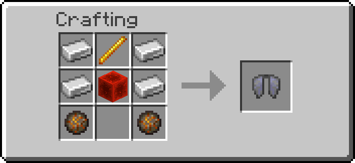
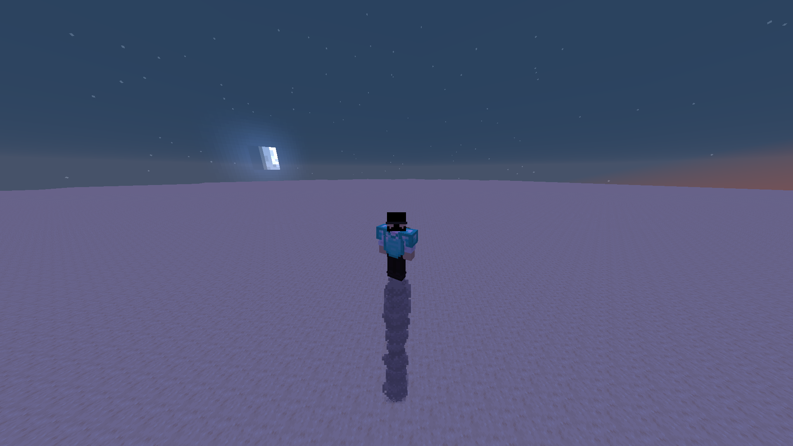
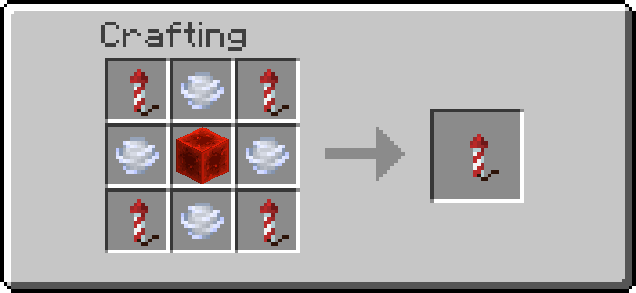
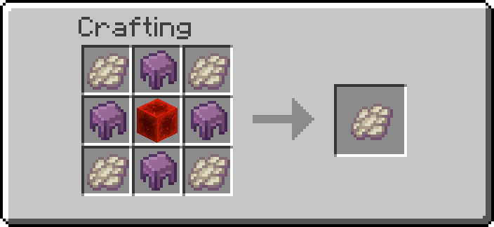
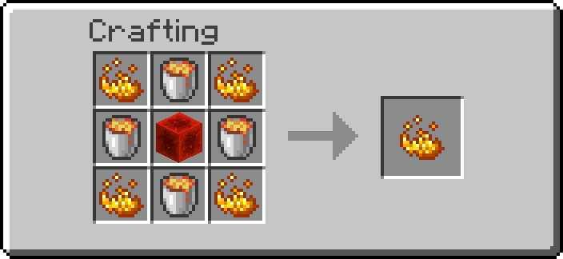

# Jetpacks

Turn **any** chestplate into a jetpack. The chestplate keeps its material, durability and
enchantments — the kit only adds flight. Three upgrade kits add speed, faster climbing and a
flamethrower underneath you.

## Getting one

| Kit | How to get it | Fuel |
| --- | --- | --- |
| Iron Jetpack Kit | Crafted: blaze rod, iron ingots, a redstone block and a coal block | 1 coal (or charcoal) per 2 minutes of flight |
| Infinite Iron Jetpack Kit | Sacrifice an Iron Jetpack Kit on an enchanting table, 1% per kit — see [Enchant Crafting](enchant-crafting.md) | none |

{ width="260" }

Operators can get every kit with `/function ra_jetpacks:items/give_all`.

## Fitting it

1. Wear the chestplate you want to fly with.
2. Hold the kit (it looks like an elytra) and right-click. The kit is used up.

The Iron kit will not go onto a chestplate that is already a jetpack. The Infinite kit will —
that is how you upgrade an iron jetpack in place.

Everything lives on the chestplate: hand it to someone else and the jetpack and its upgrades go
with it. Each fitted upgrade adds a line to the chestplate's lore.

## Flying

Pick a mode with `/trigger ra.jp.mode`. The mode belongs to you, not to the jetpack.

### Classic

Hold **sneak** to rise, about three blocks a second. Let go and you fall normally.

### Hover

| Holding station | Sneak to steer |
|---|---|
|  |  |

The jetpack carries your weight while you are in the air: let go of everything and you stay put.

| Input | Result |
| --- | --- |
| Sneak + look up | Rise, about three blocks a second (this is also how you take off) |
| Sneak + look down | Sink slowly, with no fall damage |
| Sneak + look straight ahead, or no sneak | Hold your height |
| Standing on a block | The jetpack idles; you walk normally |
| Landing after a flight | The jetpack switches itself off — `/trigger ra.jp.power` to take off again |

"Up" and "down" mean looking more than 30° above or below the horizon; anything in between holds.

While a jetpack is worn, sneaking no longer slows you down.

## Upgrade kits

Right-click these **while already wearing a jetpack**. Each is used up and can be fitted once.

| Kit | Effect |
| --- | --- |
| Thruster Kit | **Hold sprint** in the air to speed up in the direction you are moving, up to about 7 extra blocks a second. The push builds up over about half a second and fades the same way when you let go |
| Lift Kit | Climbs at about six blocks a second instead of three, and sinks faster |
| Scorch Kit | Sets fire to everything in a 3×3 column up to 6 blocks under you and hurts it (3 damage every half second) |

{ width="220" }
{ width="220" }
{ width="220" }

!!! note "Upgrades only work while the jetpack is flying you"
    In **classic** mode that means while you hold sneak in the air. In **hover** mode it means
    whenever you are airborne. Neither works on an empty tank.

Scorch never burns players, dropped items, experience orbs, armour stands, item frames,
paintings or Redstone Additions machines, so hovering over your own base is safe. It only fires
while you are properly in the air, not while standing on a block's edge.

### Managing fitted kits

`/trigger ra.jp.kits` lists the three kits and their state. Each fitted kit has two buttons:

- **[On] / [Off]** — pause it without removing it (handy for Scorch over your own farm). This
  setting is yours, not the jetpack's.
- **[Remove]** — take it off and get the kit back as an item.

## Fuel

Only the Iron jetpack burns fuel, and only while it is holding you up (classic thrust, hover
holding or climbing — sinking is free). Every 2 minutes of that, one coal is taken from your
inventory, or charcoal if you have no coal.

With neither, the jetpack cuts out and says so in the action bar. It comes back once you pick
up coal again.

## Commands

| Command | Does |
| --- | --- |
| `/trigger ra.jp.mode` | Switch between classic and hover |
| `/trigger ra.jp.power` | Turn your jetpack off completely (and on again) — useful when you just want to sneak |
| `/trigger ra.jp.sound` | Mute or unmute the engine sound (particles stay) |
| `/trigger ra.jp.kits` | Show fitted upgrade kits, switch them on/off, remove them |
| `/function ra_jetpacks:items/give_all` | Give every kit (operators) |

---

## Advanced

### Flight details

- **Hover holding** is an active correction: each tick the jetpack measures your vertical speed
  and adjusts your gravity against it.

  | Vertical speed | Gravity change | Effect |
  | --- | --- | --- |
  | within ±0.006 blocks/tick | `0` | free hover (dead zone) |
  | ±0.006 to ±0.06 blocks/tick | `∓0.02` | gentle correction |
  | beyond ±0.06 blocks/tick | `∓0.08` | full thrust |

  Player gravity has a base of `0.08`, so `-0.08` is weightless and `-0.16` pushes you up.
  Climbing uses levitation instead. Gravity returns as soon as the chestplate comes off, the
  mode changes, or the fuel runs out.
- **Sinking** hands gravity back with slow falling on top, so the descent is capped and safe.
- **Thruster** measures how far you actually moved, smooths it over about four ticks
  (`smoothed = floor((smoothed × 3 + delta) / 4)`) and, while you sprint, adds a capped push in
  that direction (`clamp(floor(smoothed × k / 100), −cap, cap)` per axis, cap 0.35 blocks a
  tick). That push is scaled by a throttle, `ra.jp.ramp` (0 to 100): each tick it covers a
  quarter of the way to its target, 100 while you sprint and 0 after, and at least 6
  (`0 → 25 → 43 → 57 → 67 → …` up, `100 → 75 → 57 → 43 → …` down), so the push eases in and out
  over about ten ticks instead of switching. Each of those is a single 26.3 `/compute`, so the
  whole step is about 16 commands per tick for an airborne player. It does nothing while you hover still: a push under the dead zone
  is skipped.
- **Engine sound** is `minecraft:item.elytra.flying` at volume 0.35, pitch 0.6, replayed once a
  second while the jetpack holds you up, stopped (for everyone within 20 blocks) when it doesn't.
- **Sneaking speed**: a worn jetpack adds `0.7` to `minecraft:sneaking_speed` (modifier
  `ra.jetpack.sneak`).
- **Gravity modifier**: `ra.jetpack.hover` on `minecraft:gravity`, always `add_value`.

### Scoreboards and tags

| Name | Meaning |
| ---- | ------- |
| `ra.jp.mode` | Trigger: switch mode |
| `ra.jp.sound` | Trigger: mute the engine |
| `ra.jp.power` | Trigger: master switch |
| `ra.jp.kits` | Trigger: upgrade kit menu |
| `ra.jp.mute` | `1` while that player's engine is muted |
| `ra.jp.off` | `1` while that player's jetpack is switched off |
| `ra.jp.snd` | Engine timer, one play a second |
| `ra.jp.sound_on` | An engine loop is currently playing |
| `ra.jp.air` | `1` once the player has left the ground, so a landing can be spotted |
| `ra.jp.y` | Last sampled height, in thousandths of a block |
| `ra.jp.ramp` | Thruster throttle, 0 to 100 |
| `ra.jp.grav` | Current thrust tier on the gravity attribute |
| `ra.jp.state` | `0` classic, `1` hover |
| `ra.jp.fuel` | Ticks of powered flight since the last coal |
| `ra.jetpack_on` | Player is wearing a jetpack |
| `ra.jp.hover_on` | The gravity modifier is applied |
| `ra.jp.dry` | Out of fuel; flight is suspended |
| `ra.jp.speed_on` | The sneaking-speed modifier is applied |
| `ra.jp.kit_*` | Which upgrades the worn chestplate has, re-read from it every tick |

Fitted upgrades are stored in the chestplate's `custom_data`, written by one generated item
modifier per tier and upgrade combination (`ra_jetpacks:fit_<tier>_<n>`).
