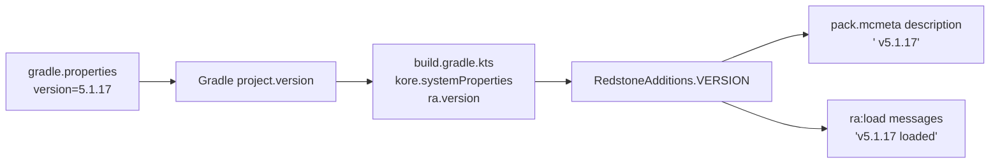

# Release and Versioning

## Where the version lives

**One place:** `version` in `redstone_additions_kore/gradle.properties`.

```properties
version=5.1.17
```

Everything in the Kore build reads it from there:



| Step | Code |
| --- | --- |
| Gradle reads `version` from `gradle.properties` as the project version | built-in Gradle behaviour |
| The Kore plugin passes it to the generator | `build.gradle.kts`: `systemProperties = mapOf(…, "ra.version" to project.version.toString())` |
| The generator exposes it | `RedstoneAdditions.VERSION` = `System.getProperty("ra.version")` |
| Run from the IDE (no plugin) | `VERSION` reads `version=` from `gradle.properties` in the working directory; `"dev"` if there is none |
| Used by | the `pack.mcmeta` description (`RedstoneAdditions.build`) and the two load messages (`hub/Load.kt`) |

Nothing else in `src/` may contain the version number. To check:

```bash
grep -rn "5\.1\.17" redstone_additions_kore/src --include=*.kt | grep -v migrations
```

Hits in `ra/migrations/` are **not** the version. Migration step names (`5.1.7-to-5.1.8`) are
identifiers tied to the two versions they bridge; a find-and-replace that bumps them renames the
chain into nonsense (`5.1.9-to-5.1.9`). The same applies to version numbers in comments that
date a bug ("the v5.1.6 bug").

A one-off build at another version needs no edit:

```bash
./gradlew koreBuild -Pversion=5.2.0-rc1
```

## Bumping the version

1. Edit `version` in `redstone_additions_kore/gradle.properties`.
2. Add a `## [vX.Y.Z]` section to the changelog. The publish script requires that exact heading
   (see below).
3. Update the version mentioned in prose docs: `readme.md` (badge), `docs/index.md`,
   `docs/developer-guide.md`, `docs/contributing-guidelines.md`, `GUIDELINES.md`. These are
   documentation, not build inputs.
4. If the change needs a world migration, add a step to `ra.migrations` named for the step it
   bridges, append it to `MigrationsPart`'s list, and make it safe to run twice.
5. `./gradlew koreBuild` (strict) and check the description:

   ```bash
   grep -o 'v[0-9][^"\\]*' build/kore/redstone_additions/pack.mcmeta
   ```

Compare the beet release checklist in `GUIDELINES.md`, which edits `pack.mcmeta`,
`ra/function/load.mcfunction` (twice) and the docs by hand. Steps 1 and 5 replace the first
three of those edits.

## Release checklist (Kore)

- [ ] Version bumped (above).
- [ ] `./gradlew koreBuild` passes **strict** — no `-Pra.strict=false` for a release.
- [ ] `python3 tools/compare_reference.py --all` reviewed: only expected differences.
- [ ] In game, on a fresh world and on an upgraded one: `/reload` with no errors in the log;
      place, break and configure every block type; `/function ra:give_all_items`; wrench, Data
      Handler, Creative Data Handler, goggles; assemble and break a Blast Forge; uninstall
      (confirm and cancel).
- [ ] Tag and push (`git tag vX.Y.Z && git push origin vX.Y.Z`) once CI publishes the Kore build
      (next section).

## Publishing: what CI expects today

The publish workflow still builds and ships the **beet** pack. Nothing in it reads the Kore
project yet. What it relies on, and what must change when it switches to Kore:

| Today (`.github/workflows/publish.yml`, `.github/scripts/modrinth_publish.py`) | When switching to Kore |
| --- | --- |
| Version comes from the tag (`v5.1.17` → `5.1.17`) or the manual-run input | unchanged; the tag must equal `version` in `gradle.properties` |
| Builds with `pip install beet==0.116.0 && beet build` and fails if the committed `build/` changed | set up JDK 25 and run `./gradlew koreBuild` in `redstone_additions_kore`, passing `-Pversion=$VERSION` or checking it equals `gradle.properties` |
| `check_pack_version` reads `redstone_additions/build/redstone_additions_data_pack/pack.mcmeta` and requires `v<version>` in its description | point `PACK` at `redstone_additions_kore/build/kore/redstone_additions`; the Kore description already contains `v<version>` |
| Release notes come from `## [v<version>]` in `redstone_additions/src/CHANGELOG.md` | move `CHANGELOG` to wherever the changelog lives after the switch (the Kore pack ships no loose files) |
| Zips the folder into `redstone_additions_v<version>(RELEASE)-0000.zip` and builds the `+mod` jar itself | unchanged, given the new `PACK` path; Kore's own `generateJar()` could replace the hand-built jar later |
| `GAME_VERSIONS: "1.21.9 1.21.10 1.21.11 26.1 26.1.1 26.1.2 26.2 26.3"` | **`"26.3"` only**: the Kore build declares format 121 only |

None of this is changed yet. Until it is, tagging a release publishes the beet build.
