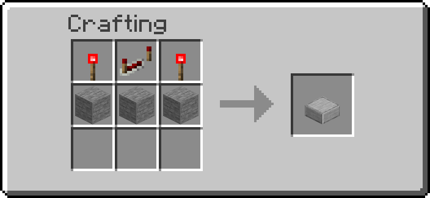
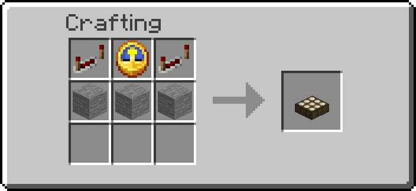
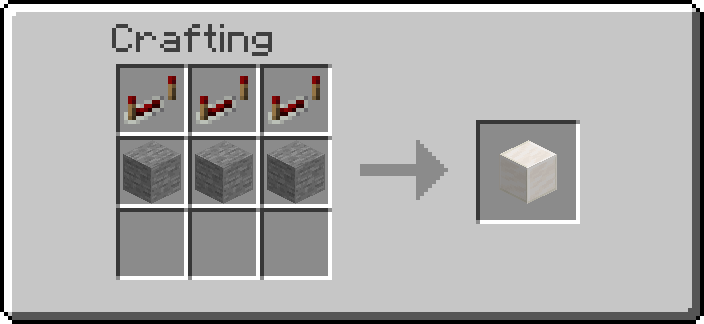
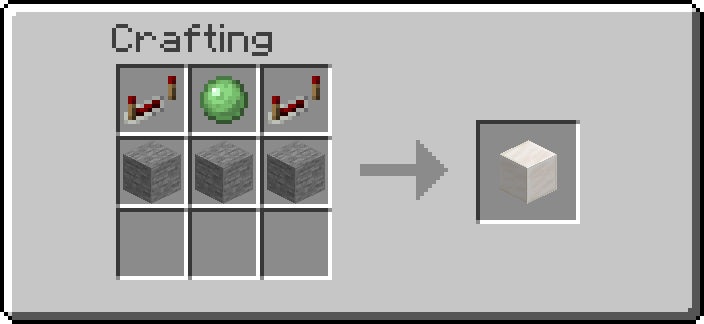
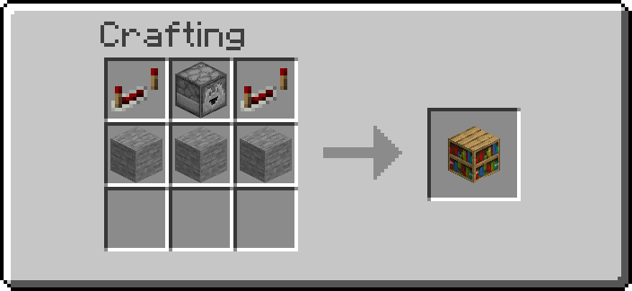
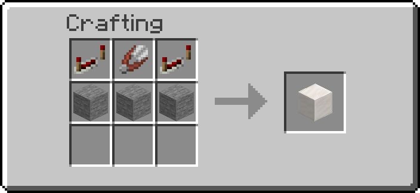
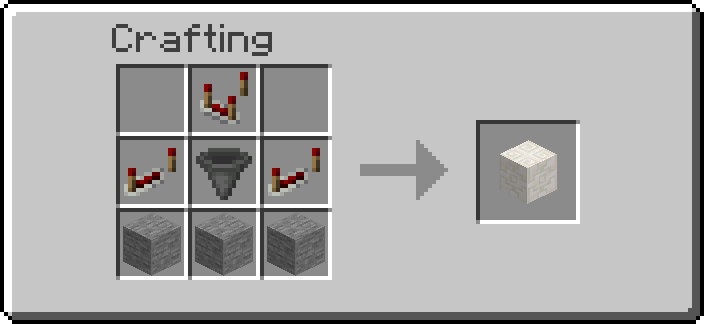
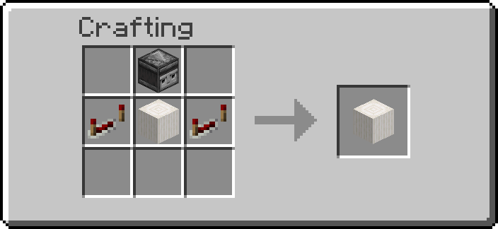

# Logic Gates

Compact logic and timing blocks for redstone builds: one universal gate that does AND, OR, NOT
and the rest, plus a clock, a delayer, a pulse extender, a pulse shortener, a randomizer, a
counter and an edge detector.

## Getting them

| Block | Recipe |
| --- | --- |
| UNI Gate | { width="220" } |
| Clock | { width="220" } |
| Delayer | { width="220" } |
| Extender | { width="220" } |
| Randomizer | { width="220" } |
| Shortener | { width="220" } |
| Counter | { width="220" } |
| Edge Detector | { width="220" } |

Operators: `/function ra_gates:items/give_all`.

## How they work

**Input:** redstone power on any side of the block — dust, levers, buttons, torches, repeaters,
comparators, pressure plates.

**Output:** put **iron blocks** next to the gate (anywhere in the 3×3×3 cube around it). While the
gate's output is on, those iron blocks turn into **redstone blocks**; when it switches off they
turn back. Wire your circuit from those blocks.

## The blocks

| Block | Does | Setting | Default |
| --- | --- | --- | --- |
| UNI Gate | A logic gate: `and`, `or`, `not`, `xor`, `nand`, `nor`, `xnor` | `gate_type` | `and` |
| Clock | Pulses the output for one tick, every `cooldown` ticks, forever | `cooldown` (ticks, at least 2) | 20 |
| Delayer | Turns on `delay` ticks after the input turns on | `delay` (ticks) | 20 |
| Extender | Stays on for `extend` ticks after the input turns off | `extend` (ticks) | 20 |
| Randomizer | Each time the input turns on, turns on with `chance`% probability | `chance` (0–100) | 50 |
| Shortener | Turns any input into a pulse of exactly `pulse` ticks | `pulse` (ticks) | 2 |
| Counter | Counts the times the input turns on; fires when the count reaches `target`. Top side resets | `target` (1–1000), `hold` | 10, off |
| Edge Detector | A pulse of `pulse` ticks when the input turns on, off, or both | `mode` (`rising`, `falling`, `both`), `pulse` (ticks) | `rising`, 2 |

20 ticks = 1 second.

### Counter

- **Counting:** each time redstone on the bottom or any of the four sides turns **on**, the count
  goes up by one. A signal that stays on counts once.
- **Reset:** redstone on the **top** (a lever, button or dust on it, or a powered block above)
  sets the count back to 0 and turns the output off. While the top stays powered, nothing is
  counted.
- **On reaching `target`**, with `hold` off (the default): the output pulses for 2 ticks and the
  count starts again from 0, so a Counter with target 4 turns every 4th pulse into an output
  pulse. With `hold` on: the output turns on and stays on, and the count stays at the target,
  until the top is powered.
- The count is shown by the Goggles and the Data Handler (read only; the Creative Data Handler
  can set it).

### Edge Detector

| Mode | Pulses when… |
| --- | --- |
| `rising` | the input turns on (the same as a Shortener) |
| `falling` | the input turns off |
| `both` | the input turns on or off |

Each pulse lasts `pulse` ticks (1–200). An edge that arrives while a pulse is still on restarts
it, so the output stays on rather than flickering. Any other value typed into `mode` acts as
`rising`.

### UNI Gate modes

| Mode | Output is on when… |
| --- | --- |
| `and` | every connected input is powered |
| `or` | at least one input is powered |
| `not` | no input is powered |
| `xor` | exactly one input is powered |
| `nand` | not every connected input is powered |
| `nor` | no input is powered |
| `xnor` | not exactly one input is powered |

For `and` / `nand`, every redstone component touching the gate counts as an input — an unpowered
repeater on one side keeps an AND gate off.

## Changing settings

- **UNI Gate mode:** Shift + right-click the gate with the [Wrench](tools.md) to cycle modes.
- **Counter hold and Edge Detector mode:** Shift + right-click with the [Wrench](tools.md) too.
- **Timings, chance and the Counter target:** open the block with the [Data Handler](tools.md) and edit the value.
- **Defaults for newly placed gates:** server operators can change them in
  [Settings](settings.md) → Logic Gates.
- **Check a gate:** wear the [Goggles](tools.md) to see its mode or timing above it.

---

## Advanced

- Each gate reads its inputs with `ra_lib:redstone/detect` every tick; any power level from 1 to
  16 counts as on.
- `and` / `nand` compare the powered sides with the number of sides that carry a redstone source
  at all (`ra_lib:redstone/count_inputs`).
- The output is a `fill … redstone_block replace iron_block` over the 3×3×3 cube, rewritten only
  when the result changes; the UNI Gate re-syncs it every 40 ticks, which also repairs a shell
  edited by hand.
- Properties live on the block's marker in `data.properties` (`gate_type`, `cooldown`, `delay`,
  `extend`, `chance`, `pulse`, `target`, `hold`, `count`, `mode`). The Clock also accepts an old
  `delay` property and renames it to `cooldown`.
- The Counter and the Edge Detector only write anything when their input changes: a steady input
  costs the same side reads as any other gate and nothing more. The Counter reads its five
  counting sides and its top separately with `ra_lib:redstone/any_side`; its count lives in
  `data.properties.count`, written once per counted edge. Output pulses are timed on the marker's
  `ra.cooldown` score.
