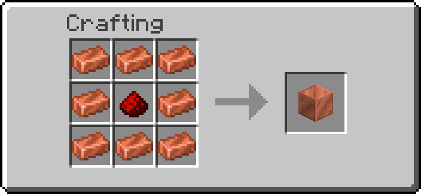
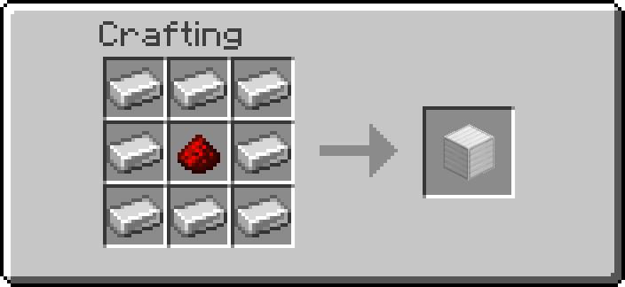
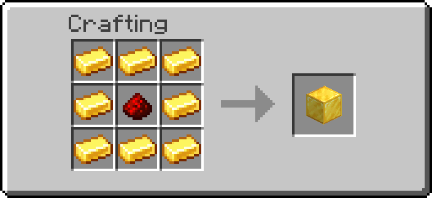
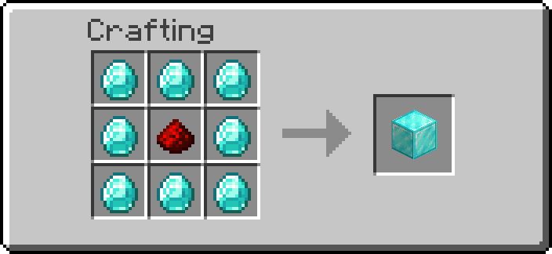
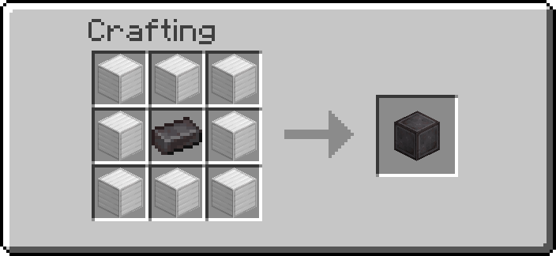

# Multiblocks

Machines built from several blocks around a **Multiblock Base**. Build the structure, then
right-click the base with the [Wrench](tools.md) to assemble it.

## Getting the bases

| Base | Placed as | Recipe |
| --- | --- | --- |
| Copper Base (tier 1) | waxed copper block | { width="200" } |
| Iron Base (tier 2) | iron block | { width="200" } |
| Gold Base (tier 3) | gold block | { width="200" } |
| Diamond Base (tier 4) | diamond block | { width="200" } |
| Netherite Base (tier 5) | netherite block | { width="200" } |

Operators: `/function ra_multiblock:blocks/give_all`.

## Building a machine

1. Place the base for the machine you want (see the table below).
2. Build the rest of the structure around it.
3. Right-click the base with the Wrench. If the structure is complete it assembles; if not, the
   Wrench tells you what is missing.

Breaking any block of an assembled machine takes it apart. The structure is also re-checked
regularly, so a machine whose blocks were changed stops by itself.

| Machine | Base | Does |
| --- | --- | --- |
| [Blast Forge](#blast-forge) | Copper | Smelts and recycles using fuel and heat |
| [Rock Metallic Drill](#rock-metallic-drill) | Copper | Produces Rock in a barrel |
| [Upgrade Platform](#upgrade-platform) | Netherite | Gambles materials into the next tier |

Wear the [Goggles](tools.md) to see an assembled machine's inputs, outputs and status.

## Blast Forge

A 3×3×3 furnace. Seen from above, middle layer, with the **front** at the top:

```text
  brick    OUTPUT    brick         OUTPUT   = barrel: results come out here
  INPUT 1  furnace   INPUT 2       INPUT 1  = barrel: items to smelt
  brick    BASE      brick         INPUT 2  = barrel: fuel
           (lock)                  furnace  = blast furnace
                                   BASE     = Copper Base
                                   (lock)   = optional redstone block: pauses the forge
```

The layers below and above are each a full 3×3 of bricks. Bricks can be nether bricks, red
nether bricks, cracked nether bricks or chiseled nether bricks. The forge can face any of the four
directions.

### Fuel and heat

Fuel in **Input 2** raises the forge's heat. Heat drops slowly over time, and smelting needs heat:
the hotter it is, the faster it works. Fuel is only burned while there is something to smelt.

| Fuel | Heat |
| --- | --- |
| Coal | +50 |
| Charcoal | +40 |
| Coal block | +400 |
| Blaze powder | +500 |
| Blaze rod | +1500 |
| Lava bucket | +5000 |

### What it makes

- **Smelting:** raw iron, gold and copper, iron / gold / copper ores (deepslate too) → ingots;
  ancient debris → netherite scrap; sand and red sand → glass; cobblestone → stone; cobbled
  deepslate → deepslate; and more.
- **Recycling:** iron and gold tools, weapons and armour → their full value in nuggets (an iron
  chestplate gives 72 iron nuggets).

## Rock Metallic Drill

A small copper-tier machine. Side view, drill facing away from you:

```text
  BARREL  BASE      BARREL = input and output
  BARS    STONE     BARS   = iron bars (the drill shaft), under the barrel
                    STONE  = smooth stone, under the Copper Base
```

It puts one **Rock** in the barrel every 2 seconds (40 ticks). A redstone block on the side of the
base opposite the barrel stops it.

## Upgrade Platform

A Netherite Base surrounded by eight **smooth stone** blocks (a flat 3×3).

Drop items on top of it. Every 2 seconds it takes one dropped item and rolls: **10%** chance it
becomes the next tier, otherwise it is destroyed.

| Input | Becomes |
| --- | --- |
| Copper ingot | Iron ingot |
| Iron ingot | Gold ingot |
| Gold ingot | Diamond |
| Diamond | Netherite scrap |
| Raw copper | Raw iron |
| Raw iron | Raw gold |
| Coal | Lapis lazuli |
| Lapis lazuli | Redstone |
| Redstone | Emerald |
| Emerald | Amethyst shard |

A redstone block directly under the Netherite Base locks the platform.

---

## Advanced

- The runtime is `ra_lib_multiblock` (assembly, rotation, validation, disassembly, IO helpers);
  the machines are in `ra_multiblock`. Adding a structure: [Multiblock Library](multiblock-library.md).
- An assembled machine is a marker tagged `ra.multiblock` and `ra.multiblock.<id>`, with
  `data.type`, `data.facing`, `data.properties`, `data.inputs`, `data.outputs` and
  `data.controls`; machine state goes in `data.data` and `data.status`.
- Blast Forge heat is the `ra.heat` score on its marker; `ra.mb_timer` paces machines.
- The structure registry and per-facing data live in `storage ra:multiblock`.
- Bricks are the block tag `#ra_multiblock:blast_forge_bricks`.
- If a machine will not assemble: check there is exactly one base in the middle, the structure
  matches block for block, and nothing else is assembled at the same spot.
