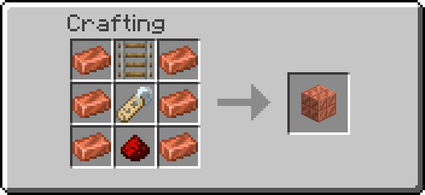
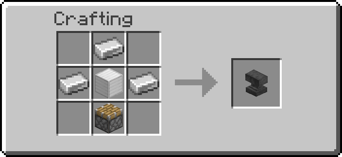
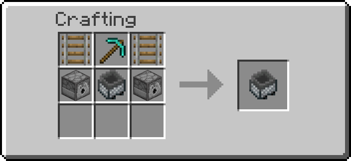

# Railworks

Blocks that work with minecarts and their tracks, and carts of our own. The **Route Rail** sits
under a rail junction and switches it for each cart: carts on its route go one way, every other
cart the other way. The **Ram Upgrade** makes a minecart hurt what it runs into, and the **Rail
Builder** is a hopper minecart that digs a tunnel and lays a straight track by itself.

## Getting them

| Item | Looks like | Recipe |
| --- | --- | --- |
| Route Rail | waxed cut copper | { width="220" } |
| Ram Upgrade | an anvil | { width="220" } |
| Rail Builder | a hopper minecart | { width="220" } |

Route Rail: six copper ingots around a rail, a name tag and a redstone dust. Ram Upgrade: four
iron ingots around an iron block, a piston below. Rail Builder: two rails beside a diamond
pickaxe, over two dispensers beside a hopper minecart. Operators:
`/function ra_railworks:items/give_all` (one of each).

## Route Rail

1. Build a junction with a plain **rail** (only a plain rail can curve; powered, detector and
   activator rails cannot be switched).
2. Break the block under the junction rail, place the Route Rail there and put the rail back on
   top of it.
3. Set the **route** and the two shapes with the Data Handler, and the source with the Wrench.

When a minecart comes within 2 blocks of the junction along one of its lines (the rail's own
row or column, a block up or down for a slope leading in), the Route Rail looks at the nearest such
cart and sets the rail on top to `on_match` if that cart carries the route, or to `on_miss` if it
does not. The rail is set before the cart gets there, even at the game's top speed. A cart on a
parallel track beside the junction is not on its lines and never switches it. A slope on top
(`ascending_*`) is never changed.

### What a cart carries

`source` says where the route is read from:

| `source` | The cart matches when | Set it with |
| --- | --- | --- |
| `name` (default) | its name is exactly `route` | a name tag renamed in an anvil, used on the cart |
| `tag` | it has the entity tag `route` | a [Tag Adder](sensors.md) next to the track, or `/tag` |
| `item` | it is a chest or hopper minecart holding an item whose id is `route` | put the item in it; write the full id, like `minecraft:coal` |
| `rider` | someone or something rides it | `route` is not read |

Names and tags are compared exactly: `Express` and `express` are different routes. An empty
`route` matches nothing (except with `rider`).

### Shapes

`on_match` and `on_miss` are rail shapes, as F3 shows them: `north_south`, `east_west`,
`north_east`, `north_west`, `south_east`, `south_west`. `none` leaves the rail as it is. The
defaults are `south_east` on a match and `north_south` otherwise: a north-south line with a
branch to the east, for carts heading north. A curve named after two sides joins those two
sides: a cart heading north comes in from the south, so it needs `south_east` to leave by the
east; for carts heading south the same branch is `north_east`.

Only a plain rail is changed, and its `waterlogged` state is kept. The rail is set again only when
its shape differs, with a soft click for players who keep block sounds on.

### Example: an express line

A north-south line, carts heading north, and a station on a branch to the east.

1. Route Rail under the junction, `source` = `name`, `route` = `local`, `on_match` = `south_east`,
   `on_miss` = `north_south`.
2. Name a minecart `local` with a name tag. That cart takes the branch to the station; every
   other cart stays on the main line.

With `source` = `item` and `route` = `minecraft:coal`, chest minecarts carrying coal go to the
branch: the same junction sorts freight.

### Wrench and tools

| Tool | Does |
| --- | --- |
| Wrench, Shift+RMB | The cycle menu: **Reads** (`source`: name, tag, item, rider), **On match** and **Otherwise** (the six shapes, then `none`) |
| Goggles | Route, source, both shapes, and whether the last cart matched |
| Data Handler | `route` (any text), `source`, `on_match`, `on_miss` |

A value typed in the Data Handler that is not one of the listed sources or shapes does nothing:
the rail is left as it is.

Server admins can switch the Route Rail off for the world on the **Railworks** settings page.
Breaking it drops it; the rail on top stays where it is.

## Ram Upgrade

An upgrade for a minecart: while the cart goes fast, it hurts the living things in its way.

**Fitting it.** Hold the upgrade, sneak and right-click a minecart, or right-click while riding
one. The upgrade is used up. A chest or hopper minecart opens its inventory
when right-clicked, whatever you do, so those carts cannot take one; a plain minecart (or a TNT,
spawner or command block minecart) can. A cart takes one Ram Upgrade.

**What it does.** While the cart goes faster than 3 blocks a second, each tick it looks at the
block in front of it, in the direction it is going. Every living thing there is hurt:

| Cart speed | Damage |
| --- | --- |
| 3 to 5 blocks a second | 3 (1.5 hearts) |
| 5 to 7 | 5 |
| 7 to 12 (8 is the vanilla top speed) | 7 |
| 12 to 20 (worlds with faster carts) | 10 |
| 20 and more | 14 |

The rider, if there is one, is the attacker: a player riding the cart gets the kill and its
drops, a mob riding it the blame. Left alone: the cart's own riders, every player riding a
minecart, armor stands, and anything that is not alive (items, item frames, other carts). A victim
is hit again only once its hurt animation is over (half a second), so a cart pushing a mob along
does not hit it every tick. The hit knocks it back as any attack does.

**Taking it off.** Shift+right-click the cart with the [Wrench](tools.md): the upgrade comes back
into your inventory. **Breaking the cart** drops it next to the minecart item. A cart removed
without dropping anything (by a creative player, or `/kill`) takes its upgrade with it, as it does
its own item.

## Rail Builder

A hopper minecart that builds a straight track by itself, tunnelling through what is in its way.

1. Place it on a **straight rail** (north-south or east-west), where the track should start.
2. Load it (it is a hopper minecart: five slots): **rails**, a **filler block** for gaps in the
   floor, **redstone torches**, and **powered rails** if you want them.
3. **Push it** the way it should build (walk into it, or start it with a powered rail). It stops,
   says which way it is building, and starts.

Every 6 ticks (a bit over 3 blocks a second) it does one block of track:

- **Digs** the two blocks ahead, at track height and above, as a diamond pickaxe would: stone gives
  cobblestone, ores give their ore, gravel can give flint. What it digs falls onto it and goes into
  its inventory like any hopper minecart's pickup; what does not fit stays on the track behind it.
  Cobblestone it digs is filler it can use.
- **Fills the floor** under the new rail where there is air, water, lava, grass, snow or another
  block you could build into, with one of its filler blocks: cobblestone, cobbled deepslate, stone,
  deepslate, dirt, coarse dirt, netherrack, andesite, diorite, granite, tuff, blackstone, basalt,
  end stone, stone bricks, mud bricks, bricks, sandstone or red sandstone. Sand and gravel are not
  used: they would fall.
- **Lays a rail** and moves onto it. An existing straight rail along the line is ridden over as it
  is, without digging.
- **Lights the tunnel.** Every 8 blocks (and on the first), if it has a redstone torch, it hangs one
  on the tunnel wall at head height, right side first, left if the right has nothing to hold it.
  If it also has a powered rail, the rail under that torch is a **powered rail**, which the torch
  keeps powered: a boost every 8 blocks.

Every rail, filler block and torch comes out of its inventory one at a time, and only once it is
really in the world.

### When it stops

It stops, tells the players within 32 blocks why and how many blocks it built, and **rolls back**
along its track to the block it started from:

| It says | Because |
| --- | --- |
| out of rails | no plain rail left (powered rails alone are not enough) |
| out of filler blocks | the floor needs filling and it has no filler block |
| a block it may not break | bedrock, a barrier, an end portal frame, a portal, reinforced deepslate, a command, structure or test block, budding amethyst, a chest, furnace, spawner or any other block with an inventory or data, or a Redstone Additions block |
| liquid ahead | water or lava where the tunnel goes (it fills liquid under the track, but never digs into it) |
| nothing to build on | the void below the track |
| the way ahead is not loaded | the next blocks are in a chunk that is not loaded |
| the track ahead is not straight | a curve, a slope or a rail across its line in the way |
| a block it could not clear | a block that would not come out, or a rail that would not stay |

On the way back it is pushed along its track at full speed and stops on its start block. If
something blocks the way back for 3 seconds (a mob, a broken rail), it stops where it is. Push it
again to build further: it starts from wherever it stands, in the direction you push.

It only builds straight and level: a slope ahead stops it, and it does not go up or down.

**Breaking it** drops its contents, as any hopper minecart, and the Rail Builder itself (not a
plain hopper minecart). A Rail Builder cannot take a Ram Upgrade.

## Troubleshooting

| What happens | Check |
| --- | --- |
| The rail never changes | It must be a plain rail directly on top of the Route Rail |
| Every cart goes the same way | The route is compared exactly: check the case, and the full item id for `item` |
| A cart takes the wrong branch | Two carts close together: the nearest one decides. Space carts a few blocks apart |
| The rail on top is a slope and never changes | A slope cannot be a junction; put the junction on flat track |
| The curve points the wrong way | Pick the shape joining the side the cart comes from and the side it should leave by |
| A named cart does not match | The name must be the whole route; `local 2` is not `local` |
| The Ram Upgrade does not fit | Sneak while you right-click, or ride the cart; chest and hopper minecarts cannot take it |
| A rammed cart does not hurt anything | It must go faster than 3 blocks a second; riders and players in carts are never hit |
| The Rail Builder does not start | It must sit on a straight rail and be pushed along it |
| The Rail Builder stops at once | Read its message: usually no plain rails, or no filler for a gap in the floor |
| The Rail Builder left items behind | Its five slots were full: what it dug and could not hold stays on the track |

---

## Advanced

### Route Rail data

| Where | What |
| --- | --- |
| `data.properties.route` | the route, text |
| `data.properties.source` | `name`, `tag`, `item` or `rider` |
| `data.properties.on_match`, `data.properties.on_miss` | a rail shape or `none` |
| `data.status.last` | `match` or `no match`, the last cart's result (the Goggles) |

**Nothing is pasted.** The route is copied into storage and the cart's value copied over it;
`store success` is 0 when nothing changed, that is, when both are equal. Tags and items are walked
one entry at a time the same way. A missing value is never copied (a failed copy would read as
equal). A name tag's name is a plain string; a name set by a command may be a text component, and
its `text` is compared as well. The sources and shapes are matched against fixed strings. No
player text reaches a selector or a command, so `route` takes any text.

**What runs.** Each tick the Route Rail tick does the break check every block has. Every other
tick, each Route Rail runs two box selectors for `#ra_railworks:minecarts`, one block wide, along
its rail's row and column (2 blocks each way, a block up and down). A box selector only looks at the
entity sections it covers, so the cost does not grow with the entities loaded elsewhere. A cart in
a box standing on a rail that runs across that box (a north-south rail in the east-west row) is on a
parallel track passing beside the junction and is left out. The other carts found are tagged `ra.rr.near` for the moment it takes to pick the nearest, and only a Route Rail
with a cart in its boxes reads its properties, checks that cart and sets the rail. A cart at 8
blocks a second needs 5 ticks to cover the 2 blocks to the junction, so it is always seen in
time.

### Carts

| Where | What |
| --- | --- |
| tag `ra.rw.ram` | the cart has a Ram Upgrade |
| tag `ra.rw.builder` | the cart is a Rail Builder (a hopper minecart) |
| tag `ra.rw.tracked`, score `ra.rw.id` | the cart has a tracker, and its number |
| scores `ra.rb.state`, `ra.rb.dir` | Rail Builder: 0 idle, 1 building, 2 going back; 1 east, 2 west, 3 south, 4 north |
| scores `ra.rb.start`, `ra.rb.built`, `ra.rb.n` | twice the start block's centre along the line, blocks built, blocks since the last torch |
| marker tag `ra.rw.tracker` | a cart's tracker |

**Dropping what a cart carried.** A minecart has no "broken" event: it is just gone, and the game
drops its own item. So a cart with an upgrade, and every Rail Builder, has a marker that follows
it each tick. When a tracker's cart is gone and a minecart item that dropped in the last two ticks
lies within 2 blocks, the cart was broken there: the tracker drops the Ram Upgrade next to it, or
turns the hopper minecart item into a Rail Builder. Without such an item (creative, `/kill`, a
chunk unloading under the cart) it drops nothing; a cart that comes back gets a new tracker.

**What runs.** Each tick: one selector for Rail Builders and one for tracked carts, plus one over
the trackers. Without Rail Builders, upgraded carts or trackers, these find nothing and nothing
else runs. An idle Rail Builder reads its speed every 4 ticks; a building one works every 6
ticks; one going back is pushed each tick. A cart with a Ram Upgrade reads its speed each tick and,
only above 3 blocks a second, looks at one block-sized box ahead of it.

**The world border.** A data pack cannot read where the world border is, so the Rail Builder does
not stop at it: stop it with a block it may not break (a barrier) if you need to.
