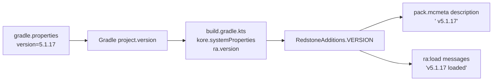

# Release and Versioning

## Where the version lives

**One place:** `version` in `redstone_additions_kore/gradle.properties`.

```properties
version=5.1.17
```

Everything in the Kore build reads it from there:



| Step | Code |
| --- | --- |
| Gradle reads `version` from `gradle.properties` as the project version | built-in Gradle behaviour |
| The Kore plugin passes it to the generator | `build.gradle.kts`: `systemProperties = mapOf(…, "ra.version" to project.version.toString())` |
| The generator exposes it | `RedstoneAdditions.VERSION` = `System.getProperty("ra.version")` |
| Run from the IDE (no plugin) | `VERSION` reads `version=` from `gradle.properties` in the working directory; `"dev"` if there is none |
| Used by | the `pack.mcmeta` description (`RedstoneAdditions.build`) and the two load messages (`hub/Load.kt`) |

Nothing else in `src/` may contain the version number. To check:

```bash
grep -rn "5\.1\.17" redstone_additions_kore/src --include=*.kt | grep -v migrations
```

Hits in `ra/migrations/` are **not** the version. Migration step names (`5.1.7-to-5.1.8`) are
identifiers tied to the two versions they bridge; a find-and-replace that bumps them renames the
chain into nonsense (`5.1.9-to-5.1.9`). The same applies to version numbers in comments that
date a bug ("the v5.1.6 bug").

A one-off build at another version needs no edit:

```bash
./gradlew koreBuild -Pversion=5.2.0-rc1
```

## Bumping the version

1. Edit `version` in `redstone_additions_kore/gradle.properties`.
2. In `redstone_additions_kore/CHANGELOG.md`, rename `## [Unreleased]` to `## [vX.Y.Z] - <date> - <title>`
   (the publish script requires a `## [vX.Y.Z]` heading), and mirror it in `docs/changelog.md`.
3. Update the version mentioned in prose docs: the `readme.md` badge and `docs/index.md`
   (header, and move the "Coming In The Next Release" notes under a "What Is New In vX.Y.Z"
   heading). These are documentation, not build inputs. Regenerate `readme.bbcode` from the
   readme ([Markdown to BBCode](markdown-to-bbcode.md)).
4. If the change needs a world migration, add a step to `ra.migrations` named for the step it
   bridges, append it to `MigrationsPart`'s list, and make it safe to run twice.
5. `./gradlew koreBuild` (strict) and check the description:

   ```bash
   grep -o 'v[0-9][^"\\]*' build/kore/redstone_additions/pack.mcmeta
   ```

The beet pipeline edited the version by hand in `pack.mcmeta` and twice in
`ra/function/load.mcfunction`; steps 1 and 5 replace all three.

## Release checklist (Kore)

- [ ] Version bumped (above).
- [ ] `./gradlew koreBuild` passes **strict** — no `-Pra.strict=false` for a release.
- [ ] `python3 tools/compare_reference.py --all` reviewed: only expected differences.
- [ ] In game, on a fresh world and on an upgraded one: `/reload` with no errors in the log;
      place, break and configure every block type; `/function ra:give_all_items`; wrench, Data
      Handler, Creative Data Handler, goggles; assemble and break a Blast Forge; uninstall
      (confirm and cancel).
- [ ] Tag and push (`git tag vX.Y.Z && git push origin vX.Y.Z`); CI publishes (next section).

## Publishing

Pushing a tag `vX.Y.Z` runs `.github/workflows/publish.yml`, which publishes two Modrinth
versions through `.github/scripts/modrinth_publish.py`:

| Version | File | Loaders |
| --- | --- | --- |
| `X.Y.Z` | `redstone_additions_vX.Y.Z(RELEASE)-0000.zip`, the data pack | `datapack` |
| `X.Y.Z+mod` | `redstone-additions-X.Y.Z.jar`, the same files plus Fabric / Quilt / Forge / NeoForge metadata | `fabric`, `forge`, `neoforge`, `quilt` |

The workflow, step by step:

| Step | What it does | Fails when |
| --- | --- | --- |
| Set up JDK 25, Gradle | `actions/setup-java` (Temurin 25), `gradle/actions/setup-gradle` | |
| Resolve version | the tag without its `v`, or the manual-run input | the value has characters other than letters, digits, dots, hyphens |
| Check version | compares it with `version` in `redstone_additions_kore/gradle.properties` | they differ |
| Build with Kore | `./gradlew koreBuild` in `redstone_additions_kore/` — strict | any call to an undefined function |
| Publish | `modrinth_publish.py`: checks `gradle.properties` and the built `pack.mcmeta` again, takes the `## [vX.Y.Z]` section of `redstone_additions_kore/CHANGELOG.md` as release notes, zips `build/kore/redstone_additions/`, builds the jar, uploads both | the description lacks `vX.Y.Z`; the changelog has no `## [vX.Y.Z]` heading; `MODRINTH_TOKEN` is unset |
| Upload packages | keeps both files as a workflow artifact | |

`GAME_VERSIONS` in the workflow is `"26.3"`. When Kore moves to a new Minecraft version
(`gradle/libs.versions.toml`), update it there too.

A version number already on Modrinth is skipped, so re-running a half-failed workflow is safe.

To check the packages locally without uploading:

```bash
cd redstone_additions_kore && ./gradlew koreBuild && cd ..
GAME_VERSIONS=26.3 python3 .github/scripts/modrinth_publish.py 5.1.17 --dry-run --out dist
```

### The changelog

Release notes come from `redstone_additions_kore/CHANGELOG.md`. Write changes under
`## [Unreleased]` as they land; when bumping, rename that heading to `## [vX.Y.Z] - <date> - <title>`.
The publish script only accepts a `## [vX.Y.Z]` heading. `docs/changelog.md` mirrors it for the
docs site.
