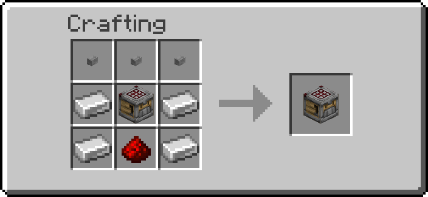

# Security

Blocks that open only for the right code. The **Keypad** is a crafter whose slots are
its keys: switch the right slots off and it gives a redstone pulse.

## Getting them

| Item | Looks like | Recipe |
| --- | --- | --- |
| Keypad | crafter | { width="220" } |

Operators: `/function ra_security:items/give_all` (a Keypad).

## Keypad

The Keypad is a crafter. Open it and click its empty slots to switch them off and on,
as on any crafter: the **code** is the set of slots switched off. It never crafts.

1. Place the Keypad. You are its **owner**.
2. Open it, switch off the slots of your code (at least one), close it and wait 1 second. The
   first combination entered becomes the code: players nearby are told "code set", and every slot
   is switched back on.
3. Put an **iron block** next to it (any of the 26 blocks around it, corners included) and wire
   that to a door, a piston or anything else. On the right code the iron block becomes a
   redstone block for the pulse, then iron again, like the sensors' output.
4. To open, switch off the same slots and wait 1 second. The Keypad chimes and gives a
   redstone pulse of `pulse` ticks (20, one second, by default).

**Entering.** A combination counts as entered once the grid has not changed for **1 second**;
closing the screen is not needed, and changing your mind within that second simply restarts
the wait. Whatever the result, every slot is switched back on afterwards. Switching every slot
back on before the second is up enters nothing.

| Combination entered | What happens |
| --- | --- |
| No code set yet | It becomes the code ("code set") |
| The code | A redstone pulse (iron blocks around it become redstone blocks) and a chime |
| Anything else | "Wrong code" and a buzz; counts as a failed try |

**The pulse.** A crafter gives no redstone signal, so the Keypad uses the pack's standard
output: for `pulse` ticks every iron block in the 3×3×3 around it is a redstone block, then iron
again. The Keypad itself stays a crafter. A combination entered during a pulse is handled as
usual: the right code starts the pulse again from that moment, a wrong one counts as a failed
try. A pulse cut short by breaking the Keypad, by its chunk unloading or by a `/reload` still
ends with the iron blocks back.

**Lockout.** A combination entered during a lockout is refused, even when the code was cleared
meanwhile, so the lockout cannot be skipped by setting a new code. After `max_attempts` wrong tries in a row (3 by default) the Keypad refuses every
try for `lockout` seconds (30 by default), and says how long is left. A right code resets the
count. Only admins can change these two, so nobody can turn the lockout off to guess the code.

**No items.** Anything put into its grid, by hand or by a hopper, is thrown back out of its front
face at once (at most one chat line a minute says so), so a redstone signal on it never crafts
anything.

**Secrecy.** The code is never shown to anyone. The Goggles say only whether a code is set, who
owns the Keypad and its state (ready, open, locked); the Data Handler lists its
settings, not the code; the Clipboard does not copy it. Someone else with the grid open while you
type it sees the slots change, and a comparator reads how many slots are off, so type it unwatched.

### Changing the code

The owner or an admin clears the code with a plain **Wrench** click on the Keypad; the
next combination entered then becomes the new code. Breaking the Keypad also loses it.

### Wrench and tools

| Tool | Does |
| --- | --- |
| Wrench, RMB | The owner or an admin clears the code |
| Wrench, Shift+RMB | Steps the pulse through 2, 10, 20 and 40 ticks |
| Goggles | Code (set or not set), owner, state, pulse |
| Data Handler | `pulse` (1–200 ticks); `max_attempts` (1–20) and `lockout` (1–3600 s), admins only; `owner` (read-only) |

Server admins set the defaults a new Keypad starts with on the **Security** settings page, and
can switch the Keypad off for the world there.

Breaking the Keypad drops it; the code is lost with it.

## Troubleshooting

| What happens | Check |
| --- | --- |
| Nothing happens after switching slots | Wait 1 second without touching the grid; switching every slot back on enters nothing |
| "Code accepted" but nothing opens | The output is an iron block next to the Keypad (corners count): wire the iron block, not the Keypad |
| "Keypad code set" when you meant to open it | It had no code (new, or cleared): your combination is now the code |
| "Wrong code" | The code was changed, or the slots differ; it is the set of slots that counts |
| "This Keypad is locked" | Too many wrong tries; wait the time it says |
| "Only its owner or an admin can clear the code" | Someone else placed it; ask them or an admin |
| Items pop out of it | It takes no items; use empty slots only |
| Owner shows `?` | The owner's name could not be read when it was placed; the owner is still known by their UUID |

---

## Advanced

### Keypad data

| Where | What |
| --- | --- |
| `data.properties.pulse` | pulse length in ticks |
| `data.properties.max_attempts`, `data.properties.lockout` | wrong tries before a lockout, its length in seconds (admin-only) |
| `data.properties.owner` | the owner's name (read-only) |
| `data.data.code` | the code: a 9-bit mask of the switched-off slots (sum of 2^slot) |
| `data.data.seen` | the grid's mask at the last look |
| `data.data.said` | game time it last said it takes no items |
| `data.data.due` | game time the current entry counts as entered |
| `data.data.owner` | the owner's UUID |
| `data.data.fails` | wrong tries since the last right one or lockout |
| `data.data.until`, `data.data.locked_until` | game times: the end of the pulse, the end of the lockout |
| `data.status.code`, `data.status.owner`, `data.status.state` | what the Goggles show |

The code is kept in `data.data`, never in `data.properties`, which is all the Data Handler, the
Clipboard and the Goggles read. The crafter's `disabled_slots` is read as a mask
(`ra_security:blocks/keypad/mask`): the array is copied into a list one entry at a time and each
slot is tested with an NBT pattern, so the order of the array does not matter and a missing or
empty array is 0. Entering compares the entry's mask with the code's. Nothing the player does is
pasted into a command.

**What runs.** Every tick, the block's tick gives each Keypad one block test and an
`if items` test (the container's slots, no NBT read). Items are thrown out the tick they are
seen; the crafter's own craft is a scheduled block tick 4 ticks after its redstone edge, which
runs after the data pack's tick, so it never sees them. The grid is read only every 4 ticks, only
with a player within 10 blocks (nobody else can click it), and only when a slot is off or an
entry is under way: a mask other than `data.data.seen` (every slot back on included) tags it
`ra.sec.kp_entry` and sets `data.data.due` 20 ticks ahead, and an unchanged mask on a keypad
whose `due` has passed enters it there and then. So an entry lands 20 to 23 ticks after the last
click; the once-a-second clock below only enters the ones whose players walked away first.

A pulsing Keypad carries `ra.sec.kp_pulse`, a locked one `ra.sec.kp_locked`, one
waiting for its grid to settle `ra.sec.kp_entry`, and any of them `ra.sec.kp_timed`; a schedule
(`ra_security:blocks/keypad/clock/run`) runs every tick while one pulses and once a second while
only locked or waiting ones are left, and stops with none. The pulse is
`fill ~-1 ~-1 ~-1 ~1 ~1 ~1 redstone_block replace iron_block`, and at its end the same fill
back to `iron_block`. Broken mid-pulse, the keypad runs the fill back before its marker is
removed; one still tagged `ra.sec.kp_pulse` after a reload or an unload restarts the clock from
its block tick, which ends the pulse when its time is up (at once if it already is). The
owner's name is read at placement from a player head given the placer's profile (`fill_player_head`).
