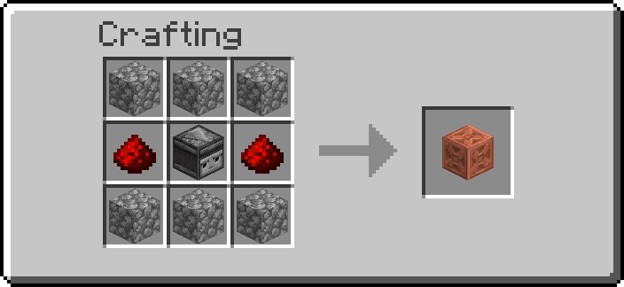
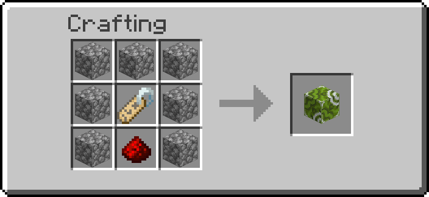
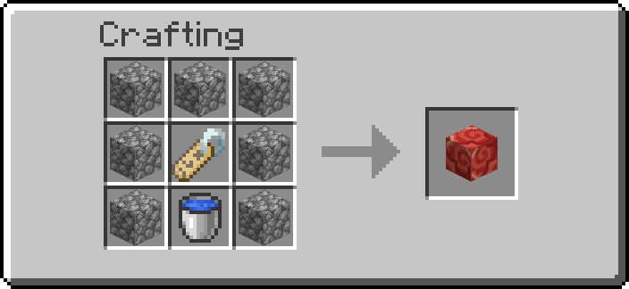
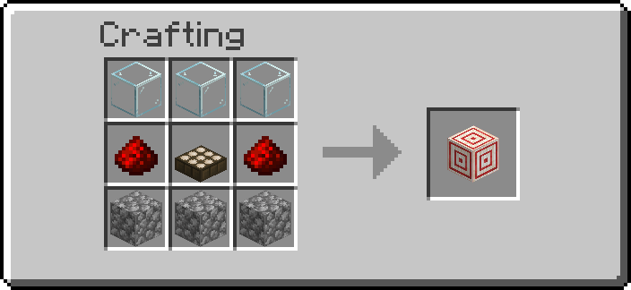
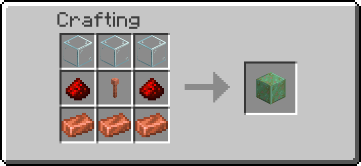

# Sensors

Blocks that react to entities and to the world: one detects entities, two add or remove scoreboard
tags on them, one reads the light level and one the weather and time of day. Handy for adventure
maps, mob farms, trigger zones and automatic lighting.

## Getting them

| Block | Looks like | Recipe |
| --- | --- | --- |
| Entity Detector | waxed chiseled copper | { width="220" } |
| Tag Adder | green glazed terracotta | { width="220" } |
| Tag Remover | red glazed terracotta | { width="220" } |
| Light Sensor | target block | { width="220" } |
| Weather Sensor | waxed weathered copper | { width="220" } |

Operators: `/function ra_sensors:items/give_all`.

## Using them

The Entity Detector, Tag Adder and Tag Remover are configured with a **target selector** (`entity_selector`), the same syntax as
commands: `@e[type=zombie,distance=..8]`, `@a[tag=red_team]`, … Edit it with the
[Data Handler](tools.md).

!!! note "Admins only, unless the server allows it"
    A selector can reach any entity in the world and a Tag Adder can hand any tag to anyone, so
    selectors and tags are changed by players with server-settings access. An operator can let
    everyone edit them with **Players may edit entity selectors and tags** on the Sensors page of
    the [server settings](settings.md).

What they accept:

- **Selector:** `@a`, `@e`, `@n`, `@p`, `@r` or `@s`, optionally followed by one `[...]`. Spaces
  only inside the brackets, quotes only as `"..."` (for `name="Bob Smith"`), no backslash, and
  nothing after the closing `]`.
- **Tag:** letters, digits and `_ . + -`, no spaces, and never starting with `ra.` (the pack's own
  tags, which include server-settings access).

A value that does not fit is refused when you type it, and a block holding one (from an older
world, or written with a command) does nothing until it is corrected: the Entity Detector stays
off, the Tag Adder and Tag Remover do not fire.

| Block | When | Does | Default settings |
| --- | --- | --- | --- |
| Entity Detector | every tick | Output is on while at least one entity matches the selector | `@e[type=minecraft:pig,distance=..5]` |
| Tag Adder | when it gets powered | Adds every tag in `tags` to every matching entity | `@e[type=pig,distance=..5]`, tags `["custom_tag"]` |
| Tag Remover | when it gets powered | Removes every tag in `tags` from every matching entity — or **all** of their tags if `tags` is an empty list (never the pack's own `ra.` tags, and never on the pack's own entities) | `@e[distance=..3]`, tags `["custom_tag"]` |

### The tag list

The Tag Adder and Tag Remover each take a list of up to 16 tags, `tags`; a new block starts with
one, `custom_tag`. In the [Data Handler](tools.md) it is a header that counts them,
`tags: list (1/16) [Add] [Edit all] [List]`; **[List]** shows one entry per line under it:
**[Edit]** changes an entry, **[Remove]** deletes it,
**[Add]** asks for a new one and puts it at the end (also on an empty list; greyed out, with
"Maximum 16 entries" on hover, once the list is full), and **[Edit all]** takes the whole
list at once, written like `["red_team","in_zone"]`. A new entry is checked like the others
before it is added. Like the selector, the list is changed
by admins only unless *Players may edit entity selectors and tags* is on.

| `tags` | Tag Adder | Tag Remover |
| --- | --- | --- |
| `["a","b"]` | adds `a` and `b` | removes `a` and `b`, leaves every other tag |
| `[]` (empty) | does nothing | clears **every** tag except the `ra.` ones |

Each tag is checked again every time the block fires. A tag that is not allowed (`ra.admin`, one
with a space, …) is skipped and the others still apply; the Goggles then show **Refused tags: N**
until the list is fixed. An empty entry (`""`) is skipped without a warning. A list whose entries
are all refused does nothing: it is never read as "clear them all", only a truly empty list is.

The Goggles show the selector (**Targets**) and the first three tags (**Tags**, then "+N more").

!!! note "Blocks from before v6.0.2"
    Older Tag Adders and Tag Removers had a single `tag`. They are converted when the world
    loads: the tag becomes the list's one entry (`"red_team"` becomes `["red_team"]`). A Tag
    Remover without a tag, which cleared every tag, gets the empty list and still does; a Tag
    Adder without one gets the empty list and still adds nothing.

**Detector output:** put **iron blocks** next to the Entity Detector (anywhere in the 3×3×3 cube
around it). They turn into **redstone blocks** while it detects something.

Tag Adder and Tag Remover act once per power-on (a button press or a pulse), not continuously.
The Entity Detector never counts Redstone Additions' own machines.

!!! tip "Keep selectors small"
    A selector with a `distance` or `type` filter is cheap. A bare `@e` checks every entity in
    the world every tick.

## World sensors

These read the world rather than entities. They are read **once a second** (every 20 ticks), all
of them on one shared clock that only runs while one is loaded.

### Light Sensor

Outputs the **light level of the block in front of it** as a redstone signal of the same strength,
0 to 15. The front is the face that looked at you when you placed it, as with a dispenser (look up
or down to aim it up or down); the Goggles show it as **Facing**, with the level as **Light**.

The level is the one mobs and crops see: the brighter of the block light and the sky light at
that time of day (so it drops at night and under rain). Put something solid in front and it
reads 0.

**Output:** the sensor itself is the source, like a daylight detector. Redstone dust, a repeater
or a comparator next to it reads the level directly; no iron blocks are needed. An arrow that hits
it (it is a target block) pulses it as usual until the next reading.

### Weather Sensor

Turns its output **on** while the world matches its **mode**, and off otherwise:

| `mode` | On while |
| --- | --- |
| `rain` (default) | it rains (or snows) |
| `thunder` | a thunderstorm is going on |
| `day` | it is day: time of day 0 to 12999 and 23000 to 23999, sunrise included |
| `night` | it is night: time of day 13000 to 22999, when monsters spawn |

Shift+right-click it with the **Wrench** to step through the modes, or set `mode` with the
[Data Handler](tools.md). The Goggles show the mode and whether the output is on.

Rain and thunder are the weather of the whole dimension, as `/weather` sets it: a sensor in a desert
still turns on when it rains elsewhere. Day and night follow the overworld clock, also in the
Nether and the End.

**Output:** like the Entity Detector, put **iron blocks** next to it (anywhere in the 3×3×3 cube);
they turn into **redstone blocks** while it is on.

## Ideas

- A pressure plate into a Tag Adder marks players who entered a zone; a Tag Remover at the exit
  clears it.
- An Entity Detector set to `@e[type=item,distance=..2]` turns on when something is dropped on it.
- A Light Sensor facing out of a window, into an inverter, switches lamps on as it gets dark; a
  comparator behind it can compare the level against a fixed strength instead.
- A Weather Sensor on `rain` closes a roof with pistons; one on `night` lights a village.

---

## Advanced

- Properties on the marker: `data.properties.entity_selector`, and on the Tag Adder / Remover
  `data.properties.tags` (a list; the single `data.properties.tag` of blocks from before v6.0.2
  is turned into it by the 6.0.1-to-6.0.2 migration and removed). A marker without `tags` does
  nothing when powered, and its Goggles say **not set**. `data.status.skipped` holds the number of refused tags from the last
  pulse, and is removed when none were refused.
- The selector and the tags are pasted into macro commands
  (`ra_sensors:blocks/entity_detector/detect_macro`, `…/tag_adder/add_listed_macro`, …). Before each
  use, `ra_lib:safe/guard` checks them (formats `SELECTOR` and `TAG`, see
  [Tools and Registries](tools-and-registries.md#text-formats)); the value last found safe is
  cached in `data.data.safe.<name>`, so an unchanged value costs one comparison. Each entry of
  `tags` is checked with `ra_lib:safe/check` (format `TAG`) on every pulse, and only the entries
  that pass are pasted into `tag @s add|remove $(t)` (`ra_sensors:tags/*`). The selector is
  evaluated once per pulse; each matched entity then gets the whole list.
- Tag Adder / Remover fire on a rising edge: `ra.powered` without `ra.was_powered`, from
  `ra_lib:redstone/detect`.
- World sensors are updated by `ra_sensors:poll/run`, scheduled every 20 ticks by
  `ra_sensors:poll/start` while `#sn.poll ra.temp` is 1. A world sensor's tick starts it when the
  flag is 0 and one of its markers is loaded; the run schedules itself again only while one still
  is. Load resets the flag, so a lost schedule restarts on the next tick.
- Light Sensor: the marker (placed with `dir_type` 3, the facing on the marker only) runs four
  `location_check` predicates on `light` at `^ ^ ^1`, a binary search, and writes the result to
  `data.status.level`; `data.status.facing` is the facing it was placed with. The block is a
  `minecraft:target`, set to `target[power=<level>]` with `fill ... replace minecraft:target`: a
  target replacing a target keeps its power, while one placed over another block would reset to 0.
  The predicate's `light` is the combined level, the only one a data pack can test, so there is no
  block-light or sky-light mode.
- Weather Sensor: `data.properties.mode`, tested with the loot predicates `weather_check`
  (`raining` / `thundering`) and `time_check` on `clock` `minecraft:overworld`, `period` 24000,
  `value` 13000..22999 for night (`day` is its negation). The result is written to
  `data.status.output` ("on" / "off"). The shell is switched with one `fill` or the other, never
  off then on, so a steady output does not pulse every second. The wrench row `Mode` runs
  `ra_sensors:blocks/weather_sensor/cycle_mode` (rain, thunder, day, night; anything else goes to
  rain), which updates the output at once.
