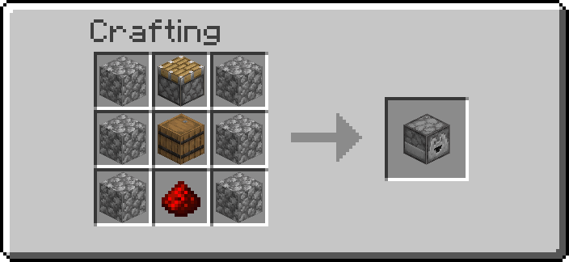
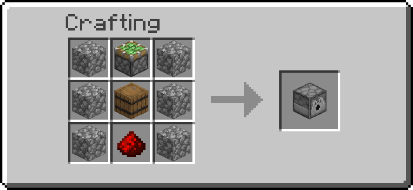

# Storage

Pack a whole chest into one item, and unpack it somewhere else. The **Boxer** turns a container's
contents into an **Item Crate**; the **Unboxer** empties crates back out. Crates stack to 64,
so a single hopper line or pipe can carry whole inventories.

## Getting them

| Block | Looks like | Recipe |
| --- | --- | --- |
| Boxer | dropper | { width="220" } |
| Unboxer | dispenser | { width="220" } |

Item Crates have no recipe: a Boxer makes them.

Operators: `/function ra_storage:items/give_all` (Boxer, Unboxer and a crate),
`/function ra_storage:items/give_storage_box` (one empty crate).

## Using them

### Packing with the Boxer

1. Place the Boxer facing the container that should **receive** the crates.
2. Put the container to **pack** directly behind the Boxer.
3. Power the Boxer. Everything in the container behind it goes into one Item Crate, and the crate
   goes into the container in front.

The source is only emptied once the crate has been delivered, so nothing is lost when the output
is full — the Boxer simply waits.

### Unpacking with the Unboxer

1. Place the Unboxer facing the container that should **receive** the items.
2. Open the Unboxer (it has a chest-like inventory) and put Item Crates inside it.
3. Power the Unboxer. One crate is emptied completely into the container in front, and the empty
   crate disappears.

If the output fills up, the rest of the crate's items are dropped on the ground rather than
destroyed.

Both blocks work at most once every 4 ticks, like a hopper.

### Item Crates

- Hover over a crate to see its first five stacks in the lore (`... and more` if there are more).
- Crates **cannot be placed** as blocks, so their contents cannot be lost by accident.
- Crates stack up to 64.

## Troubleshooting

| Problem | Check |
| --- | --- |
| Boxer or Unboxer does nothing | It is powered, and there is a container behind it (Boxer) / in front of it |
| Boxer does not empty its input | The container in front is full |
| Items on the floor next to the Unboxer | The output container was full |

---

## Advanced

- Default inputs and outputs (`data.properties`): Boxer `input1 = "^ ^ ^-1"`,
  `output1 = "^ ^ ^1"`; Unboxer `input1` is its own position (its own inventory),
  `output1 = "^ ^ ^1"`. Both must be in `#ra_lib:containers`.
- The Unboxer is a barrel wearing a dispenser skin, so redstone never makes it fire crates out.
- An Item Crate is a `minecraft:command_block` drawn as a player head (`item_model
  minecraft:player_head`). The skin is BoxMan01234's, written into the `profile` component as a
  static profile (its id and `textures` property) so it needs no name lookup; a crate the Boxer
  adds to is given it too, which updates crates from before 6.0.3. Survival players cannot place
  command blocks, which is what protects the contents.
- Crate data: `custom_data.ra.storage_box.items` (the stacks), `custom_data.ra.storage_box.preview`
  (lore lines), marker `custom_data.ra.item_box`. Older crates marked `ra.storage_box_item` are
  still accepted.
- A prefilled bundle: `/function ra:items/bundles/give_storage_bundle`.
