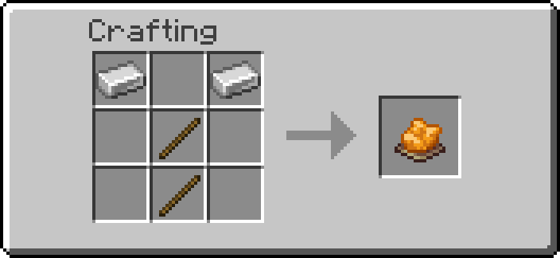
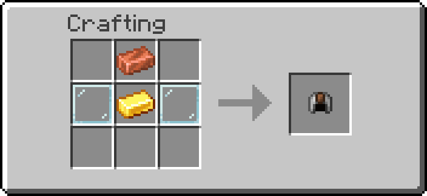
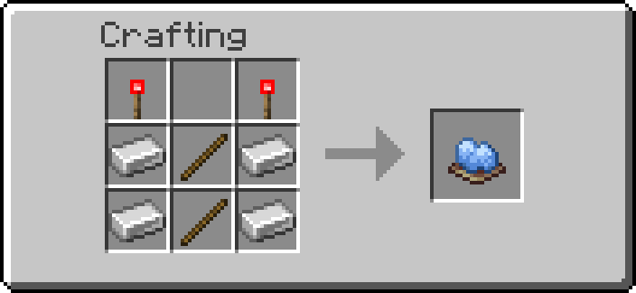
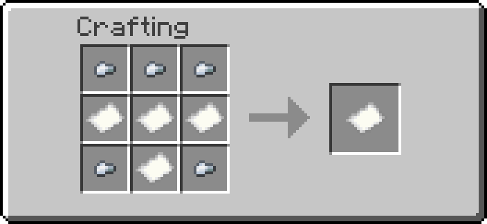
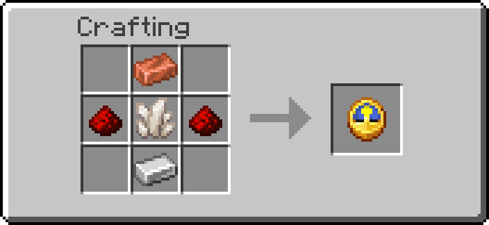

# Tools

Five tools for setting up and checking your machines. Each does one job: the **Wrench** changes
blocks, the **Goggles** show what they are doing, the **Data Handler** edits their settings in
detail, the **Clipboard** copies settings between blocks, and the **Multimeter** reads networks.

## Getting them

| Tool | Looks like | Recipe |
| --- | --- | --- |
| Wrench | an orange rod | { width="200" } |
| Goggles | an orange leather helmet | { width="200" } |
| Data Handler | a light blue rod | { width="200" } |
| Clipboard | paper | { width="200" } |
| Multimeter | a clock | { width="200" } |

Tools do not stack: each sits in its own slot.

Operators: `/function ra:give_all_items` gives everything in the pack; each tool also has its own
give function (`/function ra:tools/wrench/give`, `ra:tools/goggles/give`,
`ra:tools/data_handler/give`, `ra:tools/clipboard/give`, `ra:tools/multimeter/give`).

## Wrench

| Action | Does |
| --- | --- |
| Shift + right-click a block | Cycles its settings |
| Right-click a Wireless Emitter or Receiver | Turns it on or off |
| Right-click a Multiblock Base | Assembles the machine built around it ([Multiblocks](multiblocks.md)) |

What Shift + right-click does depends on the block:

- **No settings** — it says so.
- **One setting** — it changes straight away.
- **Several settings** — a menu in chat lists each one with its current value and a
  `[ CYCLE ]` button. The menu stays tied to that block, so you can look away while clicking.

```
── electric_furnace ──
  Output: [under]   [ CYCLE ]
  Power: [low]      [ CYCLE ]
```

| Block | Wrench settings |
| --- | --- |
| UNI Gate | gate type |
| Liquid Drain | mode, rate |
| Electric Furnace | output face, power mode |
| EU Consumer | rate |
| Creative Fluid Source | fluid |
| Ender Item / Fluid / Power Vault | mode |

## Goggles

Wear them or hold them. Every Redstone Additions block within 16 blocks shows a label with its
name and live status, refreshed once a second. A value the block has not worked out yet shows
`N/A` in red.

The Goggles only read; use the Wrench or the Data Handler to change things. Server operators can
change the range and refresh rate in [Settings](settings.md).

## Data Handler

Shift + right-click a block to open its settings in chat.

| Button | Does |
| --- | --- |
| **[Modify]** | Change a number or text: you get a book to write the new value in |
| **[Toggle]** | Switch an on/off setting |
| **[Edit list]** | Change a list (for example a Teleport Anchor's targets), written like `["A","B","C"]` |
| **[Set from hand]** | For item settings (an Item Pipe filter): use the item you are holding |
| **[Cancel Input]** | Abandon an edit you started |
| **[Refresh]** | Redraw the menu with current values |

Some values are the block's own working numbers (a generator's output rate, a valve's rate) and
cannot be changed: they show a crossed-out red `[Modify]`, with the reason when you hover it.

If your inventory is full, the input book cannot be given — free a slot and try again.

## Clipboard

Copies settings from one block to others of the **same kind**.

1. Shift + right-click a block: it becomes the source.
2. Shift + right-click other blocks of the same kind: each gets the source's settings.
3. Shift + right-click at nothing to clear the source.

## Multimeter

Right-click a block to read its network in chat: which network it is on, what the network holds
and its capacity, what this block adds, and what it uses or makes. A pipe carrying several fluids
at once lists each one with its amount. Two blocks showing different network numbers are not
connected. See [Transport Networks](transport-networks.md).

---

## Advanced

- **Creative Data Handler** (`/function ra:tools/creative_data_handler/give`): edits anything,
  including locked values, adds and removes properties and shows a block's internal data. Meant
  for building the pack, not for play.
- The Wrench offers the rows each block registers (`ra:tools/wrench/init_registry`); locked values
  are listed in `ra:tools/readonly/init_registry` and are hidden from the Wrench and locked in the
  Data Handler. See [Tools and Registries](tools-and-registries.md).
- The Clipboard copies only `data.properties`, never a block's internal state (`data.data`).
- The Data Handler's menu buttons work through `/trigger ra.dh.action` and `/trigger ra.edit_type`,
  the Wrench menu through `/trigger ra.wrench`; these triggers are only enabled while you hold the
  tool (and for a short while after).
- Goggles labels are `text_display` entities tagged `ra.billboard`.
