# Transport Networks

Pipes for liquids and gases, wires for electricity (EU), and the machines that fill, store and use
them: pumps, tanks, boilers, generators, solar panels, batteries, an electric furnace and lights.

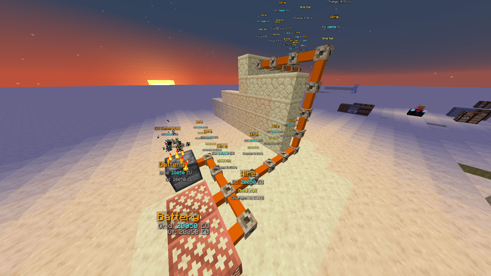

*An EU grid: generator, wire, battery and consumers, with the Goggles showing what each one holds.*

## Getting them

| Block | Recipe |
| --- | --- |
| Copper Pipe | 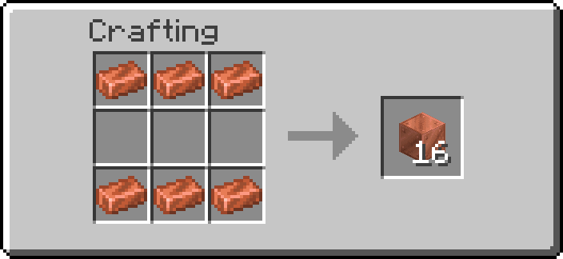{ width="220" } |
| Liquid Tank | 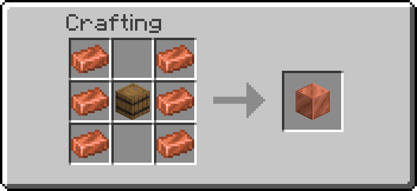{ width="220" } |
| Liquid Pump | 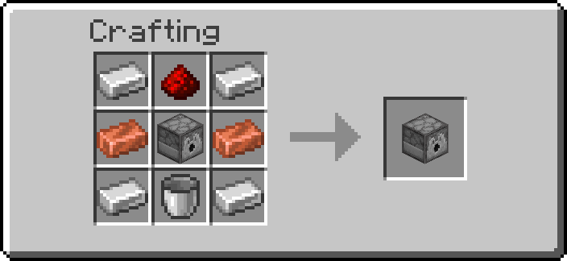{ width="220" } |
| Liquid Drain | 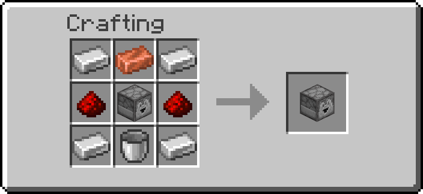{ width="220" } |
| Liquid Valve | 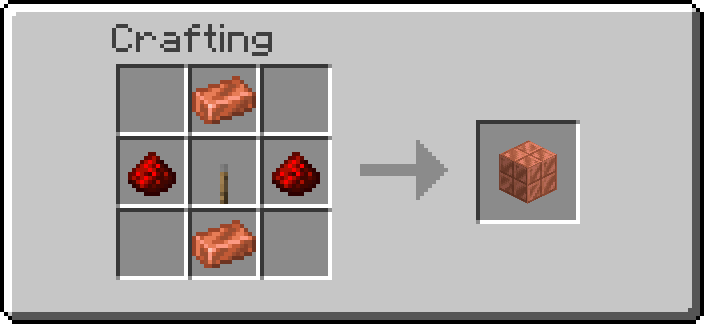{ width="220" } |
| Liquid Filter | 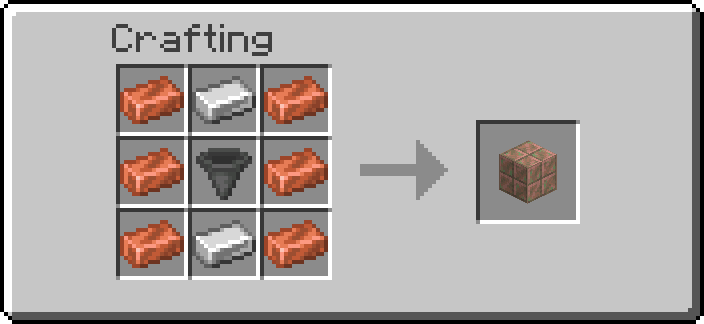{ width="220" } |
| Gas Tank | 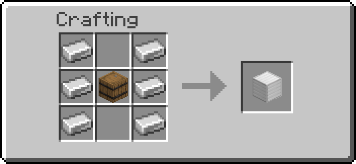{ width="220" } |
| Gas Pump | 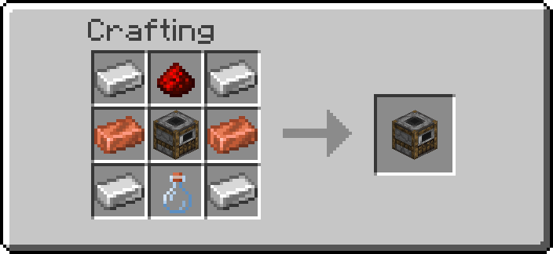{ width="220" } |
| Gas Valve | 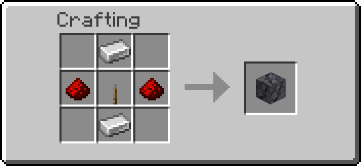{ width="220" } |
| Boiler | 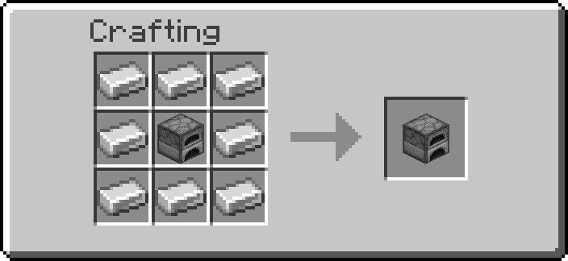{ width="220" } |
| Wire | 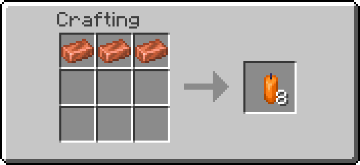{ width="220" } |
| EU Generator | 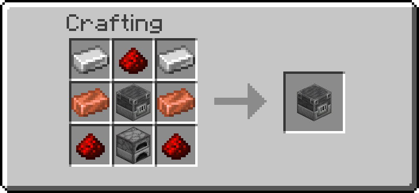{ width="220" } |
| Solar Panel | 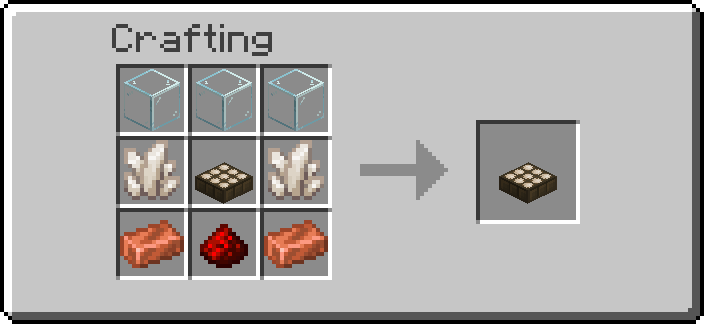{ width="220" } |
| Battery | 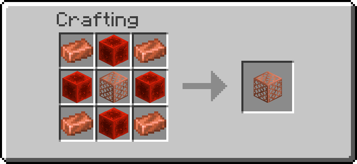{ width="220" } |
| EU Switch | 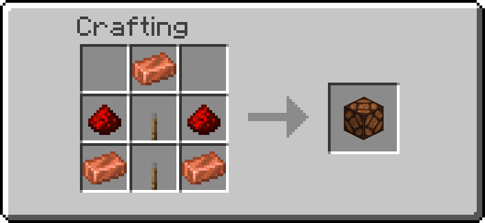{ width="220" } |
| EU Breaker | 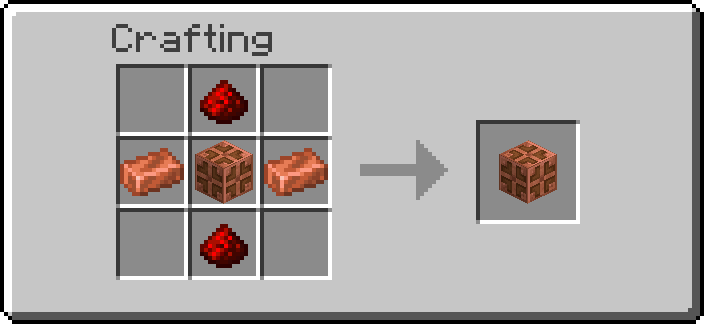{ width="220" } |
| EU Consumer | 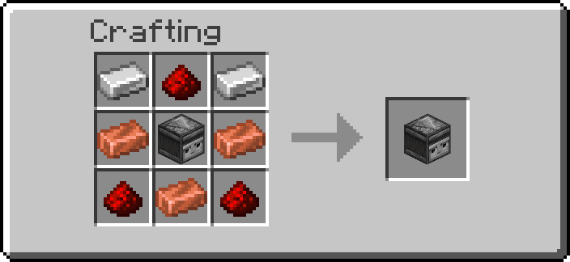{ width="220" } |
| Electric Furnace | 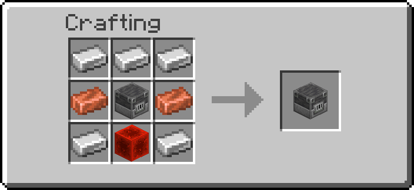{ width="220" } |
| Industrial Light | 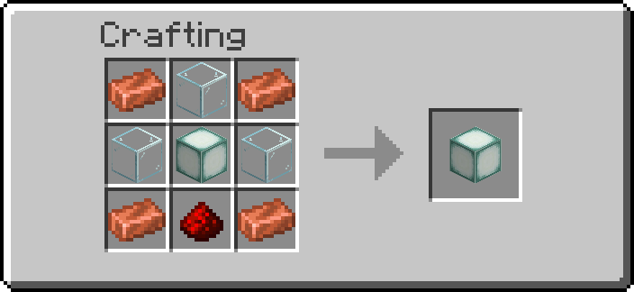{ width="220" } |

Operators: the **Wires Bundle** (`/function ra:items/bundles/give_wires_bundle`) has everything;
`/function ra_wires:items/give_creative` gives the two creative sources.

## How networks work

Blocks of the same family that touch form one **network**:

- **Fluid network** — pipes, tanks, pumps, drains (liquids and gases share the same pipes).
- **Electric grid** — wires, generators, solar panels, batteries, consumers, the furnace, lights.

A network has **one shared pool**. Whatever a pump or generator adds is instantly available to
every drain or machine on the same network, however far away. Each block adds to the network's
capacity:

| Block | Holds |
|---|---|
| Pipe | 1000 mL |
| Pump, Drain | 5000 mL |
| Liquid Tank, Gas Tank | 100000 mL (20 buckets) |
| Wire, EU Switch, EU Breaker | 0 EU |
| EU Generator, EU Consumer, Solar Panel, Electric Furnace | 50 EU |
| **Battery** | 10000 EU |

Fluids are measured in millilitres: **a bucket is 5000 mL**.

!!! tip "Wire stores nothing"
    Without a Battery, power that is not used straight away is lost. Put Batteries on any grid
    with a generator or solar panel.

Different families never mix, so an electric wire and a pipe can run side by side.

## Fluids

### Getting fluid in and out

| Block | Does |
| --- | --- |
| **Liquid Pump** | Pulls a fluid source block next to it (any side) into the network — only when the whole 5000 mL fits. Cauldrons give 1667 + 1667 + 1666 mL |
| **Liquid Drain** | Same as the pump, taking in a source block next to it. Water and lava fall onto the drain as it does |
| **Liquid Drain**, powered by redstone | Pours out instead: spends 5000 mL to put a source block back into the world on a free side (says `not_enough` below 5000 mL) |
| **Liquid Drain**, facing up or down | Also a **loading point**: takes filled buckets/bottles from you (sneak while holding one), from a container on top of it, or from items dropped on it, and gives the empties back; with none of those, a sneaking player's **experience**. With nothing to load, it takes in a source block next to it like any drain |
| **Gas Pump** | Like the Liquid Pump, for gases. No world block holds a gas, so today a Gas Pump has nothing to pull: fill gas networks from a Boiler |

A drain points where you look when you place it, so looking down to place one makes it face up.
That is fine: an upright drain still drains the pool beside it.

A drain's **speed** is in litres per second: 5 (the default) is one source block a second, 10 is
two, 1 is one every five seconds. Only operators change it, with the [Data Handler](tools.md);
the default for new drains is in the [Server Settings](settings.md).

**Infinite sources:** a source block with **nine or more** matching sources within two blocks is
left in place when pumped, so a large lake never runs dry. Smaller pools do empty.

### Fluids you can move

| Fluid | Kind |
|---|---|
| Water, Lava, Powder Snow, Milk | liquid |
| Steam, Smoke, Oxygen | gas |
| Experience | 1 point = 100 mL; a powered Drain gives it back as orbs |
| Potion | keeps its effects (see below) |

### Several fluids in one pipe

A network can carry several fluids at once; it is full when the **total** reaches its capacity. The
fluid that arrived first is the **primary** one: it is what a Valve moves and what a Drain places
unless told otherwise.

To split a mixed pipe back into separate ones, use **Liquid Filters** (below).

### Valves, Filters and Breakers

These connect **two** networks without merging them, and only work **while powered by redstone**.
They move contents from the fuller side to the emptier one until both are level, up to their rate
per tick. They work whichever way round you place them.

| Block | Connects | Moves |
| --- | --- | --- |
| Liquid Valve, Gas Valve | two fluid networks | the primary fluid |
| Liquid Filter | two fluid networks | only its `filter_medium` (default `water`) — set it with the [Data Handler](tools.md) to `lava`, `steam`, `potion`… |
| EU Breaker | two electric grids | EU — lets two bases with their own batteries share power |

To cut a pipe completely, remove a pipe block. To cut a wire, use an **EU Switch**: without a redstone
signal it splits the grid in two; powered, it joins it again.

### Potions

Pour a potion into a Drain and the network remembers which potion it is (the **first** potion in
wins; a different potion added later becomes the same one). A Drain powered by redstone pours it over
everyone within 4 blocks. A full bottle (1000 mL) gives the potion's full duration; less gives a
proportional share — 250 mL of a 3-minute Strength potion is 45 seconds. The level is unchanged.

## Electricity

### Making power

| Source | Makes |
| --- | --- |
| **EU Generator** | 60 EU per tick. Burns **steam** from a network, or solid fuel (coal etc.) put into it — it opens like a chest |
| **Solar Panel** | 10–50 EU per tick from sky light: most at noon, less at night, in rain, under a roof or snow |
| **Boiler** | Not power itself: turns 1000 mL of water into 1000 mL of steam every second |

**Steam power chain:**

```text
water network → Boiler (over a heat source) → steam network → EU Generator → EU
```

The Boiler needs one of these under it: lava, fire, soul fire, magma block, campfire, soul
campfire, lava cauldron. It sits **between** the water pipe and the steam pipe and is not part of
either.

### Using power

| Block | Uses |
| --- | --- |
| **EU Consumer** | A power load: draws a fixed amount every tick, all or nothing (20 / **40** / 80 EU per tick, cycled with the Wrench). Sparks while running |
| **Electric Furnace** | Smelts with EU instead of fuel (below) |
| **Industrial Light** | With redstone **and** EU, shines a 10-block beam of light (stops at the first solid block). Uses 10 EU by default (`eu_use`) |
| **Battery** | Stores 10000 EU for later |

### Electric Furnace

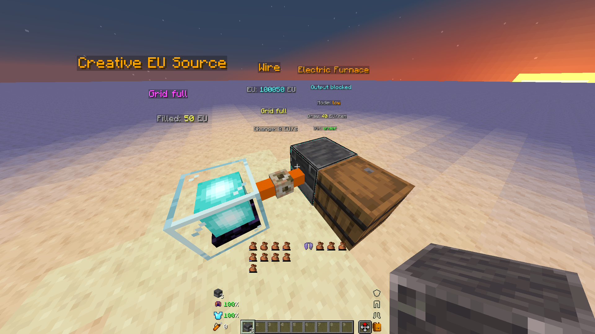

1. Put items to smelt into the furnace (it opens like a chest; hoppers work from any side).
2. Put a container on the **output face**: under, front, back or top — choose it with the
   [Wrench](tools.md).
3. Connect it to a powered grid.

Results always go to the output container, never back into the furnace. If that container is
missing or full, the furnace stops and the Goggles show `Output blocked` — nothing is wasted.

| Power mode | Ticks per item | EU per item | EU per tick |
| --- | --- | --- | --- |
| low | 100 | 40 | 0.4 |
| medium | 50 | 80 | 1.6 |
| high | 20 | 160 | 8 |
| superpowered | 5 | 300 | 60 |

It smelts ores and raw metals, iron and gold gear back into nuggets, food, sand, clay, stone,
cracked bricks, and logs into charcoal.

## Creative sources

For testing, with no recipe (`/function ra_wires:items/give_creative`):

| Block | Does |
| --- | --- |
| Creative EU Source | Refills its grid to full every tick |
| Creative Fluid Source | Adds `rate` mL of one fluid per tick (default 1000), until the network is full. Change the fluid with the Wrench |

A network fed by a Creative Fluid Source fills up quickly, which leaves no room for a second fluid;
for mixed-fluid tests, give the run extra tanks.

## Checking a network

- **[Goggles](tools.md):** each block shows its fluid (or `Multimedium` for several) and amount,
  or its EU and whether it is running.
- **[Multimeter](tools.md):** right-click a block for its network number, contents per fluid,
  capacity and what this block adds.

```
── Copper Pipe ──
  Network 22   this block adds 1000
  Stored 10000 of 20000
  Holding
    Water  5000 mL
    Lava  5000 mL
```

Two blocks showing different network numbers are not connected. A network keeps its number while
you extend it.

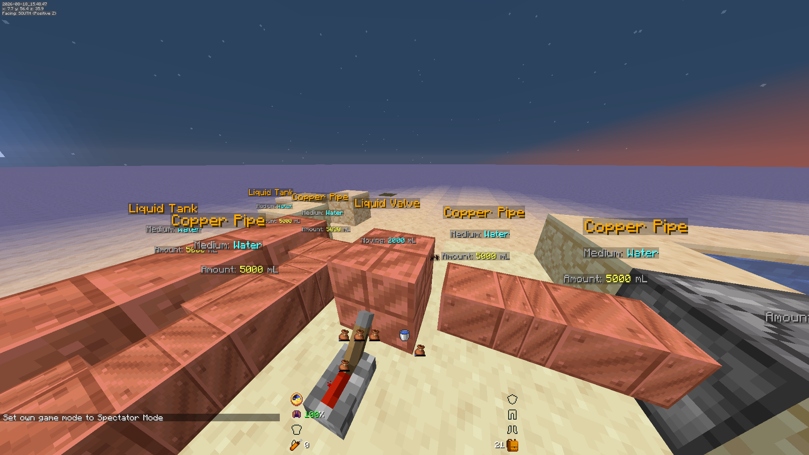

---

## Advanced

- **Engine.** All networks run on `ra_lib:transport`: adjacent nodes of the same class are grouped
  by flood fill when a node is placed or broken (debounced to one rebuild every 5 ticks). Pipes,
  tanks, valves and wires do no work per tick; only blocks that move something between the world
  and a network are ticked.
- **Out of view.** A rebuild only touches the networks a change concerns; every other network,
  loaded or not, keeps its contents and its number. A network that reaches into unloaded chunks
  is never recounted or trimmed: a new pipe simply joins it, and a break that splits it takes
  effect once the whole network is loaded again (until then both halves share one pool).
  See [Scoped rebuilds](developer-guide.md#scoped-rebuilds).
- **Storage.** Each network is `storage ra:transport nets.n<id>`: `amount` (total), `capacity`,
  `nodes` (block count), `amounts` (per fluid), `media` (fluids in arrival order), `medium` (the
  primary), and `potion`.
  See the [Developer Guide](developer-guide.md#transport) for the full model.
- **Properties** (`data.properties`): Drain `speed` (admin only; one action every `100 / speed`
  ticks); Filter `filter_medium`, `rate` (2000); Creative Fluid Source `medium`, `rate`; EU
  Consumer and Industrial Light `eu_use`; Electric Furnace `output`, `mode`. Status for the
  Goggles is in `data.status`. Drains from before 6.0.1 have their `cooldown` turned into `speed`
  (`100 / cooldown`) and `mode` removed once, the first time they are loaded, by the 6.0.1
  migration (`ra_migrations:6.0.0-to-6.0.1/liquid_drain`).
- **Media `drip`.** A medium may name a `drip` particle (`falling_water`, `falling_lava`) that a
  drain shows on itself while taking that medium in (`ra_wires:fluid/drip`); without one it shows
  the medium's `particle`.
- **Fixed rates** such as a generator's `generation_rate` are read-only: the Data Handler shows them
  locked.
- **Heat sources** are the block tag `#ra_wires:heat_sources`.
- **Media registry** (`ra_wires:media/init`): display name, state, colour, particle, optional world
  block and bucket; pumpable blocks are listed as `source_blocks`. Preset potions get their effects
  from `ra_wires:media/potions`; a potion with `custom_effects` is read from the item.
- **Bridges** (Valves, Filters, Breakers, the Boiler, the Ender Power Vault) belong to neither
  network they touch, which is why a valve always splits a run in two. A bridge picks
  its fullest neighbouring network as the source and its emptiest as the destination, by fill
  ratio (`amount / capacity`, in ten-thousandths, divided in floating point so it holds at any
  network size). It then moves the smallest of its rate, what the source holds, the room left
  in the destination, and half the gap between them, so two networks level out instead of
  swapping contents back and forth.
- **Arithmetic.** Every network sum, clamp and bridge move is one 26.3 `/compute` over the
  network's storage; see [Arithmetic with `/compute`](developer-guide.md#arithmetic-with-compute).
- **Visuals.** Each node draws its own half of each connection; fluid pipes are a 0.56 copper or
  iron core, electric wires a thinner 0.26 concrete core.
