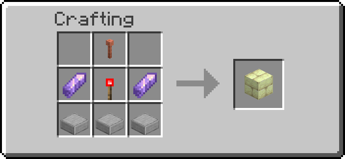
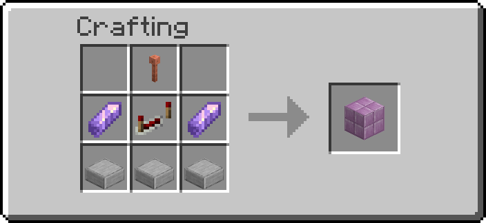
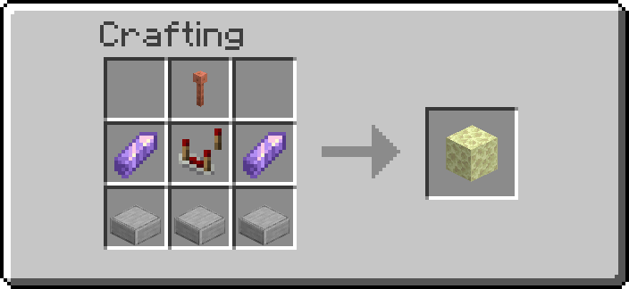
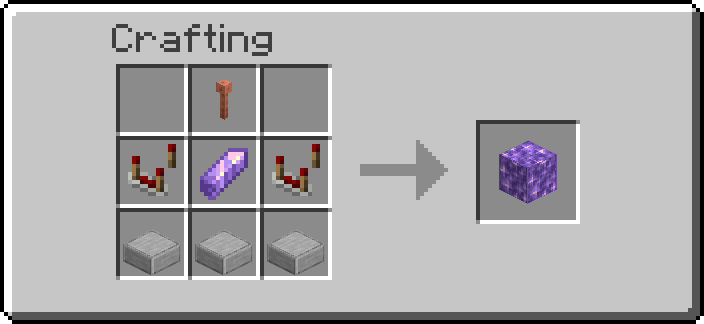
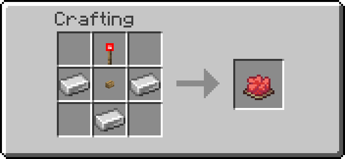

# Wireless Redstone

Send a redstone signal anywhere without wires. An **Emitter** broadcasts on a named channel, every
**Receiver** on the same channel turns on, and the **Redstone Remote** pulses receivers from your
hand. The **Analog Emitter** and **Analog Receiver** carry the signal strength (0 to 15) as well.

## Getting them

| Item | Recipe |
| --- | --- |
| Wireless Emitter | { width="240" } |
| Wireless Receiver | { width="240" } |
| Analog Emitter | { width="240" } |
| Analog Receiver | { width="240" } |
| Redstone Remote | { width="240" } |

Operators: `/function ra_wireless:items/give_all`, or `/function ra_wireless:tools/remote/give`
for the Remote alone.

## Using them

1. Place an Emitter and a Receiver. Both start on the channel `default`.
2. To use another channel, set the same name on both with the [Data Handler](tools.md) (for
   example `main`). Channels are text and must match exactly.
3. Put **iron blocks** next to the Receiver (anywhere in the 3×3×3 cube around it). They become
   **redstone blocks** while it is on.
4. Power the Emitter. Every Receiver on its channel turns on, and stays on while any Emitter on
   that channel is powered.

### Switching a block off

Neither block has an off switch. An Emitter transmits while it is powered: to stop it, cut its
redstone input or give it a channel no Receiver listens on. A Receiver follows its channel: to keep
one off, give it a channel nothing transmits on, or remove the iron blocks around it.

### Analog: carrying a signal strength

The Analog Emitter and Analog Receiver use channels the same way, and share them with the plain
blocks.

1. Place an Analog Emitter and an Analog Receiver on the same channel.
2. Put **target blocks** next to the Analog Receiver (anywhere in the 3×3×3 cube around it). Each
   one gives off the channel's level, so dust beside it carries that strength and a comparator
   behind it reads it. Iron blocks in the cube turn into redstone blocks while the level is above 0.
3. Power the Analog Emitter. It sends the strongest signal reaching it, from any side: dust at
   strength 9 sends 9, a repeater or comparator pointing into it sends 15.

| On one channel | The level |
| --- | --- |
| Several Analog Emitters | the strongest of them |
| A powered Wireless Emitter | 15 |
| Nothing powered | 0 |

A plain Wireless Receiver turns on while an Analog Emitter on its channel sends 1 or more.

The level travels only when an emitter's signal changes, so a channel that stays the same costs
nothing. Every two seconds each Analog Receiver checks its channel again, which picks up a channel
changed with the Data Handler and target blocks placed next to it since.

### The Redstone Remote

| Action | Does |
| --- | --- |
| Right-click | Pulses every Receiver on the Remote's channel for 4 ticks |
| Sneak + right-click | Opens an **Input Form** book: write the channel on page 1 and close it. Drop the book to cancel |

The Remote tells you its channel in chat each time you use it. Setting the channel needs no
permissions, so it works in survival.

## Troubleshooting

| Problem | Check |
| --- | --- |
| Receiver never turns on | The channel names are identical, the Emitter is powered, and there are iron blocks next to the Receiver |
| Receiver stays on | Another Emitter on the same channel is still powered |
| Analog Receiver shows 15 | A plain Wireless Emitter on the channel is powered: it counts as 15 |
| Analog level not on the dust | The dust must touch a **target block** next to the Analog Receiver, not the receiver itself |
| Remote does nothing | Its channel matches the Receiver's exactly |

---

## Advanced

- Properties on the markers: `data.properties.channel` (string, default `"default"`). Emitters
  and Receivers placed before v6.0.1 may still carry an `enabled` key; nothing reads it.
- The Remote's channel is stored on the item: `custom_data.ra.channel`.
- An Emitter reads its power with `ra_lib:redstone/detect`; while powered it carries
  the tag `ra.transmitting`. A Receiver scans transmitters for an exact channel match and tags
  itself `ra.receiving`.
- Remote pulses use `ra.pulsing` and the `ra.pulse_timer` score on the Receiver.
- Analog blocks keep their level in the `ra.wl.level` score and `data.status.level`. A channel's
  level is not stored anywhere: when an emitter's own level changes (an Analog Emitter's input, a
  Wireless Emitter turning on or off, or either being broken), `ra_wireless:channel/changed` asks
  the other emitters on the channel for their levels and pushes the strongest to the Analog
  Receivers on it. Channels are compared as values, never pasted into a command.
- An Analog Receiver works its level out from scratch when placed and every 40 ticks
  (`ra.wl.synced`), and rewrites its target blocks then.
