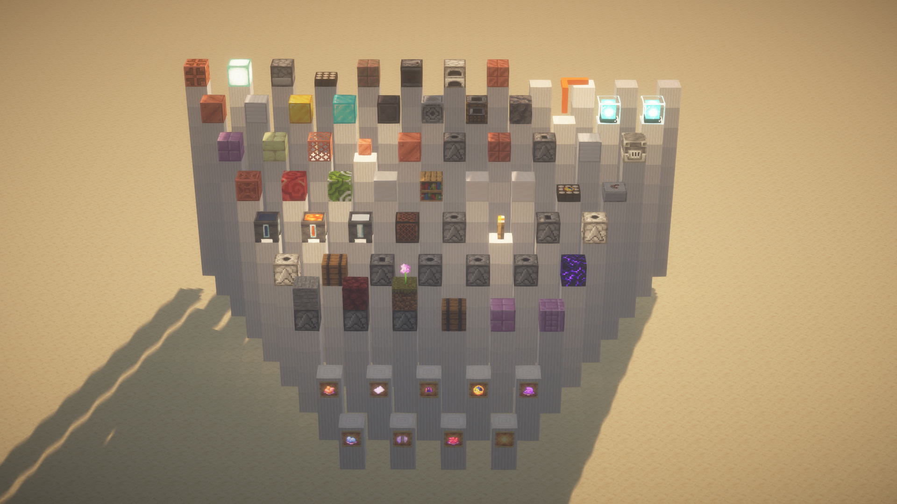
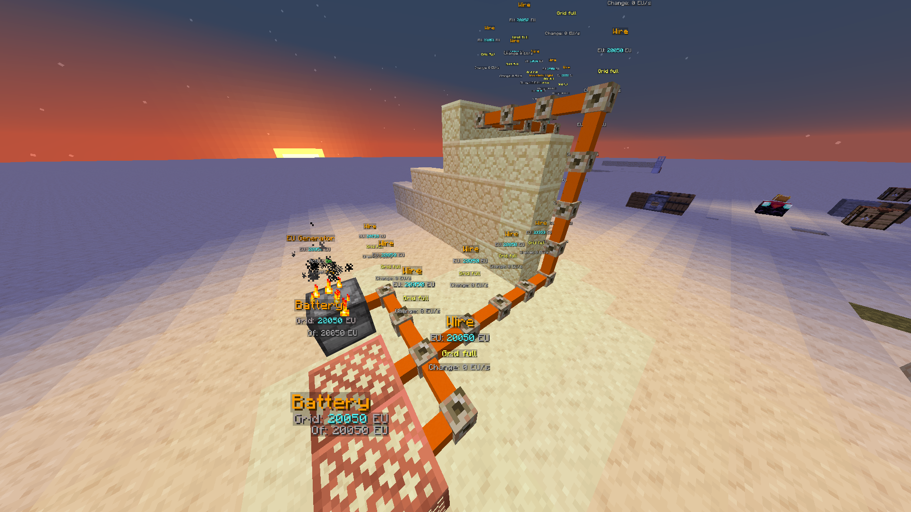
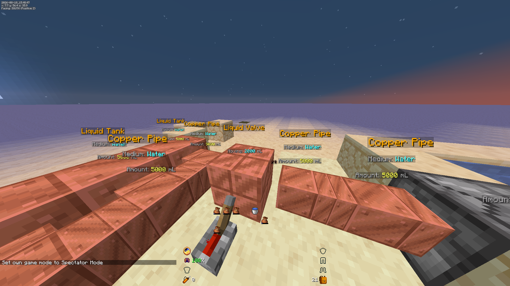
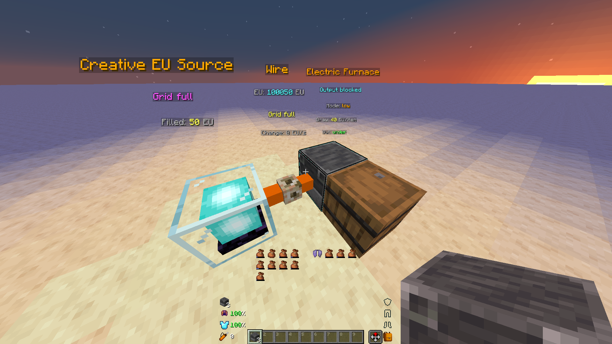
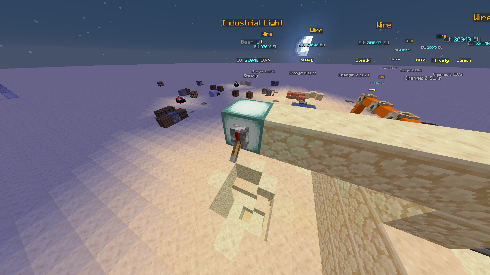
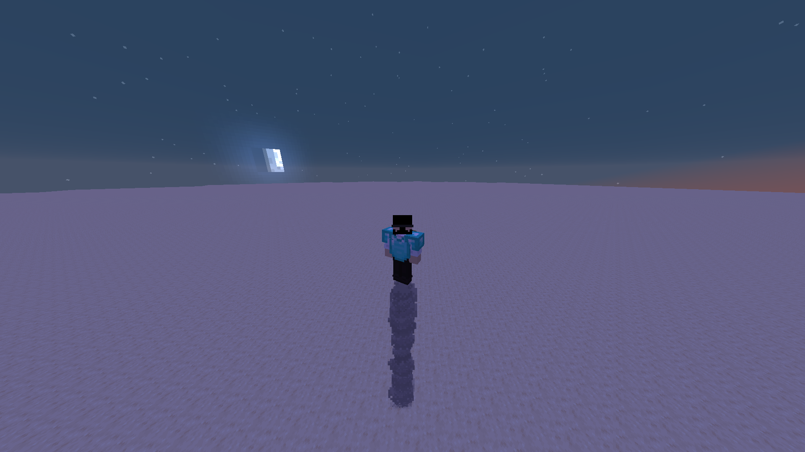

<p align="center">
  
</p>

<h1 align="center">Redstone Additions</h1>

<p align="center">
  <strong>96 custom blocks. 9 tools. 113 recipes. 2 jetpacks and 3 upgrade kits. Vanilla datapack for Minecraft 26.3.</strong>
</p>

<p align="center">
  <a href="https://modrinth.com/datapack/redstone-additions"></a>
  <a href="https://github.com/AnCarsenat/Redstone-Additions"></a>
</p>

<p align="center">
  
  
  
  
  
</p>

<p align="center">
  <a href="https://github.com/AnCarsenat/Redstone-Additions/raw/main/docs/images/gallery/with-shader-2026-08-20_19.23.57.png"></a>
</p>

<p align="center">
  <em>Every block the pack adds, in one place. Click to enlarge.</em>
</p>

---

Redstone Additions expands vanilla redstone with logic gates, automation machines, storage, sensors, wireless signaling, chunk loading, multiblocks, and liquid/gas/electric transport networks.

It also goes beyond redstone: **jetpacks** that fit onto any chestplate, **enchant crafting** that gambles items on an enchanting table, **generators** that regrow their own material, and **ender links** that move items, fluids, power and players between distant places.

All systems run as a pure datapack using marker entities and function-driven runtime logic. No mods required.

Any system / block can be disabled or configured in the new settings panel. (Admin only)
There is also client side settings.

## Version Compatibility

**Supported: Minecraft 26.3** (data pack format 121).

The pack is generated from Kotlin by [Kore](https://kore.ayfri.com), which writes every file in
the exact shape 26.3 reads. `pack.mcmeta` declares format 121 only, so other versions refuse the
pack rather than loading it half-broken.

On 1.21.9 – 26.2, use **v5.1.17**, the last release of the old build: it covers 1.21.9 – 26.3
through overlays that the single-version build no longer needs.

I recommend using [Bundles Beyond](https://modrinth.com/mod/bundles-beyond) for better bundle previews.

---

## Module Previews

One banner per module. Modules without a screenshot yet show a placeholder —
**contributions welcome**, drop a PNG in `docs/images/screenshots/` and swap the
row.

**Every recipe in the pack is on one page in the
[Recipe Atlas](https://ancarsenat.github.io/Redstone-Additions/recipe-atlas/)** —
listed A to Z and grouped by module.

| Module | Banner |
|---|---|
| Logic Gates |  |
| Interactive Machines |  |
| Storage |  |
| Sensors |  |
| Wireless Redstone |  |
| Transport Networks |  |
| &nbsp;&nbsp;↳ fluids |  |
| &nbsp;&nbsp;↳ Electric Furnace |  |
| &nbsp;&nbsp;↳ Industrial Light |  |
| Chunk Loader |  |
| Multiblocks |  |
| Enchant Crafting |  |
| Jetpacks |  |
| Infinite Generators |  |
| Ender Links |  |
| Displays |  |
| Automation |  |
| Security |  |
| Farming |  |
| Railworks |  |
| Audio |  |
| Tools |  |

---

## Blocks

### Logic Gates (10)
- UNI Gate
- Clock
- Delayer
- Extender
- Randomizer
- Shortener
- Counter
- Edge Detector
- Signal Calculator
- Sequencer

### Interactive Machines (14)
- Block Breaker
- Block Placer
- Item Pipe — filters by an item id set from your hand, no item frame
- Item Mover
- Spitter
- Magic Crate — pulls dropped items in from 5-20 blocks
- Big Torch — drops mobs that spawn within 1-100 blocks into the void
- Elevator — jump to go up, sneak to go down, to the next one in the column
- Trash Can — destroys every item put into it
- Fan — pushes items, mobs and players along its face while powered
- Infinite Water Cauldron
- Infinite Lava Cauldron
- Infinite Snow Cauldron
- Message Block

### Storage (2)
- Boxer
- Unboxer

### Sensors (8)
- Entity Detector
- Tag Adder
- Tag Remover
- Light Sensor — outputs the light level in front of it (0-15)
- Weather Sensor — on during rain, thunder, day or night
- Held Item Detector — on while a nearby player carries an item
- Player Detector — on while a listed player is near
- Block Detector — on while the block at its target is the chosen block

### Wireless (4)
- Wireless Emitter
- Wireless Receiver
- Analog Emitter — sends its input level (0-15) on a channel
- Analog Receiver — outputs its channel's level on target blocks

### Transport Networks (27)

Fluids, in millilitres:

- Copper Pipe
- Liquid Tank
- Liquid Pump
- Liquid Valve — moves contents between the two networks it separates
- Liquid Filter — passes only the one medium it is set to
- Fluid Drain — world source in, or network contents back out; vents gases with their effect
- Gas Tank
- Gas Pump
- Gas Valve
- Boiler — water plus heat to steam
- Spout — fills buckets and bottles under it from the network
- Air Charger — fills the Air Tank of whoever stands on it, from the network's oxygen

Electricity, in EU:

- Wire
- EU Generator — a barrel wearing a furnace; drop fuel in, no smelting slot
- EU Consumer
- EU Switch — redstone conducts, no redstone cuts
- Battery — 10000 EU of grid capacity
- EU Breaker — evens EU between the grids either side
- Solar Panel
- Water Wheel — EU from flowing water, with a turning wheel
- Industrial Light — redstone plus EU, a 10 block beam of real light
- Electric Furnace — smelts on EU with no fuel, four power modes
- Tesla Coil — redstone plus EU, zaps hostile mobs around it once a second

Reading a network with redstone:

- Network Gauge — redstone 0-15 from how full the network behind it is
- Usage Meter — a pulse every N mL or EU used or made, and a running total

Diving gear (worn, not placed):

- Air Tank — a chestplate holding 15 minutes of air under water
- Heavy Boots — sink and walk on the bottom at your usual pace

Creative, for building and testing:

- Creative EU Source — refills its grid to capacity every tick
- Creative Fluid Source — tops its network up with one medium, at a settable rate

Pipes and wires have a single tier.

### Chunk Loader (1)
- Chunk Loader

### Enchant Crafting (3)
- Disenchanter — moves an item's enchantments onto a book, for liquid experience
- Book Upgrader — raises one enchantment of a book by a level, each level twice the price of the last
- Book Printer — a small chance of a book's Schematic, then prints copies of it for liquid experience

### Infinite Generators (3)
- Mineral Generator
- Nether Generator
- Poppy Generator

Built from a crafted Generator Casing plus a Core won by sacrificing stone,
netherrack or poppies on an enchanting table.

### Ender Links (5)
- Ender Item Vault — barrels that share their contents across a channel
- Ender Fluid Vault — liquid and gas across a channel, as a fluid network node
- Ender Power Vault — EU across a channel, as an electric node
- Teleport Anchor — redstone strength 1-15 picks which anchor you arrive at
- Anchor Terminal — stand on it and sneak to pick a destination from a menu

### Displays (3)
- Gauge Bar — a bar on its face, filled to the redstone level feeding it
- Item Hologram — shows the item inside it, turning above the block, with its name
- Text Screen — glowing nixie-style text: the redstone level picks which item's name it shows

### Automation (4)
- Crafter Controller — fires the crafter next to it once it holds what its Pattern says; with a Recipe Pattern it fills the crafter itself from a container
- Uncrafter — takes items back apart into their ingredients, for EU
- Experience Absorber — collects experience orbs into a fluid network
- Item Pipe Splitter — shares the items of the container above it between the containers around it

### Security (1)
- Keypad — a crafter whose slots are the code; the right code gives a redstone pulse

### Farming (2)
- Sprinkler — waters the farmland around it; with liquid experience, crops grow 4x as fast
- Breeder
### Railworks (1)
- Route Rail — under a rail junction: switches it for each cart by its name, tag, cargo or rider

### Audio (3)
- Alarm — sounds one of seven alarms while powered, heard within its range
- Doorbell — a button that plays one of six chimes when pressed
- Jukebox Controller — redstone plays, stops and skips the jukebox next to it; a chest of discs is the playlist

### Multiblock Bases (5)
- Copper Multiblock Base
- Iron Multiblock Base
- Gold Multiblock Base
- Diamond Multiblock Base
- Netherite Multiblock Base

### Items (15)
- Iron Jetpack Kit — right-click while wearing any chestplate to fit it
- Infinite Iron Jetpack Kit — won on an enchanting table; burns no fuel
- Thruster Kit — hold sprint while airborne to accelerate
- Lift Kit — climbs and sinks about twice as fast
- Scorch Kit — sets fire to what flies under you
- Generator Casing
- Mineral Core
- Nether Core
- Poppy Core
- Enchanted Coal — won by sacrificing coal on an enchanting table
- Enchanted Coal Block — nine Enchanted Coal make one; one block plus a stick makes a Big Torch
- Item Crate — what the Boxer packs a chest into, and the Unboxer unpacks
- Pattern — sneak + right-click a crafter to record its grid, for the Crafter Controller
- Recipe Pattern — a Pattern the Crafter Controller fills the crafter from
- Goggles Lens — fits into any helmet and gives it the Goggles' view;
  `/trigger ra.goggles` switches it off or takes it back out

Fitted kits live on the chestplate and are listed in its lore.
`/trigger ra.jp.kits` switches one off or takes it back as an item.

### Tools (9)
- Wrench — the only tool that **changes** a block. Shift+RMB cycles a setting, or
  opens a menu when the block has more than one
- Goggles — wear or hold to read every block in range. Read-only
- Data Handler — edits one block's properties in detail
- Creative Data Handler — edits anything, including what the block owns
- Clipboard — copies one block's settings onto others of the same kind
- Multimeter — reads a network's numbers into chat
- Redstone Remote — wireless channel control
- Pager — alerts you when its channel turns on, anywhere in your inventory
- Anchor Tablet — teleport to any Teleport Anchor from anywhere, for ender pearls

See the [Tools page](https://ancarsenat.github.io/Redstone-Additions/tools/) for
recipes and usage.

---

## Development Setup

The pack is Kotlin in `redstone_additions/`, turned into the data pack by
**[Kore](https://kore.ayfri.com)** with Gradle.

### Prerequisites
- JDK 25
- Git

### Build and install into a world

```bash
git clone https://github.com/AnCarsenat/Redstone-Additions.git
cd Redstone-Additions/redstone_additions

./gradlew koreBuild                                  # build into build/kore/redstone_additions/
./gradlew koreRun -Pworld="My World"                 # build and install into a world
./gradlew koreRun -Pworld --continuous               # rebuild on every save, world from local.properties
```

Then `/reload` in game. `-Pworld` takes a world name (under your Minecraft `saves/`) or a path;
a bare `-Pworld` reads `ra.world` from an untracked `local.properties` (copy
`local.properties.example`), which can also point `ra.minecraftDir` at a launcher instance.

Full details: [Contributing Guidelines](https://ancarsenat.github.io/Redstone-Additions/contributing-guidelines/)
and [Getting Started](https://ancarsenat.github.io/Redstone-Additions/getting-started/).

---

## Installation

### Option A (Modrinth)
1. Download the latest `.zip` from [Modrinth](https://modrinth.com/datapack/redstone-additions).
2. Place it in `.minecraft/saves/<your_world>/datapacks/`.
3. Run `/reload`.

To update later, run `python updater.py` from inside the pack's folder in `datapacks/` (or
next to the zip): it checks Modrinth and installs a newer version after asking.

### Option B (from source)
Build it with Gradle and install it straight into a world — see
[Development Setup](#development-setup):

```bash
cd redstone_additions && ./gradlew koreRun -Pworld="<your world>"
```

Then run `/reload`.

Starter command:

```mcfunction
/function ra:give_all_items
```

---

## Quick Links

| Link | URL |
|---|---|
| Docs Home | https://ancarsenat.github.io/Redstone-Additions/ |
| Logic Gates | https://ancarsenat.github.io/Redstone-Additions/logic-gates/ |
| Interactive Machines | https://ancarsenat.github.io/Redstone-Additions/interactive-machines/ |
| Storage | https://ancarsenat.github.io/Redstone-Additions/storage/ |
| Sensors | https://ancarsenat.github.io/Redstone-Additions/sensors/ |
| Wireless Redstone | https://ancarsenat.github.io/Redstone-Additions/wireless-redstone/ |
| Transport Networks | https://ancarsenat.github.io/Redstone-Additions/transport-networks/ |
| Tools | https://ancarsenat.github.io/Redstone-Additions/tools/ |
| Chunk Loader | https://ancarsenat.github.io/Redstone-Additions/chunk-loader/ |
| Multiblocks | https://ancarsenat.github.io/Redstone-Additions/multiblocks/ |
| Enchant Crafting | https://ancarsenat.github.io/Redstone-Additions/enchant-crafting/ |
| Jetpacks | https://ancarsenat.github.io/Redstone-Additions/jetpacks/ |
| Infinite Generators | https://ancarsenat.github.io/Redstone-Additions/infinite-generators/ |
| Ender Links | https://ancarsenat.github.io/Redstone-Additions/ender-links/ |
| Displays | https://ancarsenat.github.io/Redstone-Additions/displays/ |
| Automation | https://ancarsenat.github.io/Redstone-Additions/automation/ |
| Security | https://ancarsenat.github.io/Redstone-Additions/security/ |
| Farming | https://ancarsenat.github.io/Redstone-Additions/farming/ |
| Railworks | https://ancarsenat.github.io/Redstone-Additions/railworks/ |
| Audio | https://ancarsenat.github.io/Redstone-Additions/audio/ |
| Item Reference | https://ancarsenat.github.io/Redstone-Additions/item-reference/ |
| Recipe Atlas | https://ancarsenat.github.io/Redstone-Additions/recipe-atlas/ |
| Changelog | https://ancarsenat.github.io/Redstone-Additions/changelog/ |

---

## Useful Commands

| Command | Purpose |
|---|---|
| `/function ra:give_all_items` | One prefilled bundle per namespace |
| `/function ra_gates:items/give_all` | Logic gate items |
| `/function ra_interactive:items/give_all` | Interactive machine items |
| `/function ra_storage:items/give_all` | Storage items |
| `/function ra_sensors:items/give_all` | Sensor items |
| `/function ra_wireless:items/give_all` | Wireless items |
| `/function ra_wires:items/give_all` | Transport and EU items |
| `/function ra_chunk_loader:items/give_all` | Chunk loader items |
| `/function ra_multiblock:blocks/give_all` | Multiblock base items |
| `/function ra_infinite:items/give_all` | Generator casing and generators |
| `/function ra_jetpacks:items/give_all` | Jetpack kits |
| `/function ra_enchanting:items/give_all` | Disenchanter, Book Upgrader and Book Printer |
| `/function ra_ender:items/give_all` | Ender vaults, Teleport Anchor, Anchor Terminal and Anchor Tablet |
| `/function ra_displays:items/give_all` | Display blocks |
| `/function ra_automation:items/give_all` | Crafter Controller, a Pattern, a Recipe Pattern, Uncrafter, Experience Absorber and Item Pipe Splitter |
| `/function ra_security:items/give_all` | Keypad |
| `/function ra_farming:items/give_all` | Sprinkler, Breeder |
| `/function ra_railworks:items/give_all` | Route Rail |
| `/function ra_audio:items/give_all` | Alarm, Doorbell and Jukebox Controller |
| `/function ra:tools/wrench/give` | Wrench |
| `/function ra:tools/data_handler/give` | Data Handler |
| `/function ra:tools/creative_data_handler/give` | Creative Data Handler |
| `/function ra:tools/goggles/give` | Goggles |
| `/function ra:tools/goggles/lens/give` | Goggles Lens |
| `/function ra_wireless:tools/remote/give` | Redstone Remote |
| `/function ra:uninstall` | Clean uninstall |

---

## Documentation

- Wiki : [https://ancarsenat.github.io/Redstone-Additions/](https://ancarsenat.github.io/Redstone-Additions/)
- Build config: [mkdocs.yml](https://github.com/AnCarsenat/Redstone-Additions/raw/main/mkdocs.yml)

---

## License

Copyright (c) 2026 AnCarsenat. All rights reserved. See
[LICENSE](https://github.com/AnCarsenat/Redstone-Additions/raw/main/LICENSE) for the
full terms — the short version:

- **Play with it freely** on any world, server or realm, including commercial servers.
- **Modify your own copy** as much as you like.
- **Do not redistribute it** — no reuploads, mirrors, repackages or modpack bundles of
  the pack or any part of it, modified or not, without written permission. Link to the
  official pages instead.
- **Addons are welcome and need no permission.** A separate pack of your own that
  depends on RA, in your own namespaces, containing no RA namespace, is yours: publish
  it anywhere, on any terms, and use the snippets from the docs and `ra_example` to
  build it.

Redstone Additions is fan content and is not affiliated with Mojang or Microsoft. The
recipe pictures under `docs/images/recipes/` are drawn from Minecraft's own textures,
which remain Mojang's property and are used under their asset guidelines.

---

<p align="center">
  <strong>Created by <a href="https://github.com/AnCarsenat">AnCarsenat</a></strong><br>
  <a href="https://github.com/AnCarsenat/Redstone-Additions/issues">Report a Bug</a> · <a href="https://ancarsenat.github.io/Redstone-Additions/">Documentation</a> · <a href="https://modrinth.com/datapack/redstone-additions">Download</a>
</p>

